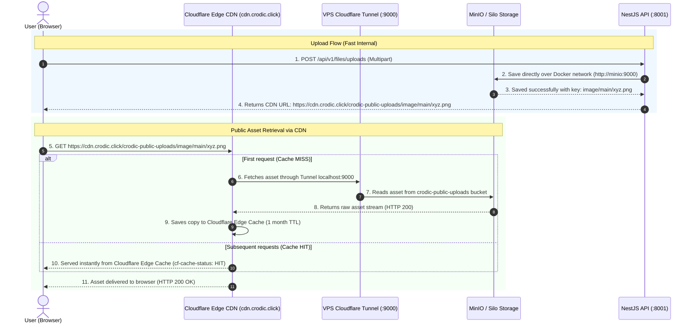

# Comprehensive Production Deployment Guide (VPS & Docker Compose)

> **English** | [Tiếng Việt](../vi/DEPLOYMENT.md)

This document provides a comprehensive, step-by-step production deployment guide for the entire Monorepo on an Ubuntu VPS using **Docker Compose** ([`docker-compose.prod.yml`](../../docker-compose.prod.yml)), automated CI/CD via a **GitHub Actions Self-Hosted Runner**, and secure domain routing through **Cloudflare Tunnel (Zero Trust)** or **Nginx Reverse Proxy**.

---

## Table of Contents

1. [Deployment Architecture & Network Topology](#1-deployment-architecture--network-topology)
2. [Step 1: VPS Setup, Swap Configuration & Docker Installation](#step-1-vps-setup-swap-configuration--docker-installation)
3. [Step 2: Install GitHub Actions Self-Hosted Runner on VPS](#step-2-install-github-actions-self-hosted-runner-on-vps)
4. [Step 3: Clone Repository & Configure 4 `.env` Files](#step-3-clone-repository--configure-4-env-files)
5. [Step 4: Domain Routing (Cloudflare Tunnel / Nginx)](#step-4-domain-routing-cloudflare-tunnel--nginx)
6. [Step 5: Initial Deployment & Database Provisioning](#step-5-initial-deployment--database-provisioning)
7. [Step 6: Automated CI/CD Workflow (GitHub Actions)](#step-6-automated-cicd-workflow-github-actions)
8. [Step 7: Day-2 Operations, Management & Backups](#step-7-day-2-operations-management--backups)
9. [Troubleshooting & FAQs](#troubleshooting--faqs)

---

## 1. Deployment Architecture & Network Topology

### 1.1. Network & Routing Diagram

The project supports two production routing options:

- **Option 1 (Recommended & In Use)**: **Cloudflare Tunnel (Zero Trust)**. All public traffic routes through an outbound encrypted tunnel. **No public ports need to be exposed** on the VPS firewall, providing automatic DDoS mitigation and 100% origin IP masking.
- **Option 2**: Host **Nginx Reverse Proxy + Let's Encrypt Certbot SSL**.

```
                           [ Internet: End Users & Admins ]
                                          │
                ┌─────────────────────────┴─────────────────────────┐
                ▼ (Option 1: Zero Trust)                            ▼ (Option 2: Direct)
     ┌─────────────────────────┐                         ┌─────────────────────────┐
     │ Cloudflare Edge Network │                         │ Nginx Reverse Proxy     │
     │ (*.crodic.click)        │                         │ Ports 80 / 443 (SSL)    │
     └────────────┬────────────┘                         └────────────┬────────────┘
                  │                                                   │
                  ▼ (Outbound Tunnel: network_mode: host)             │
     ┌─────────────────────────┐                                      │
     │  crodic_tunnel          │                                      │
     │  (cloudflare/cloudflared)                                      │
     └────────────┬────────────┘                                      │
                  │                                                   │
  ────────────────┴───────────────────────────────────────────────────┴───────────────────
  HOST MACHINE (VPS Ubuntu):
        ┌────────────────────────────────┬────────────────────────────────┐
        │ api.crodic.click               │ crodic.click                   │ admin.crodic.click
        ▼ (:8001 -> container :8000)     ▼ (:3000 -> container :3000)     ▼ (:8080 -> container :80)
 ┌──────────────┐                 ┌──────────────┐                 ┌──────────────┐
 │  crodic_api  │                 │crodic_client │                 │  crodic_web  │
 │  NestJS 11   │                 │  Next.js 16  │                 │ Nginx + Vite │
 └──────┬───┬───┘                 └──────┬───────┘                 └──────────────┘
        │   │                            │ (SSR internal fetch http://api:8000)
        │   └──────────────┬─────────────┘
        ▼                  ▼                                ┌─────────────────────────┐
 ┌──────────────┐   ┌──────────────┐                        │    crodic_minio_init    │
 │  PostgreSQL  │   │    Redis     │                        │    (pgsty/mc bucket)    │
 │  :5432       │   │    :6379     │                        └────────────┬────────────┘
 └──────────────┘   └──────────────┘                                     ▼
        ▲                  ▲                                ┌─────────────────────────┐
        │                  │                                │      crodic_minio       │
        └──────────────────┴────────────────────────────────┤   (pgsty/silo S3 API)   │
                                                            │       :9000/:9001       │
                                                            └─────────────────────────┘
 (Database & cache services are isolated in Docker app-network & bound to 127.0.0.1 on host)
```

### 1.2. Port Allocation Table

| Service               | Container Name    | Host Port (VPS)           | Container Port  | Notes                                                                                      |
| :-------------------- | :---------------- | :------------------------ | :-------------- | :----------------------------------------------------------------------------------------- |
| **Backend API**       | `crodic_api`      | `8001`                    | `8000`          | Avoids port 8000 conflicts on host                                                         |
| **Admin Portal**      | `crodic_web`      | `8080`                    | `80`            | Serves SPA via internal Nginx in container                                                 |
| **Client Website**    | `crodic_client`   | `3000`                    | `3000`          | Next.js Server-Side Rendering (Standalone)                                                 |
| **PostgreSQL 16**     | `crodic_postgres` | `127.0.0.1:5432`          | `5432`          | Bound to localhost, volume `postgres_data`                                                 |
| **Redis 7**           | `crodic_redis`    | `127.0.0.1:6379`          | `6379`          | BullMQ queues and cache with password auth                                                 |
| **S3 Storage (Silo)** | `crodic_minio`    | `127.0.0.1:9000` / `9001` | `9000` / `9001` | High-efficiency `pgsty/silo` S3 replacement. Port 9000 routed via CDN (`cdn.crodic.click`) |
| **Cloudflare Tunnel** | `crodic_tunnel`   | `network_mode: host`      | -               | Runs daemon connection to Cloudflare edge                                                  |

### 1.3. Recommended VPS Specifications

| Criteria    | Minimum Requirement                 | Recommended Production Spec |
| :---------- | :---------------------------------- | :-------------------------- |
| **OS**      | Ubuntu 22.04 LTS / 24.04 LTS x86_64 | Ubuntu 24.04 LTS x86_64     |
| **CPU**     | 2 vCPU                              | 4 vCPU                      |
| **RAM**     | 4 GB (**4GB - 8GB Swap mandatory**) | 8 GB (+ 4GB Swap)           |
| **Storage** | 40 GB NVMe SSD                      | 80+ GB NVMe SSD             |

---

## Step 1: VPS Setup, Swap Configuration & Docker Installation

Connect via SSH to your VPS as `root` or a user with `sudo` permissions:

```bash
ssh root@<YOUR_VPS_IP>
```

### 1.1. Update System & Install Core Packages

```bash
apt update && apt upgrade -y
apt install -y curl wget git ufw htop ca-certificates gnupg
```

### 1.2. Create 4GB - 8GB Swap Space (Mandatory)

> [!IMPORTANT]
> Compiling TypeScript bundles and optimizing Next.js (`apps/client`) and Vite (`apps/web`) requires transient spikes in memory. Without swap space, the Linux kernel will terminate build processes abruptly with `Exit code 137 (OOM Killed)`.

```bash
# Create 4GB swapfile (or 8GB if VPS has 4GB physical RAM)
fallocate -l 4G /swapfile || dd if=/dev/zero of=/swapfile bs=1M count=4096
chmod 600 /swapfile
mkswap /swapfile
swapon /swapfile

# Ensure swap persists across reboots
echo '/swapfile none swap sw 0 0' | tee -a /etc/fstab

# Optimize swappiness
sysctl vm.swappiness=10
echo 'vm.swappiness=10' | tee -a /etc/sysctl.conf

# Verify memory & swap status
free -h
```

### 1.3. Install Docker Engine & Docker Compose Plugin

```bash
curl -fsSL https://get.docker.com | sh
systemctl enable --now docker

# Verify Docker version (Docker 26+ and Docker Compose v2.20+ required)
docker --version
docker compose version
```

### 1.4. Create Production Work Directory

The project standardizes on `/var/www/crodic-framework`:

```bash
mkdir -p /var/www/crodic-framework
```

---

## Step 2: Install GitHub Actions Self-Hosted Runner on VPS

Rather than storing VPS SSH keys in third-party CI runners and exposing port 22, the project uses a native **GitHub Actions Self-Hosted Runner** executing directly on the host machine. The runner communicates outbound over HTTPS.

### 2.1. Generate Runner Registration Token

1. Open your repository on GitHub.
2. Navigate to **Settings > Actions > Runners > New self-hosted runner**.
3. Choose OS: **Linux**, Architecture: **x64**.
4. GitHub will show download instructions and a single-use registration `<TOKEN>`.

### 2.2. Install and Register the Runner

Run the commands in a dedicated directory:

```bash
mkdir -p /opt/actions-runner && cd /opt/actions-runner

# Download runner package (e.g. v2.322.0)
curl -o actions-runner-linux-x64-2.322.0.tar.gz -L https://github.com/actions/runner/releases/download/v2.322.0/actions-runner-linux-x64-2.322.0.tar.gz
tar xzf ./actions-runner-linux-x64-2.322.0.tar.gz

# Configure runner to your repository
./config.sh --url https://github.com/<ORG>/<REPO> --token <TOKEN> --name vps-production-runner --work /var/www/crodic-framework --unattended --replace
```

### 2.3. Run Runner as a Systemd Service

To keep the runner active permanently across reboots:

```bash
cd /opt/actions-runner
sudo ./svc.sh install
sudo ./svc.sh start
sudo ./svc.sh status
```

Check GitHub at **Settings > Actions > Runners** — `vps-production-runner` should display an **Idle** green badge.

---

## Step 3: Clone Repository & Configure 4 `.env` Files

### 3.1. Clone Repository into `/var/www/crodic-framework`

```bash
cd /var/www/crodic-framework
git clone https://github.com/<ORG>/<REPO>.git .
git checkout main
```

### 3.2. Initialize 4 Environment Files from Templates

```bash
cp .env.example .env
cp apps/api/.env.example apps/api/.env
cp apps/web/.env.example apps/web/.env
cp apps/client/.env.example apps/client/.env
```

### 3.3. Configuration Values for Each File

#### 1. Root `.env` (Infrastructure, Host Ports & Cloudflare Token)

```env
API_PORT=8001
WEB_PORT=8080
CLIENT_PORT=3000

POSTGRES_HOST=postgres
POSTGRES_USER=postgres
POSTGRES_PASSWORD=StrongDbPassword123!
POSTGRES_DB=monorepo
POSTGRES_PORT=5432

REDIS_HOST=redis
REDIS_PASSWORD=StrongRedisPassword123!
REDIS_PORT=6379

MINIO_HOST=minio
MINIO_PORT=9000
MINIO_CONSOLE_PORT=9001
AWS_ACCESS_KEY_ID=crodic_5ce135e51e0b5f4e
AWS_SECRET_ACCESS_KEY=36605c11bdd76bd03c0f64f04a80a448ed17dd7b9862db7a
AWS_DEFAULT_S3_BUCKET=crodic-public-uploads
AWS_PRIVATE_BUCKET=crodic-private-uploads

# Token from Cloudflare Zero Trust Dashboard
CLOUDFLARE_TUNNEL_TOKEN=eyJhIjoi...
```

#### 2. `apps/api/.env` (NestJS Backend)

```env
NODE_ENV=production
APP_PORT=8000
APP_URL=https://api.crodic.click
APP_DEBUG=false
APP_CORS_ORIGIN=https://crodic.click,https://www.crodic.click,https://kosume.crodic.click,https://admin.crodic.click

DATABASE_HOST=postgres
DATABASE_PORT=5432
DATABASE_USERNAME=postgres
DATABASE_PASSWORD=StrongDbPassword123!
DATABASE_NAME=monorepo
DATABASE_SYNCHRONIZE=false

REDIS_HOST=redis
REDIS_PORT=6379
REDIS_PASSWORD=StrongRedisPassword123!

# Storage S3 & Cloudflare CDN
FILESYSTEM_DISK=s3
STORAGE_PUBLIC_DISK=s3
STORAGE_PRIVATE_DISK=s3-private # or local
AWS_ACCESS_KEY_ID=crodic_5ce135e51e0b5f4e
AWS_SECRET_ACCESS_KEY=36605c11bdd76bd03c0f64f04a80a448ed17dd7b9862db7a
AWS_REGION=us-east-1
AWS_BUCKET=crodic-public-uploads
AWS_PRIVATE_BUCKET=crodic-private-uploads
AWS_ENDPOINT=http://minio:9000
AWS_URL=https://cdn.crodic.click/crodic-public-uploads
AWS_USE_PATH_STYLE_ENDPOINT=true

AUTH_PORTAL_URL=https://admin.crodic.click
AUTH_PORTAL_RESET_PASSWORD_URL=https://admin.crodic.click/reset-password
USER_AUTH_CLIENT_URL=https://kosume.crodic.click
USER_AUTH_CLIENT_RESET_PASSWORD_URL=https://kosume.crodic.click/auth/reset-password

# Generate secure 32+ character secrets: openssl rand -base64 32
AUTH_JWT_SECRET=strong-random-admin-jwt-secret-string-32-chars
USER_AUTH_JWT_SECRET=strong-random-client-jwt-secret-string-32-chars
```

#### 3. `apps/web/.env` (Admin Portal - Vite + React)

```env
PORT=5173
VITE_API_URL=https://api.crodic.click/api/v1
VITE_APP_NAME="Crodic Framework"
VITE_AUTH_KEY="${VITE_APP_NAME}_AUTH_KEY"
VITE_CLIENT_URL=https://kosume.crodic.click
VITE_SENTRY_ENVIRONMENT=production
```

#### 4. `apps/client/.env` (Client Website - Next.js)

```env
PORT=3000
NEXT_PUBLIC_APP_URL=https://crodic.click
NEXT_PUBLIC_API_URL=https://api.crodic.click
NEXT_PUBLIC_ADMIN_PORTAL_URL=https://admin.crodic.click

# Dynamic Subdomain Routing & Cross-Subdomain Cookies
NEXT_PUBLIC_ROOT_DOMAIN=crodic.click
NEXT_PUBLIC_APP_SUBDOMAIN=kosume
NEXT_PUBLIC_COOKIE_DOMAIN=.crodic.click

# Internal Docker network SSR endpoint
SERVER_API_URL=http://api:8000

TOKEN_EXPIRY_MINUTES_REMAINING=1m
APP_NAME=Crodic
NEXT_PUBLIC_ENABLE_WHITE_LABEL=true
NEXT_PUBLIC_USE_CASE=as-needed
NEXT_PUBLIC_APP_LOCALE=en
NEXT_PUBLIC_FALLBACK_LOCALE=en
NEXT_PUBLIC_ALLOWED_LOCALE=en,vi
SENTRY_ENVIROMENT=production
```

---

## Step 4: Domain Routing (Cloudflare Tunnel / Nginx)

### Option A: Cloudflare Tunnel (Zero Trust - Recommended & Active)

1. Log into the [Cloudflare Zero Trust Dashboard](https://one.dash.cloudflare.com/).
2. Navigate to **Networks > Tunnels > Create a tunnel > Select Cloudflared**.
3. Name your tunnel (e.g. `crodic-vps-tunnel`) and copy the installation token string.
4. Paste the token into `CLOUDFLARE_TUNNEL_TOKEN` inside the root `.env` file.
5. In the **Public Hostname** tab, configure the following rules:

| Public Hostname       | Service Type | Host Target URL  | Purpose                                     |
| :-------------------- | :----------- | :--------------- | :------------------------------------------ |
| `crodic.click`        | `HTTP`       | `localhost:3000` | Landing Page (Next.js SSR Root)             |
| `kosume.crodic.click` | `HTTP`       | `localhost:3000` | Client Web App Core (Next.js SSR Subdomain) |
| `admin.crodic.click`  | `HTTP`       | `localhost:8080` | Admin Portal (Vite React SPA)               |
| `api.crodic.click`    | `HTTP`       | `localhost:8001` | Backend API (NestJS)                        |
| `cdn.crodic.click`    | `HTTP`       | `localhost:9000` | S3 Object Storage CDN (MinIO / Silo)        |

> [!TIP]
> You can also configure a wildcard rule `*.crodic.click` pointing to `localhost:3000` to support multi-tenant subdomains dynamically. Specific hostnames (`api`, `admin`, `cdn`) always take precedence.

The `crodic_tunnel` container running `network_mode: host` in [`docker-compose.prod.yml`](../../docker-compose.prod.yml) will establish the outbound connection and forward traffic seamlessly.

---

### 4.2. Dynamic Subdomain Architecture (Landing vs App Subdomain)

- `crodic.click` $\rightarrow$ Landing Page (internal rewrite from `/{locale}/landing` to `/`)
- `kosume.crodic.click` $\rightarrow$ Main Application (Feed, Spotlight, Profile, Ranking, Auth...)
- Local Development: `http://localhost:3000/` (Landing) vs `http://kosume.localhost:3000/` (App)
- RFC 6761: Modern browsers natively resolve `*.localhost` to `127.0.0.1` with no hosts file modification required.
- Shared Cookies: `NEXT_PUBLIC_COOKIE_DOMAIN=.crodic.click` ensures session continuity across all subdomains.

---

### 4.2. Configuring Cloudflare CDN Caching for MinIO Storage

The media storage architecture in Crodic Framework couples **Self-Hosted MinIO/Silo** with **Cloudflare Global CDN** through Cloudflare Tunnel. This architecture provides three major advantages:

- **Blazing Performance**: Public assets (images, avatars, logos) are cached across hundreds of Cloudflare Edge servers globally (`cf-cache-status: HIT`).
- **99% VPS Resource Savings**: The VPS spends 0% CPU and network bandwidth serving repetitive asset downloads.
- **Strict Security Isolation**: Port 9000 is only bound to host `127.0.0.1`, completely closed to the public Internet. All external traffic is inspected and routed securely through Cloudflare.



#### Step 1: Add Public Hostname in Cloudflare Tunnel

1. Go to [Cloudflare Zero Trust Dashboard](https://one.dash.cloudflare.com/) > **Networks** > **Tunnels**.
2. Select your tunnel (e.g. `crodic-vps-tunnel`) > **Configure** > **Public Hostname** tab.
3. Click **Add a public hostname**:
   - **Subdomain**: `cdn`
   - **Domain**: `crodic.click` (choose your domain)
   - **Path**: Leave empty
   - **Service**: `HTTP`
   - **URL**: `localhost:9000`
4. Click **Save hostname**. `https://cdn.crodic.click` is now securely linked to MinIO S3 API on your VPS.

#### Step 2: Configure Cache Rules on Cloudflare Dashboard

By default, Cloudflare does not cache raw S3 API responses. Create a dedicated Cache Rule to ensure Cloudflare Edge caches all public assets:

1. Log into the standard [Cloudflare Dashboard](https://dash.cloudflare.com/).
2. Select your zone/domain (e.g. `crodic.click`) > **Caching** on the sidebar > **Cache Rules**.
3. Click **Create rule**:
   - **Rule name**: `Cache MinIO S3 CDN Assets`
   - **When incoming requests match (Custom filter expression)**:
     - Field: `Hostname`
     - Operator: `equals`
     - Value: `cdn.crodic.click`
       _(Expression Preview: `http.host eq "cdn.crodic.click"`)_
   - **Cache eligibility**: Select **Eligible for cache** (Cache Everything)
   - **Edge TTL**: Select **Override origin** > Choose duration: `1 month` (or your preferred duration)
   - **Browser TTL**: Select `Respect origin` or `Override origin` (`1 month`)
4. Click **Deploy** to propagate globally.

#### Step 3: Create & Authorize MinIO Buckets

The system enforces strict data isolation between public and private data:

| Bucket Type | Example Bucket Name      | Access Policy                   | Intended Usage                                           | Delivery Mechanism                                         |
| :---------- | :----------------------- | :------------------------------ | :------------------------------------------------------- | :--------------------------------------------------------- |
| **Public**  | `crodic-public-uploads`  | Anonymous Download (`download`) | Avatars, banners, logos, post images, public attachments | Direct Cloudflare CDN Edge (`cf-cache-status: HIT`)        |
| **Private** | `crodic-private-uploads` | Deny Anonymous Access (Private) | Invoices, KYC documents, contracts, internal reports     | HMAC Signed URLs via API Gateway (`expires` + `signature`) |

Upon first deployment, the `crodic_minio_init` container automatically provisions both buckets based on root `.env`. If you need to manually configure or verify buckets on your VPS:

```bash
docker run --rm --network crodic-framework_app-network --entrypoint /bin/sh pgsty/mc:latest -c '
  mc alias set myminio http://minio:9000 <AWS_ACCESS_KEY_ID> <AWS_SECRET_ACCESS_KEY>
  mc mb --ignore-existing myminio/crodic-public-uploads
  mc anonymous set download myminio/crodic-public-uploads
  mc mb --ignore-existing myminio/crodic-private-uploads
  mc ls myminio
'
```

#### Step 4: Configure `apps/api/.env`

Ensure the NestJS backend points to your S3 and CDN setup:

```env
# Enable S3 storage for public and private assets
FILESYSTEM_DISK=s3
STORAGE_PUBLIC_DISK=s3
STORAGE_PRIVATE_DISK=s3-private # or local

# MinIO / Silo Credentials
AWS_ACCESS_KEY_ID=crodic_5ce135e51e0b5f4e
AWS_SECRET_ACCESS_KEY=36605c11bdd76bd03c0f64f04a80a448ed17dd7b9862db7a
AWS_REGION=us-east-1
AWS_BUCKET=crodic-public-uploads
AWS_PRIVATE_BUCKET=crodic-private-uploads

# Internal Docker network endpoint for fast upload & streaming
AWS_ENDPOINT=http://minio:9000
AWS_USE_PATH_STYLE_ENDPOINT=true

# Public CDN prefix returned to frontend clients
AWS_URL=https://cdn.crodic.click/crodic-public-uploads
```

> [!IMPORTANT]
>
> - `AWS_ENDPOINT=http://minio:9000`: Direct container-to-container communication within Docker network at gigabit speeds without routing outside to the Internet.
> - `AWS_URL`: Public CDN prefix prepended to stored file paths when returned to web/mobile clients (e.g. `${AWS_URL}/image/main/xyz.png`).
> - `AWS_USE_PATH_STYLE_ENDPOINT=true`: Required for MinIO / Silo (`hostname/bucket/key` path style).

#### Step 5: Verification & Acceptance

After uploading an image via the Admin Portal or Client Website, run `curl` to verify response headers:

```bash
curl -I https://cdn.crodic.click/crodic-public-uploads/image/main/example.png
```

Expected output:

```http
HTTP/2 200
server: cloudflare
cf-cache-status: HIT
content-type: image/png
cache-control: public, max-age=...
```

- `server: cloudflare`: Confirms request is routed through Cloudflare's global edge network.
- `cf-cache-status: HIT`: Confirms asset is cached at edge and served without touching VPS resources.

---

### Option B: Host Nginx Reverse Proxy & Certbot Let's Encrypt

If not using Cloudflare Tunnel:

1. Point your domain A-records (`@`, `admin`, `api`) to the VPS public IP.
2. Allow HTTP/HTTPS ports through UFW:
   ```bash
   ufw allow 80/tcp
   ufw allow 443/tcp
   ufw --force enable
   ```
3. Copy the template from [`deploy/nginx/vps-reverse-proxy.conf`](../../deploy/nginx/vps-reverse-proxy.conf):
   ```bash
   cp deploy/nginx/vps-reverse-proxy.conf /etc/nginx/sites-available/crodic.conf
   ```
4. Adjust `server_name` and proxy ports:
   - `api.crodic.click` -> `proxy_pass http://127.0.0.1:8001;`
   - `admin.crodic.click` -> `proxy_pass http://127.0.0.1:8080;`
   - `crodic.click` -> `proxy_pass http://127.0.0.1:3000;`
5. Enable and issue SSL certificates:
   ```bash
   ln -s /etc/nginx/sites-available/crodic.conf /etc/nginx/sites-enabled/
   nginx -t && systemctl reload nginx
   certbot --nginx -d crodic.click -d www.crodic.click -d admin.crodic.click -d api.crodic.click
   ```

---

## Step 5: Initial Deployment & Database Provisioning

In `/var/www/crodic-framework`, execute the deployment script with the `--seed` flag to perform initial database population:

```bash
cd /var/www/crodic-framework
chmod +x scripts/deploy.sh
./scripts/deploy.sh --seed
```

### What the script executes under the hood:

1. **Prerequisite Check**: Verifies Docker, Compose v2, and presence of all 4 `.env` files.
2. **Build Docker Images**: Builds production images for `api`, `web`, `client`, and boots `postgres`, `redis`, `silo S3`, and `cloudflared`.
3. **Run TypeORM Migrations**:
   Executes migrations via Node directly in container with `-e CI=true` to avoid TTY errors:
   ```bash
   docker compose -f docker-compose.prod.yml exec -T -e CI=true api node ./node_modules/typeorm/cli.js -d dist/database/data-source.js migration:run
   ```
4. **Sync RBAC Permissions**:
   Populates system permissions table:
   ```bash
   docker compose -f docker-compose.prod.yml exec -T -e CI=true api node dist/database/sync-permissions.js
   ```
5. **Run Database Seeds (`--seed`)**:
   Creates default Super Admin account and White-Label theme configurations:
   ```bash
   docker compose -f docker-compose.prod.yml exec -T -e CI=true api node dist/database/seeds/run-seed.js
   ```
6. **Automated Smoke Test**:
   Polls `http://127.0.0.1:8001/health` to confirm the API is responding before completing.
7. **Cleanup**:
   Prunes dangling images automatically (`docker image prune -f`).

---

## Step 6: Automated CI/CD Workflow (GitHub Actions)

Configured at [`.github/workflows/deploy.yml`](../../.github/workflows/deploy.yml).

### 6.1. Push-to-Deploy

Whenever code is merged to `main`:

1. The `self-hosted` runner on the VPS activates.
2. It changes directory to `/var/www/crodic-framework`, executes `git pull origin main`, and triggers `./scripts/deploy.sh`.
3. Thanks to multi-stage Docker caching:
   - Editing only `apps/web` triggers rebuild solely for `crodic_web` (~15s), with zero disruption to `api` or `client`.
   - Backend changes rebuild `crodic_api`, apply new migrations, and verify health checks.

### 6.2. Manual Workflow Dispatch

To trigger redeployment or run migrations manually:

1. Go to the **Actions** tab on GitHub.
2. Select **Deploy to Production (VPS)**.
3. Click **Run workflow**.
4. _(Optional)_ Check `skip_migration` if no database schema updates are required.

---

## Step 7: Day-2 Operations, Management & Backups

### 7.1. Deploy Script Flags

```bash
# Standard deploy (git pull + build + migrations + healthcheck)
./scripts/deploy.sh

# Deploy with database re-seeding
./scripts/deploy.sh --seed

# Deploy local changes without git pull (useful for debugging directly on server)
./scripts/deploy.sh --skip-pull

# Deploy without running migrations
./scripts/deploy.sh --skip-migration
```

### 7.2. Common Docker Management Commands

```bash
# Check status of all containers
docker compose -f docker-compose.prod.yml ps

# View real-time logs
docker compose -f docker-compose.prod.yml logs -f api
docker compose -f docker-compose.prod.yml logs -f web
docker compose -f docker-compose.prod.yml logs -f client
docker compose -f docker-compose.prod.yml logs -f cloudflared

# Restart an individual service without downtime for others
docker compose -f docker-compose.prod.yml restart api

# Graceful shutdown of entire cluster
docker compose -f docker-compose.prod.yml down
```

### 7.3. Automated Daily PostgreSQL Backups (Cronjob)

Configure an automated daily backup at 02:00 AM with 14-day retention:

```bash
mkdir -p /var/backups/postgres
crontab -e

# Append the following crontab entry:
0 2 * * * docker exec crodic_postgres pg_dump -U postgres monorepo | gzip > /var/backups/postgres/db_$(date +\%F_%H%M%S).sql.gz && find /var/backups/postgres -type f -name "db_*.sql.gz" -mtime +14 -delete
```

To restore from a backup:

```bash
gunzip -c /var/backups/postgres/db_2026-11-10.sql.gz | docker exec -i crodic_postgres psql -U postgres -d monorepo
```

---

## Troubleshooting & FAQs

### 1. Build aborted with `Exit code 137 (OOM Killed)`

- **Cause**: Out of physical RAM during compilation.
- **Fix**: Run `free -h`. Ensure a 4GB - 8GB swapfile has been created as detailed in [Step 1.2](#step-1-vps-setup-swap-configuration--docker-installation).

### 2. `ERR_PNPM_NO_TTY` Error Inside Container

- **Cause**: Running interactive CLI tools in headless environments.
- **Fix**: The script invokes compiled JavaScript directly via `node` with `-e CI=true`:
  ```bash
  docker compose -f docker-compose.prod.yml exec -T -e CI=true api node ./node_modules/typeorm/cli.js -d dist/database/data-source.js migration:run
  ```

### 3. Browser CORS Errors

- **Cause**: Origin not permitted in API configuration.
- **Fix**: Ensure `APP_CORS_ORIGIN` in `apps/api/.env` lists all origins with `https://` and without trailing slashes:
  ```env
  APP_CORS_ORIGIN=https://crodic.click,https://www.crodic.click,https://kosume.crodic.click,https://admin.crodic.click
  ```
  Then reload: `docker compose -f docker-compose.prod.yml up -d api`.

### 4. Vite or Next.js Environment Variables Not Updating

- **Cause**: `VITE_*` and `NEXT_PUBLIC_*` are statically embedded at build time.
- **Fix**: Rebuild the respective images:
  ```bash
  docker compose -f docker-compose.prod.yml up -d --build web client
  ```

### 5. S3 / MinIO Pull Failures

- **Fix**: The project uses `pgsty/silo:latest` (lightweight, license-friendly S3 drop-in) and `pgsty/mc:latest` to automatically initialize the `nest-uploads` bucket. Data persists in the `minio_data` volume.

### 6. `NoSuchBucket: The specified bucket does not exist` Error on Upload

- **Symptom**: When uploading a file, the API responds with HTTP 404/500 and the `crodic_api` container log displays `NoSuchBucket: The specified bucket does not exist`.
- **Cause**: The bucket name defined in `AWS_BUCKET` (e.g. `crodic-public-uploads`) has not been created yet in MinIO / Silo.
- **Fix**: Run `pgsty/mc` to create the bucket and apply public download permissions:
  ```bash
  docker run --rm --network crodic-framework_app-network --entrypoint /bin/sh pgsty/mc:latest -c '
    mc alias set myminio http://minio:9000 <AWS_ACCESS_KEY_ID> <AWS_SECRET_ACCESS_KEY>
    mc mb --ignore-existing myminio/<AWS_BUCKET>
    mc anonymous set download myminio/<AWS_BUCKET>
    mc mb --ignore-existing myminio/<AWS_PRIVATE_BUCKET>
  '
  ```
  Then inspect the bucket list via `mc ls myminio` and retry uploading from the UI.
