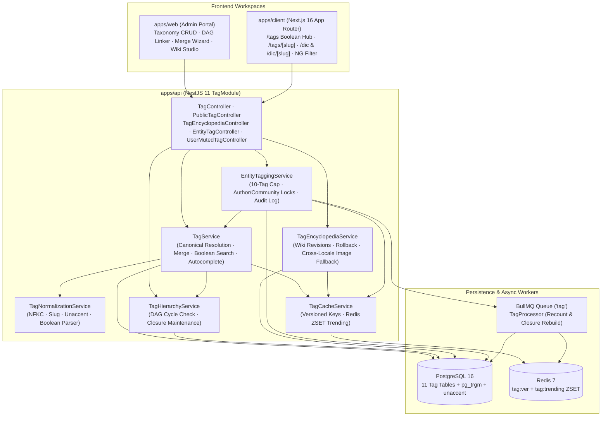
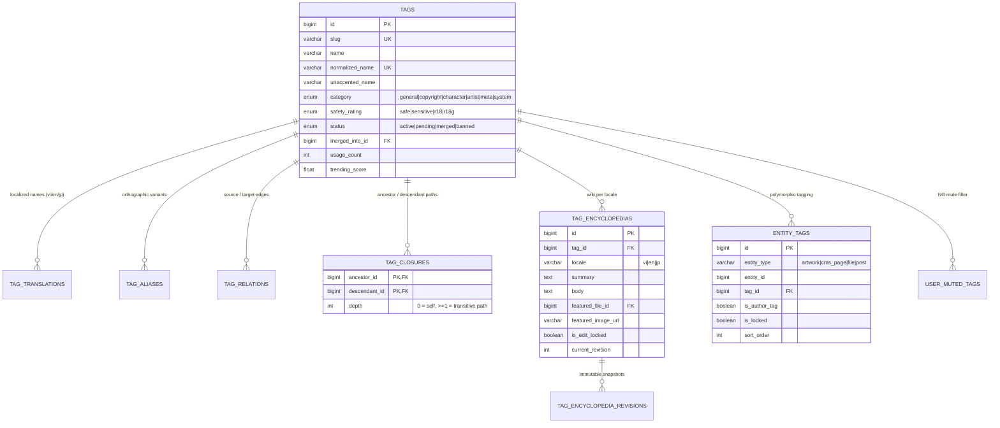

# Tags & Community Encyclopedia (`dic`) System

> **English** | [Tiếng Việt](../vi/TAGS.md)

Enterprise **Semantic Taxonomy, Collaborative Folksonomy & Community Encyclopedia (`dic`)** subsystem inspired by community art platforms. Designed as a standalone, polymorphic, multilingual (`vi`, `en`, `jp`) architecture across `apps/api`, `apps/web`, and `apps/client`.

---

## Table of Contents

- [Key Capabilities](#key-capabilities)
- [System Architecture](#system-architecture)
  - [High-Level Architecture Diagram](#high-level-architecture-diagram)
  - [11-Table Relational Data Model (ERD)](#11-table-relational-data-model-erd)
  - [Unicode NFKC Normalization & Orthographic Alias Resolution (`表記揺れ`)](#unicode-nfkc-normalization--orthographic-alias-resolution-表記揺れ)
  - [Directed Acyclic Graph (DAG) & Transitive Closure Table](#directed-acyclic-graph-dag--transitive-closure-table)
  - [Collaborative Folksonomy Governance (10-Tag Cap & Locks)](#collaborative-folksonomy-governance-10-tag-cap--locks)
  - [Tag Encyclopedia (`dic`) & Immutable Revisions](#tag-encyclopedia-dic--immutable-revisions)
  - [Redis Caching & BullMQ Workers](#redis-caching--bullmq-workers)
- [User & Administrator Guide](#user--administrator-guide)
  - [1. Admin Management Portal (`apps/web`)](#1-admin-management-portal-appsweb)
  - [2. Customer Application (`apps/client`)](#2-customer-application-appsclient)
- [Developer Integration Guide](#developer-integration-guide)
  - [Directory Structure](#directory-structure)
  - [Database Migrations, RBAC Permissions & Seeding](#database-migrations-rbac-permissions--seeding)
  - [Attaching Tags to Any Polymorphic Entity Module](#attaching-tags-to-any-polymorphic-entity-module)
  - [REST API Endpoints Reference](#rest-api-endpoints-reference)
  - [Running Tests](#running-tests)

---

## Key Capabilities

- **6 Semantic Categories**: `general`, `copyright` (series/franchises), `character`, `artist`, `meta` (technique/format), and `system` (platform markers such as `AI-Generated`).
- **4 Content Safety Ratings**: `safe`, `sensitive`, `r18`, and `r18g`.
- **Orthographic Alias Resolution (`表記揺れ`) & SEO Canonicalization**: Synonyms, abbreviations, typos, and merged legacy tags (`synonym`, `abbreviation`, `typo`, `legacy_merge`) resolve automatically to their canonical tag with `308 Permanent Redirect` responses.
- **DAG Hierarchy & Closure Table**: Multi-parent / multi-child taxonomy (`Parent 親タグ` / `Child 子タグ`), associative links (`Related 関連タグ`), and disambiguation notices (`Disambiguation 曖昧さ回避`) with cycle detection and single-join descendant search expansion.
- **Boolean Tag Search Engine**: Supports standard `AND` (whitespace), `OR`, `-exclude` (`NOT`), and `"quoted multi-word tags"`, combined seamlessly with per-user **NG Tag Mute Filters**.
- **Collaborative Folksonomy**: Enforces a **10-tag cap per entity**, distinguishes Creator tags (`*`) from Community tags, supports per-tag locks and entity-wide `tagEditLocked`, and records an immutable audit trail (`entity_tag_logs`).
- **Tag Encyclopedia (`dic`)**: Localized rich-text wiki articles (`vi`, `en`, `jp`) powered by Tiptap, **Media Library File Picker** + **Direct File Upload** for Featured Header Images (with automatic cross-locale image fallback), immutable revision history, and 1-click rollback.

---

## System Architecture

### High-Level Architecture Diagram



### 11-Table Relational Data Model (ERD)



### Unicode NFKC Normalization & Orthographic Alias Resolution (`表記揺れ`)

`TagNormalizationService` normalizes every tag input prior to storage or lookup:

1. Applies **Unicode `NFKC`** normalization (collapsing full-width Japanese/Latin characters, trimming leading `#`, and collapsing whitespace).
2. Computes `normalizedName`, diacritic-free `unaccentedName` (for accent-insensitive Vietnamese/Latin matching), and URL-safe `slug` (preserving CJK characters where applicable).
3. Visiting `/tags/fgo` or `/dic/fgo` resolves `fgo` via `tag_aliases` to canonical `fate-grand-order`, returning `redirectSlug: "fate-grand-order"` so Next.js issues an SEO-friendly **HTTP 308 Permanent Redirect**.

### Directed Acyclic Graph (DAG) & Transitive Closure Table

Instead of running expensive `WITH RECURSIVE` queries on read paths, `TagHierarchyService` maintains `tag_closures (ancestor_id, descendant_id, depth)`:

- Every canonical tag has a self-closure row `(id, id, depth = 0)`.
- Before inserting `Parent → Child`, cycle detection checks whether `Parent` is already a descendant of `Child` and rejects cycles with `400 Bad Request`.
- When **DAG Sub-Tag Expansion** (`expandHierarchy = true`) is active, searching for `#Fate/Grand Order` expands all descendant sub-tags (`#Mash Kyrielight`, etc.) in a single indexed join.

### Collaborative Folksonomy Governance (10-Tag Cap & Locks)

`EntityTaggingService` enforces collaborative folksonomy tagging rules:

- **10-Tag Cap**: Maximum 10 tags per entity by default (`maxTags = 10` in `entity_tag_settings`).
- **Creator (`*`) vs Community Tags**: Tags attached by the entity owner are marked `isAuthorTag = true` and `isLocked = true` so community editors cannot delete creator-defined tags.
- **Entity Edit Lock (`tagEditLocked`)**: Owners or moderators can freeze community tag edits on an entity at any time.
- **Immutable Audit Trail (`entity_tag_logs`)**: Every add, remove, lock, unlock, or merge rewire action is recorded with actor metadata and tag name snapshots.

### Tag Encyclopedia (`dic`) & Immutable Revisions

- Each canonical tag supports per-locale wiki articles (`vi`, `en`, `jp`) in `tag_encyclopedias`.
- **Featured Header Image**: Supports selecting existing assets via **Media Library (`FilePickerDialog`)**, **uploading files directly (`POST /api/v1/files/upload`)**, or pasting an external URL. If a locale edition does not specify its own image, the API automatically falls back to any available featured image across other locales of the same tag.
- Every save creates an append-only snapshot in `tag_encyclopedia_revisions`. Rolling back creates a new revision restoring the target snapshot's content while preserving full history.

### Redis Caching & BullMQ Workers

- **O(1) Versioned Cache Invalidation**: `TagCacheService` namespaces cached keys under `tag:ver`. Taxonomy mutations increment `tag:ver` atomically without expensive key scans.
- **Trending Leaderboard**: Uses a Redis Sorted Set (`ZINCRBY tag:trending`) with PostgreSQL fallback.
- **BullMQ Queue (`tag`)**: `TagProcessor` handles asynchronous `usage_count` recalculation and closure rebuilds after large tag merges.

---

## User & Administrator Guide

### 1. Admin Management Portal (`apps/web`)

Requires an administrator role granted `TAG` and `TAG_ENCYCLOPEDIA` permissions.

1. **Tag Directory (`/tags`)**:
   - Filter by **Semantic Category**, **Safety Rating**, **Lifecycle Status**, or search across canonical names, translations, and aliases.
2. **Create & Edit Tag (`/tags/create`, `/tags/:id/edit`)**:
   - Configure **Semantic Category**, **Safety Rating**, **Lifecycle Status**, **Official Verified Tag**, and **System Tag** flags.
   - Populate **Multilingual Translations** (`EN`, `VI`, `JP`) with localized display names and hover tooltip summaries (up to 280 characters).
   - Add **Orthographic Aliases (`表記揺れ`)** (`synonym`, `abbreviation`, `typo`, `legacy_merge`).
3. **Tag Detail, DAG Hierarchy & Safe Merge (`/tags/:id`)**:
   - **Overview Tab**: Inspect localized names, aliases, and recent entity tag audit logs.
   - **DAG Hierarchy Tab**: Link `Parent (親タグ)`, `Child (子タグ)`, `Related (関連タグ)`, or `Disambiguation (曖昧さ回避)` relations with live cycle validation.
   - **Merge Into Another Tag**: Preview affected entity tags, transferred aliases, and rewired DAG edges before executing an atomic merge.
4. **Encyclopedia Studio (`/tags/:id` → Encyclopedia Tab & `/tag-encyclopedias`)**:
   - Switch locale editions (`EN`, `VI`, `JP`), choose or upload a **Featured Header Image**, author rich HTML content with Tiptap, toggle **Lock Community Editing**, and restore previous snapshots from the **Revision History** panel.

### 2. Customer Application (`apps/client`)

1. **Boolean Tag Discovery Hub (`/[locale]/tags`)**:
   - Supports standard boolean queries:
     - `frieren illustration` → **AND** (must match all terms, including child sub-tags when DAG expansion is enabled).
     - `genshin-impact OR honkai-star-rail` → **OR** (matches any term).
     - `-ai-generated` → **NOT** (excludes matching items).
     - `"fate/grand order"` → Quoted multi-word tag token.
2. **Canonical Tag Landing Page (`/[locale]/tags/[slug]`)**:
   - Displays the tag hero, featured `dic` thumbnail, orthographic aliases, `Parents / Children / Siblings & Related` DAG cards, **Mute Tag (NG)** toggle, and tagged content feed.
3. **Tag Encyclopedia (`/[locale]/dic` & `/[locale]/dic/[slug]`)**:
   - `/[locale]/dic` provides a visual directory of encyclopedia articles with cover banners and category filters.
   - `/[locale]/dic/[slug]` renders the localized wiki article, disambiguation banner (`曖昧さ回避`), **Canonical Taxonomy Infobox**, and community revision editor (`WikiCommunityEditor`).
4. **Personal NG Muted Tags (`/[locale]/settings/muted-tags`)**:
   - Authenticated users can mute specific tags (with optional descendant sub-tag muting via the DAG closure table) to hide unwanted content across tag feeds and boolean searches.

---

## Developer Integration Guide

### Directory Structure

```text
monorepo/
├── apps/api/src/
│   ├── api/tag/
│   │   ├── constants/tag.constant.ts               # Enums, Redis keys, 10-tag limit
│   │   ├── entities/                               # 11 TypeORM Entities
│   │   ├── dto/                                    # Request / Response DTOs + Swagger
│   │   ├── services/
│   │   │   ├── tag-normalization.service.ts        # NFKC, slug, boolean parser
│   │   │   ├── tag-cache.service.ts                # Redis versioned cache & ZSET trending
│   │   │   ├── tag-hierarchy.service.ts            # DAG cycle detection & closure table
│   │   │   ├── tag.service.ts                      # CRUD, merge, autocomplete, boolean search
│   │   │   ├── tag-encyclopedia.service.ts         # Wiki CRUD, revisions, rollback
│   │   │   └── entity-tagging.service.ts           # Polymorphic tagging, locks, audit logs
│   │   ├── queues/tag.processor.ts                 # BullMQ async recount & closure rebuild
│   │   └── tag.module.ts                           # Standalone NestJS module
│   └── database/seeds/tag/                         # TagSeedModule & TagSeedService
├── apps/web/src/pages/tags/                        # Admin Portal Tag & Encyclopedia UI
└── apps/client/src/
    ├── services/tags.ts                            # SSR fetchers + TanStack Query hooks
    ├── components/tags/                            # TagChip, TagHoverCard, BooleanTagSearchBar, CollaborativeTagBar
    └── app/[locale]/(public)/
        ├── tags/                                   # /tags & /tags/[slug]
        ├── dic/                                    # /dic & /dic/[slug]
        └── settings/muted-tags/                    # /settings/muted-tags
```

### Database Migrations, RBAC Permissions & Seeding

```bash
# 1. Run PostgreSQL migrations for the 11 tag & encyclopedia tables
pnpm --filter api migration:run

# 2. Sync CASL RBAC permissions (TAG, TAG_ENCYCLOPEDIA)
pnpm --filter api permissions:sync

# 3. Seed curated standard sample tags, translations, DAG edges, wikis, and sample entities
pnpm --filter api seed:tags
```

### Attaching Tags to Any Polymorphic Entity Module

The tag subsystem is completely decoupled via `(entityType, entityId)`:

#### 1. Backend Service Integration

Import `TagModule` into your feature module and invoke `EntityTaggingService.syncAuthorTags`:

```typescript
import { Injectable } from "@nestjs/common";
import { ETaggableEntityType } from "../tag/constants/tag.constant";
import { EntityTaggingService } from "../tag/services/entity-tagging.service";

@Injectable()
export class ArtworkService {
  constructor(private readonly entityTaggingService: EntityTaggingService) {}

  async publishArtwork(
    artworkId: string,
    authorUserId: string,
    rawTags: string[],
  ) {
    await this.entityTaggingService.syncAuthorTags(
      ETaggableEntityType.ARTWORK,
      artworkId,
      rawTags,
      { userId: authorUserId, adminId: null },
      false,
    );
  }
}
```

#### 2. Frontend Component Integration (`apps/client`)

Drop `<CollaborativeTagBar />` into any detail page to get a 10-tag folksonomy bar, creator `*` badges, lock indicators, autocomplete add input, and hover encyclopedia cards:

```tsx
import { CollaborativeTagBar } from "@/components/tags/collaborative-tag-bar";

export function ArtworkDetailFooter({
  artworkId,
  locale,
}: {
  artworkId: string;
  locale: string;
}) {
  return (
    <CollaborativeTagBar
      entityType="artwork"
      entityId={artworkId}
      locale={locale}
    />
  );
}
```

### REST API Endpoints Reference

| Group                | Method & Path                                                   | Auth                       | Description                                                                      |
| :------------------- | :-------------------------------------------------------------- | :------------------------- | :------------------------------------------------------------------------------- |
| **Public Discovery** | `GET /api/v1/public/tags`                                       | Public                     | Paginated canonical tag directory with QueryBuilder filters & sorts.             |
| **Public Discovery** | `GET /api/v1/public/tags/trending`                              | Public                     | Trending tags from Redis ZSET with PostgreSQL fallback.                          |
| **Public Discovery** | `GET /api/v1/public/tags/autocomplete`                          | Public                     | Prefix + trigram + alias autocomplete (`?q=&locale=`).                           |
| **Public Discovery** | `GET /api/v1/public/tags/by-slug/:slug`                         | Public (Optional JWT)      | Canonical tag detail, DAG graph, and alias `redirectSlug`.                       |
| **Public Discovery** | `GET /api/v1/public/tags/by-slug/:slug/tooltip`                 | Public                     | Lightweight summary, parent tag, and `featuredImageUrl` for hover cards.         |
| **Public Discovery** | `GET /api/v1/public/tags/encyclopedia/:slug`                    | Public                     | Localized encyclopedia article (`dic`) and revision history.                     |
| **Public Discovery** | `GET /api/v1/public/tags/search-content`                        | Public (Optional JWT)      | Boolean tag search (`AND`, `OR`, `-NOT`) with DAG expansion & NG filtering.      |
| **Folksonomy**       | `GET / POST / DELETE /api/v1/entity-tags/:entityType/:entityId` | Public / User JWT          | Read, append, or remove collaborative entity tags.                               |
| **Community Wiki**   | `PUT /api/v1/tag-encyclopedias/community/:tagId`                | User JWT                   | Submit a community encyclopedia revision when unlocked.                          |
| **NG Mute Filter**   | `GET / POST / DELETE /api/v1/users/me/muted-tags`               | User JWT                   | Manage personal muted tags and descendant muting.                                |
| **Admin Taxonomy**   | `GET / POST / PATCH / DELETE /api/v1/tags`                      | Admin (`TAG`)              | Full CRUD for canonical tags, translations, and aliases.                         |
| **Admin Taxonomy**   | `POST /api/v1/tags/:sourceId/merge-preview` & `/merge`          | Admin (`TAG.UPDATE`)       | Impact preview and transactional tag merge.                                      |
| **Admin DAG**        | `POST / DELETE /api/v1/tags/:id/relations`                      | Admin (`TAG.UPDATE`)       | Add/remove DAG relations and update closure paths.                               |
| **Admin Wiki**       | `PUT /api/v1/tag-encyclopedias/admin/:tagId` & `rollback`       | Admin (`TAG_ENCYCLOPEDIA`) | Publish wiki articles, manage header images, lock edits, and rollback revisions. |

### Running Tests

```bash
# Run all unit tests across the monorepo
pnpm test

# Run tag-specific test suites per workspace
pnpm --filter api test -- tag
pnpm --filter web test -- schema.test.ts
pnpm --filter client test -- boolean-tag-search-bar.test.ts
```
