# Bản Phân Tích & Thiết Kế Database Chi Tiết — Hệ Thống Kosume Cosplay Platform

> [!IMPORTANT]
> Tài liệu này phân tích toàn bộ hiện trạng (`As-Is`) của Backend PostgreSQL/TypeORM trong `apps/api`, đối chiếu 1-1 với toàn bộ màn hình/form/mock data trong Frontend `apps/client`, từ đó đề xuất kiến trúc Database chuẩn hóa (`To-Be`) gồm **23 bảng nghiệp vụ mới** + **2 phần mở rộng Core** gắn kết chặt chẽ trên nền **34 bảng hạ tầng có sẵn** (tổng cộng **57 bảng**).

---

## Mục lục

1. [Phân tích hiện trạng (`As-Is`) & Khoảng trống (`Gap Analysis`)](#1-phân-tích-hiện-trạng-as-is--khoảng-trống-gap-analysis)
2. [Sơ đồ Kiến trúc Tổng thể (`Master ERD`)](#2-sơ-đồ-kiến-trúc-tổng-thể-master-erd)
3. [Thiết kế Chi tiết Schema (2 Mở rộng Core + 23 Bảng Mới)](#3-thiết-kế-chi-tiết-schema-2-mở-rộng-core--23-bảng-mới)
   - [3.0. Mở rộng hạ tầng Core hiện có (`users` & `ETaggableEntityType`)](#30-mở-rộng-hạ-tầng-core-hiện-có)
   - [3.1. Phân hệ 1 — Hồ sơ Cosplayer & Portfolio (`cosplayer_profiles`, `cosplayer_services`, `cosplayer_characters`)](#31-phân-hệ-1--hồ-sơ-cosplayer--portfolio)
   - [3.2. Phân hệ 2 — Studio Albums & Bài đăng Thống nhất (`posts`, `post_media`)](#32-phân-hệ-2--studio-albums--bài-đăng-thống-nhất)
   - [3.3. Phân hệ 3 — Tương tác Mạng xã hội & Bộ sưu tập Đã lưu (`user_follows`, `post_likes`, `post_comments`, `post_comment_likes`, `collections`, `collection_items`)](#33-phân-hệ-3--tương-tác-mạng-xã-hội--bộ-sưu-tập-đã-lưu)
   - [3.4. Phân hệ 4 — Tuyển dụng & Việc làm Cosplay (`jobs`, `job_applications`)](#34-phân-hệ-4--tuyển-dụng--việc-làm-cosplay)
   - [3.5. Phân hệ 5 — Sự kiện & Lễ hội (`events`, `event_participants`, `event_applications`, `event_interests`)](#35-phân-hệ-5--sự-kiện--lễ-hội)
   - [3.6. Phân hệ 6 — Đặt lịch Booking & Tin nhắn Trực tiếp (`booking_requests`, `direct_messages`)](#36-phân-hệ-6--đặt-lịch-booking--tin-nhắn-trực-tiếp)
   - [3.7. Phân hệ 7 — Bảng xếp hạng Ranking, Spotlight, Thông báo & Báo cáo Vi phạm (`leaderboard_snapshots`, `spotlight_banners`, `notifications`, `content_reports`)](#37-phân-hệ-7--bảng-xếp-hạng-ranking-spotlight-thông-báo--báo-cáo-vi-phạm)
4. [Giải pháp Kỹ thuật & Tối ưu Hiệu năng](#4-giải-pháp-kỹ-thuật--tối-ưu-hiệu-năng)
5. [Lộ trình Triển khai 5 Phase & Quy trình Verification](#5-lộ-trình-triển-khai-5-phase--quy-trình-verification)
6. [Các Điểm Cần Chốt Trước Khi Code (`Open Decisions`)](#6-các-điểm-cần-chốt-trước-khi-code-open-decisions)

---

## 1. Phân tích hiện trạng (`As-Is`) & Khoảng trống (`Gap Analysis`)

### 1.1. Quy chuẩn Kiến trúc Backend hiện tại (`apps/api`)

Qua kiểm toán trực tiếp mã nguồn TypeORM trong `apps/api/src`, hệ thống đang tuân thủ nghiêm ngặt các quy chuẩn sau — mọi bảng thiết kế mới **bắt buộc phải tuân theo 100%** để đồng bộ với hệ sinh thái sẵn có:

1. **Khóa chính (`Primary Key`) dùng `bigint` tự tăng (`AutoIncrementID`), KHÔNG dùng UUID**:
   - Toàn bộ entity đang sử dụng `@PrimaryGeneratedColumn('increment', { primaryKeyConstraintName: 'PK_...', type: 'bigint' })` ánh xạ kiểu TypeScript `AutoIncrementID` (xem [user.entity.ts](file:///home/crodic/personal/crodic-framework/apps/api/src/api/user/entities/user.entity.ts#L29-L33), [file.entity.ts](file:///home/crodic/personal/crodic-framework/apps/api/src/api/file/entities/file.entity.ts#L20-L24), [entity-tag.entity.ts](file:///home/crodic/personal/crodic-framework/apps/api/src/api/tag/entities/entity-tag.entity.ts#L29-L33), [base.entity.ts](file:///home/crodic/personal/crodic-framework/apps/api/src/common/entities/base.entity.ts#L8-L10)).
   - Toàn bộ khóa ngoại (`Foreign Key`) tham chiếu tới `users.id`, `files.id`, `cities.id`, `tags.id` và đặc biệt cột đa hình `entity_tags.entity_id` đều là `bigint`.
2. **Kế thừa `AbstractEntity` + Đặt tên `SnakeNamingStrategy`**:
   - Mọi entity kế thừa [AbstractEntity](file:///home/crodic/personal/crodic-framework/apps/api/src/database/entities/abstract.entity.ts#L10-L45) để tự động có `created_at` và `updated_at` kiểu `timestamptz` xếp cuối bảng nhờ `@Order(9999)`.
   - Các bảng nghiệp vụ cần xóa mềm bổ sung `@DeleteDateColumn({ name: 'deleted_at', type: 'timestamptz', default: null })` kèm Partial Unique Index `WHERE "deleted_at" IS NULL` giống pattern trong [user.entity.ts](file:///home/crodic/personal/crodic-framework/apps/api/src/api/user/entities/user.entity.ts#L50-L67) và [tag.entity.ts](file:///home/crodic/personal/crodic-framework/apps/api/src/api/tag/entities/tag.entity.ts#L27-L34).
   - Đặt tên cột và bảng tuân thủ [SnakeNamingStrategy](file:///home/crodic/personal/crodic-framework/apps/api/src/database/naming-strategies/snake-naming.strategy.ts#L4-L48) (`snake_case`).
3. **Quy trình Migration bắt buộc**:
   - Tuyệt đối không viết tay file SQL/TS trong `apps/api/src/database/migrations/`.
   - Luôn định nghĩa TypeORM Entity trước, sau đó chạy lệnh:
     ```bash
     pnpm --filter api migration:generate src/database/migrations/<MigrationName>
     ```

### 1.2. Kiểm toán 34 bảng hạ tầng đã có sẵn (`As-Is`)

Hệ thống hiện tại đã xây dựng hoàn chỉnh **32 `@Entity` + 2 bảng trung gian `@JoinTable`** thuộc 4 cụm hạ tầng dùng chung:

| Cụm Hạ tầng                                         | Danh sách Bảng hiện có                                                                                                                                                                                     | File tham chiếu tiêu biểu                                                                                                                                                                                                                                                                                                                                                                                                                                                                                                                                                                                                                                                                                                                                | Vai trò tái sử dụng cho Kosume                                                                                                                                                                                                                |
| :-------------------------------------------------- | :--------------------------------------------------------------------------------------------------------------------------------------------------------------------------------------------------------- | :------------------------------------------------------------------------------------------------------------------------------------------------------------------------------------------------------------------------------------------------------------------------------------------------------------------------------------------------------------------------------------------------------------------------------------------------------------------------------------------------------------------------------------------------------------------------------------------------------------------------------------------------------------------------------------------------------------------------------------------------------- | :-------------------------------------------------------------------------------------------------------------------------------------------------------------------------------------------------------------------------------------------- |
| **1. Identity, Auth & RBAC (10 bảng)**              | `users`, `user_accounts`, `user_sessions`, `admin_users`, `admin_accounts`, `admin_sessions`, `admin_roles`, `admin_permissions`, `admin_user_role` (`@JoinTable`), `admin_role_permission` (`@JoinTable`) | [user.entity.ts](file:///home/crodic/personal/crodic-framework/apps/api/src/api/user/entities/user.entity.ts), [user-account.entity.ts](file:///home/crodic/personal/crodic-framework/apps/api/src/api/user/entities/user-account.entity.ts), [admin-user.entity.ts](file:///home/crodic/personal/crodic-framework/apps/api/src/api/admin-user/entities/admin-user.entity.ts), [admin-role.entity.ts](file:///home/crodic/personal/crodic-framework/apps/api/src/api/admin-role/entities/admin-role.entity.ts)                                                                                                                                                                                                                                           | Tài khoản đăng nhập Client (`OAuth`/Local), cấu hình JSONB notification preferences, xác thực Admin & phân quyền CASL từ [permissions.constant.ts](file:///home/crodic/personal/crodic-framework/apps/api/src/utils/permissions.constant.ts). |
| **2. Storage & Media Upload (3 bảng)**              | `files`, `file_folders`, `file_upload_sessions`                                                                                                                                                            | [file.entity.ts](file:///home/crodic/personal/crodic-framework/apps/api/src/api/file/entities/file.entity.ts), [sortable-image-upload.service.ts](file:///home/crodic/personal/crodic-framework/apps/api/src/api/file/sortable-image-upload.service.ts)                                                                                                                                                                                                                                                                                                                                                                                                                                                                                                  | Lưu metadata ảnh/video (width, height, duration, public_id, visibility), upload phân mảnh & kéo thả sắp xếp thứ tự ảnh Album.                                                                                                                 |
| **3. Hệ thống Đa hình Tag & Từ điển (11 bảng)**     | `tags`, `tag_translations`, `tag_aliases`, `tag_relations`, `tag_closure`, `tag_encyclopedias`, `tag_encyclopedia_revisions`, `entity_tags`, `entity_tag_configs`, `entity_tag_logs`, `user_muted_tags`    | [tag.constant.ts](file:///home/crodic/personal/crodic-framework/apps/api/src/api/tag/constants/tag.constant.ts), [tag.entity.ts](file:///home/crodic/personal/crodic-framework/apps/api/src/api/tag/entities/tag.entity.ts), [tag-closure.entity.ts](file:///home/crodic/personal/crodic-framework/apps/api/src/api/tag/entities/tag-closure.entity.ts), [entity-tag.entity.ts](file:///home/crodic/personal/crodic-framework/apps/api/src/api/tag/entities/entity-tag.entity.ts), [user-muted-tag.entity.ts](file:///home/crodic/personal/crodic-framework/apps/api/src/api/tag/entities/user-muted-tag.entity.ts), [tag-query-filter.helper.ts](file:///home/crodic/personal/crodic-framework/apps/api/src/api/tag/helpers/tag-query-filter.helper.ts) | Gắn thẻ nhân vật (`CHARACTER`), tác phẩm (`COPYRIGHT`), kỹ thuật/general (`GENERAL`) đa ngôn ngữ (`vi`/`en`/`jp`), cây phân cấp DAG, tìm kiếm Boolean (`AND`/`OR`/`-NOT`) và **tự động ẩn bài chứa Muted Tags** của User.                     |
| **4. CMS, White-Label, Địa giới & Audit (10 bảng)** | `cms_pages`, `cms_page_translations`, `white_labels`, `settings`, `regions`, `countries`, `states`, `cities`, `activity_logs`, `email_logs`                                                                | [cms-page.entity.ts](file:///home/crodic/personal/crodic-framework/apps/api/src/api/cms-page/entities/cms-page.entity.ts), [city.entity.ts](file:///home/crodic/personal/crodic-framework/apps/api/src/api/location/entities/city.entity.ts), [activity-log.entity.ts](file:///home/crodic/personal/crodic-framework/apps/api/src/api/audit-log/entities/activity-log.entity.ts)                                                                                                                                                                                                                                                                                                                                                                         | Chuẩn hóa Tỉnh/Thành phố cho Cosplayer, Events, Jobs (`cities.id`, `countries.id`), ghi log hoạt động & email thông báo.                                                                                                                      |

> [!TIP]
> **Nhờ tái sử dụng `user_muted_tags`, `entity_tags`, `files`, `cities`**, ta **không cần** tạo dư thừa bảng `muted_tags` hay `fandoms`/`characters` rời rạc mà tận dụng ngay hệ thống Tag + Từ điển sẵn có để hỗ trợ tìm kiếm đa ngôn ngữ, alias đồng nghĩa (vd: `HSR` -> `Honkai: Star Rail`) và mở rộng cây phân cấp DAG!

### 1.3. Đối chiếu Khoảng trống (`Gap Analysis`: Frontend `apps/client` vs Backend `apps/api`)

Hiện tại toàn bộ phân hệ nghiệp vụ Cosplay ở `apps/client` đang chạy dữ liệu tĩnh từ các file `*-data.ts`. Bảng dưới đây ánh xạ từng cụm UI tới dữ liệu còn thiếu ở Backend:

| Tính năng / Màn hình UI (`apps/client`)                                            | File UI / Types đại diện                                                                                                                                                                                                                                                                                                                                                                                                                                                                                                                                                                                                                                 | Thực trạng Backend                                                 | Bảng & Mở rộng cần thiết                                                                                                                      |
| :--------------------------------------------------------------------------------- | :------------------------------------------------------------------------------------------------------------------------------------------------------------------------------------------------------------------------------------------------------------------------------------------------------------------------------------------------------------------------------------------------------------------------------------------------------------------------------------------------------------------------------------------------------------------------------------------------------------------------------------------------------- | :----------------------------------------------------------------- | :-------------------------------------------------------------------------------------------------------------------------------------------- |
| **1. Trang cá nhân Cosplayer & Edit Dialog & Tab Giới thiệu**                      | [profile-types.ts](file:///home/crodic/personal/crodic-framework/apps/client/src/components/cosplayer-profile/profile-types.ts), [profile-edit-dialog.tsx](file:///home/crodic/personal/crodic-framework/apps/client/src/components/cosplayer-profile/profile-edit-dialog.tsx), [profile-about.tsx](file:///home/crodic/personal/crodic-framework/apps/client/src/components/cosplayer-profile/profile-about.tsx)                                                                                                                                                                                                                                        | Mới chỉ có `users` (tên, email, avatar)                            | Mở rộng `users` (`username`, `show_online_status`, `last_active_at`) + Tạo `cosplayer_profiles`, `cosplayer_services`, `cosplayer_characters` |
| **2. Đăng Album Studio, Bảng tin Feed, Khám phá Explore & Chi tiết Post**          | [create-album-form.tsx](file:///home/crodic/personal/crodic-framework/apps/client/src/components/studio/create-album-form.tsx), [feed-types.ts](file:///home/crodic/personal/crodic-framework/apps/client/src/components/feed/feed-types.ts), [post-types.ts](file:///home/crodic/personal/crodic-framework/apps/client/src/components/post-detail/post-types.ts), [explore-types.ts](file:///home/crodic/personal/crodic-framework/apps/client/src/components/explore/explore-types.ts)                                                                                                                                                                 | Đã có `files` + `entity_tags` (`POST`) nhưng chưa có bảng bài đăng | Tạo `posts` (hợp nhất Album & Post) + `post_media`                                                                                            |
| **3. Thích, Bình luận, Theo dõi, Lưu vào Bộ sưu tập (3-panel Mosaic)**             | [post-info.tsx](file:///home/crodic/personal/crodic-framework/apps/client/src/components/post-detail/post-info.tsx), [feed-post-card.tsx](file:///home/crodic/personal/crodic-framework/apps/client/src/components/feed/feed-post-card.tsx), [profile-saved-collections.tsx](file:///home/crodic/personal/crodic-framework/apps/client/src/components/cosplayer-profile/profile-saved-collections.tsx)                                                                                                                                                                                                                                                   | Chưa có                                                            | Tạo `user_follows`, `post_likes`, `post_comments`, `post_comment_likes`, `collections`, `collection_items`                                    |
| **4. Việc làm Cosplay & Đăng tin / Ứng tuyển**                                     | [jobs-types.ts](file:///home/crodic/personal/crodic-framework/apps/client/src/components/jobs/jobs-types.ts), [post-job-dialog.tsx](file:///home/crodic/personal/crodic-framework/apps/client/src/components/jobs/post-job-dialog.tsx), [job-apply-dialog.tsx](file:///home/crodic/personal/crodic-framework/apps/client/src/components/jobs/job-apply-dialog.tsx)                                                                                                                                                                                                                                                                                       | Chưa có                                                            | Tạo `jobs`, `job_applications` + thêm `JOB` vào `ETaggableEntityType`                                                                         |
| **5. Sự kiện & Lễ hội, Khách mời, Ứng tuyển & Quan tâm**                           | [events-types.ts](file:///home/crodic/personal/crodic-framework/apps/client/src/components/events/events-types.ts), [event-detail-content.tsx](file:///home/crodic/personal/crodic-framework/apps/client/src/components/events/event-detail-content.tsx), [event-apply-dialog.tsx](file:///home/crodic/personal/crodic-framework/apps/client/src/components/events/event-apply-dialog.tsx)                                                                                                                                                                                                                                                               | Chưa có                                                            | Tạo `events`, `event_participants`, `event_applications`, `event_interests` + thêm `EVENT` vào `ETaggableEntityType`                          |
| **6. Đặt lịch Booking trực tiếp & Liên hệ Widget**                                 | [ranking-booking-dialog.tsx](file:///home/crodic/personal/crodic-framework/apps/client/src/components/ranking/ranking-booking-dialog.tsx), [booking-widget.tsx](file:///home/crodic/personal/crodic-framework/apps/client/src/components/home/booking-widget.tsx)                                                                                                                                                                                                                                                                                                                                                                                        | Chưa có                                                            | Tạo `booking_requests`, `direct_messages`                                                                                                     |
| **7. Bảng xếp hạng Podium/Bảng điểm, Spotlight Home, Thông báo, Privacy Settings** | [ranking-types.ts](file:///home/crodic/personal/crodic-framework/apps/client/src/components/ranking/ranking-types.ts), [home-types.ts](file:///home/crodic/personal/crodic-framework/apps/client/src/components/home/home-types.ts), [notifications-types.ts](file:///home/crodic/personal/crodic-framework/apps/client/src/components/notifications/notifications-types.ts), [notifications-settings.tsx](file:///home/crodic/personal/crodic-framework/apps/client/src/components/settings/notifications-settings.tsx), [privacy-settings.tsx](file:///home/crodic/personal/crodic-framework/apps/client/src/components/settings/privacy-settings.tsx) | Đã có `user_muted_tags` & `users.notifications` (cơ bản)           | Tạo `leaderboard_snapshots`, `spotlight_banners`, `notifications`, `content_reports` + mở rộng JSONB `users.notifications`                    |

---

## 2. Sơ đồ Kiến trúc Tổng thể (`Master ERD`)

Sơ đồ dưới đây minh họa mối liên kết giữa **4 bảng Core hiện có** (`users`, `files`, `cities`, `tags`) + `admin_users` với **23 bảng nghiệp vụ mới** chia theo 7 phân hệ:

```mermaid
erDiagram
    USERS ||--o| COSPLAYER_PROFILES : "has 1-1 portfolio"
    USERS ||--o{ COSPLAYER_SERVICES : "offers"
    USERS ||--o{ COSPLAYER_CHARACTERS : "portrays"
    USERS ||--o{ POSTS : "authors"
    USERS ||--o{ USER_FOLLOWS : "follower / following"
    USERS ||--o{ POST_LIKES : "likes"
    USERS ||--o{ POST_COMMENTS : "writes"
    USERS ||--o{ POST_COMMENT_LIKES : "likes"
    USERS ||--o{ COLLECTIONS : "owns"
    USERS ||--o{ JOBS : "posts job"
    USERS ||--o{ JOB_APPLICATIONS : "applies"
    USERS ||--o{ EVENT_APPLICATIONS : "applies"
    USERS ||--o{ EVENT_INTERESTS : "interested in"
    USERS ||--o{ BOOKING_REQUESTS : "requests / receives"
    USERS ||--o{ DIRECT_MESSAGES : "sends / receives"
    USERS ||--o{ NOTIFICATIONS : "receives / acts"
    USERS ||--o{ CONTENT_REPORTS : "reports"
    USERS ||--o{ SPOTLIGHT_BANNERS : "featured in"
    USERS ||--o{ LEADERBOARD_SNAPSHOTS : "ranked in"

    CITIES ||--o{ COSPLAYER_PROFILES : "city"
    CITIES ||--o{ JOBS : "job city"
    CITIES ||--o{ EVENTS : "event city"

    COSPLAYER_CHARACTERS ||--o{ POSTS : "groups"
    POSTS ||--o{ POST_MEDIA : "contains"
    FILES ||--o{ POST_MEDIA : "stores binary"
    POSTS ||--o{ POST_LIKES : "receives"
    POSTS ||--o{ POST_COMMENTS : "has"
    POST_COMMENTS ||--o{ POST_COMMENTS : "replies to"
    POST_COMMENTS ||--o{ POST_COMMENT_LIKES : "receives"
    POSTS ||--o{ COLLECTION_ITEMS : "saved in"
    COLLECTIONS ||--o{ COLLECTION_ITEMS : "contains"
    POST_MEDIA ||--o{ COLLECTION_ITEMS : "optional specific photo"

    JOBS ||--o{ JOB_APPLICATIONS : "receives"
    EVENTS ||--o{ EVENT_PARTICIPANTS : "features guests"
    EVENTS ||--o{ EVENT_APPLICATIONS : "receives"
    EVENTS ||--o{ EVENT_INTERESTS : "tracked by"

    TAGS ||--o{ ENTITY_TAGS : "polymorphic tagging"
    TAGS ||--o{ USER_MUTED_TAGS : "ng filter"
    TAGS ||--o{ POSTS : "character_tag / copyright_tag"
    TAGS ||--o{ COSPLAYER_CHARACTERS : "character_tag / copyright_tag"

    USERS {
        bigint id PK
        varchar username UK
        varchar email UK
        boolean show_online_status
        timestamptz last_active_at
        jsonb notifications
    }
    COSPLAYER_PROFILES {
        bigint id PK
        bigint user_id FK,UK
        varchar slug UK
        varchar handle UK
        varchar display_name
        bigint city_id FK
        boolean is_accepting_booking
        int followers_count
        double ranking_score
    }
    POSTS {
        bigint id PK
        bigint author_id FK
        varchar slug UK
        varchar post_type
        varchar album_category
        jsonb collage_preview_urls
        int photos_count
        int likes_count
        double trending_score
    }
    POST_MEDIA {
        bigint id PK
        bigint post_id FK
        bigint file_id FK
        varchar media_type
        varchar url
        smallint sort_order
        boolean is_cover
    }
    COLLECTIONS {
        bigint id PK
        bigint user_id FK
        varchar title
        jsonb preview_thumbnails
        int items_count
    }
    JOBS {
        bigint id PK
        bigint poster_user_id FK
        varchar slug UK
        varchar category_code
        varchar status
        int applications_count
    }
    EVENTS {
        bigint id PK
        varchar slug UK
        boolean is_recruiting
        boolean is_featured_festival
        jsonb schedule
        int interested_count
    }
    BOOKING_REQUESTS {
        bigint id PK
        bigint target_cosplayer_id FK
        bigint requester_user_id FK
        varchar status
    }
    NOTIFICATIONS {
        bigint id PK
        bigint recipient_user_id FK
        varchar category
        varchar type
        boolean is_read
    }
```



---

## 3. Thiết kế Chi tiết Schema (2 Mở rộng Core + 23 Bảng Mới)

> [!NOTE]
> **Quy ước chung cho mọi bảng mới**:
>
> - Toàn bộ bảng nghiệp vụ kế thừa `AbstractEntity` (`created_at`, `updated_at` kiểu `timestamptz`).
> - Các bảng nội dung chính có `deleted_at` (`timestamptz`, nullable) để hỗ trợ xóa mềm và dùng **Partial Unique Index (`WHERE deleted_at IS NULL`)** cho các cột `slug`, `handle`, `username`.
> - Toàn bộ tên khóa chính, khóa ngoại, index đặt theo chuẩn đặt tên có sẵn của repo: `PK_<tên>`, `FK_<bảng>_<cột>`, `UQ_<bảng>_<cột>`, `IDX_<bảng>_<cột>`.

---

### 3.0. Mở rộng hạ tầng Core hiện có

#### A. Mở rộng bảng `users` ([user.entity.ts](file:///home/crodic/personal/crodic-framework/apps/api/src/api/user/entities/user.entity.ts))

Bổ sung các cột cần thiết cho URL `/cosplayer/[username]`, trạng thái trực tuyến và tùy chọn thông báo chi tiết trên trang Cài đặt ([privacy-settings.tsx](file:///home/crodic/personal/crodic-framework/apps/client/src/components/settings/privacy-settings.tsx), [notifications-settings.tsx](file:///home/crodic/personal/crodic-framework/apps/client/src/components/settings/notifications-settings.tsx)):

| Tên cột                              | Kiểu PostgreSQL | Nullable / Default                                                                                                                                                | Ràng buộc / Ghi chú                                                                                                                                            |
| :----------------------------------- | :-------------- | :---------------------------------------------------------------------------------------------------------------------------------------------------------------- | :------------------------------------------------------------------------------------------------------------------------------------------------------------- |
| `username`                           | `varchar(60)`   | `NULL` (giai đoạn chuyển đổi) / khuyến nghị `NOT NULL` sau backfill                                                                                               | `@Index('UQ_user_username', { unique: true, where: '"deleted_at" IS NULL' })`. Định danh duy nhất phục vụ route `/cosplayer/[username]` và đồng bộ với handle. |
| `show_online_status`                 | `boolean`       | `NOT NULL DEFAULT true`                                                                                                                                           | Tương ứng switch **"Hiển thị trạng thái hoạt động (Online Status)"** trong `PrivacySettings`.                                                                  |
| `last_active_at`                     | `timestamptz`   | `NULL`                                                                                                                                                            | Cập nhật định kỳ từ middleware / session / WebSocket heartbeat để xác định chấm xanh online khi `show_online_status = true`.                                   |
| `notifications` _(cập nhật default)_ | `jsonb`         | `DEFAULT '{"email": true, "system": true, "security": true, "notifyNewPost": true, "notifyInteractions": true, "notifyFestivals": false, "notifyBooking": true}'` | Mở rộng JSONB có sẵn trên `UserEntity` để lưu đủ 4 toggle của `NotificationsSettings` mà không phải tạo thêm bảng 1-1 dư thừa.                                 |

#### B. Mở rộng Enum `ETaggableEntityType` ([tag.constant.ts](file:///home/crodic/personal/crodic-framework/apps/api/src/api/tag/constants/tag.constant.ts#L37-L42))

Hiện tại enum đã có `CMS_PAGE = 'cms_page'`, `ARTWORK = 'artwork'`, `FILE = 'file'`, `POST = 'post'`. Cần bổ sung thêm **3 giá trị** vào TypeORM PostgreSQL enum và đồng bộ cấu hình trong `entity_tag_configs`:

```ts
export enum ETaggableEntityType {
  CMS_PAGE = "cms_page",
  ARTWORK = "artwork",
  FILE = "file",
  POST = "post",
  EVENT = "event", // Mới: gắn tag thể loại cho Lễ hội / Sự kiện
  JOB = "job", // Mới: gắn tag yêu cầu cho Job tuyển dụng
  COSPLAYER_PROFILE = "cosplayer_profile", // Mới: gắn chuyên môn / fandom sở trường
}
```

---

### 3.1. Phân hệ 1 — Hồ sơ Cosplayer & Portfolio

Mọi người dùng đăng nhập (`UserEntity`) đều có thể đóng vai **Fan/Nhà tuyển dụng** hoặc nâng cấp thành **Cosplayer/Crafting Creator** thông qua hồ sơ mở rộng 1-1.

#### Bảng 1: `cosplayer_profiles`

> **Nguồn đối chiếu UI**: [profile-types.ts](file:///home/crodic/personal/crodic-framework/apps/client/src/components/cosplayer-profile/profile-types.ts#L40-L74), [profile-edit-dialog.tsx](file:///home/crodic/personal/crodic-framework/apps/client/src/components/cosplayer-profile/profile-edit-dialog.tsx#L29-L37), [profile-about.tsx](file:///home/crodic/personal/crodic-framework/apps/client/src/components/cosplayer-profile/profile-about.tsx#L38-L120).

| Tên cột                                    | Kiểu PostgreSQL    | Nullable / Default           | Ràng buộc / FK / Mô tả                                                                            |
| :----------------------------------------- | :----------------- | :--------------------------- | :------------------------------------------------------------------------------------------------ |
| `id`                                       | `bigint`           | `NOT NULL`                   | `PK_cosplayer_profile_id` (AutoIncrement)                                                         |
| `user_id`                                  | `bigint`           | `NOT NULL`                   | `UQ_cosplayer_profiles_user_id` (Unique FK -> `users.id` `ON DELETE CASCADE`)                     |
| `slug`                                     | `varchar(80)`      | `NOT NULL`                   | URL slug công khai (`/cosplayer/kiriko`)                                                          |
| `display_name`                             | `varchar(120)`     | `NOT NULL`                   | Tên hiển thị nghệ danh (`KIRIKO`, `Soriko`)                                                       |
| `handle`                                   | `varchar(80)`      | `NOT NULL`                   | Handle chuẩn không dấu `@` hoặc lưu kèm `@` thống nhất (vd: `kirikocos`, render `@kirikocos`)     |
| `role_badge`                               | `varchar(80)`      | `NULL`                       | Nhãn vai trò hiển thị trên hero (`Cosplayer Pro`, `Model • Crafting`, `Thành viên (Fan)`)         |
| `tagline`                                  | `varchar(255)`     | `NULL`                       | Câu giới thiệu ngắn trên Spotlight / Hero                                                         |
| `bio`                                      | `varchar(500)`     | `NULL`                       | Tiểu sử ngắn trong `ProfileHero` & `ProfileEditDialog`                                            |
| `artistic_bio`                             | `text`             | `NULL`                       | Tiểu sử nghệ thuật dài (nhiều đoạn) trong tab Giới thiệu `ProfileAbout`                           |
| `avatar_file_id`                           | `bigint`           | `NULL`                       | FK -> `files.id` (`ON DELETE SET NULL`)                                                           |
| `avatar_url`                               | `varchar(500)`     | `NULL`                       | Cache URL ảnh đại diện (hoặc CDN path)                                                            |
| `cover_file_id`                            | `bigint`           | `NULL`                       | FK -> `files.id` (`ON DELETE SET NULL`)                                                           |
| `cover_url`                                | `varchar(500)`     | `NULL`                       | Cache URL ảnh bìa                                                                                 |
| `location_label`                           | `varchar(120)`     | `NULL`                       | Nhãn địa điểm hiển thị (`HÀ NỘI, VN`, `TP.HCM, VN`)                                               |
| `city_id`                                  | `bigint`           | `NULL`                       | FK -> `cities.id` (`ON DELETE SET NULL`) để lọc chuẩn theo địa giới                               |
| `country_id`                               | `bigint`           | `NULL`                       | FK -> `countries.id` (`ON DELETE SET NULL`)                                                       |
| `work_area`                                | `varchar(160)`     | `NULL`                       | Khu vực nhận việc (`Hà Nội & Toàn quốc`)                                                          |
| `height_cm`                                | `smallint`         | `NULL`                       | Số đo chiều cao dạng số (vd: `165`) phục vụ lọc tuyển dụng Lookbook                               |
| `height_label`                             | `varchar(30)`      | `NULL`                       | Nhãn hiển thị (`1m65`)                                                                            |
| `experience_years_num`                     | `smallint`         | `NULL`                       | Số năm kinh nghiệm dạng số (vd: `5`)                                                              |
| `experience_label`                         | `varchar(80)`      | `NULL`                       | Nhãn hiển thị (`5 năm kinh nghiệm`)                                                               |
| `skills`                                   | `jsonb`            | `NOT NULL DEFAULT '[]'`      | `string[]` kỹ năng (`["Crafting Đạo Cụ", "Make-up Chuyên Nghiệp"]`)                               |
| `specialties`                              | `jsonb`            | `NOT NULL DEFAULT '[]'`      | `string[]` fandom sở trường (`["Genshin Impact", "Honkai: Star Rail"]`)                           |
| `awards_badges`                            | `jsonb`            | `NOT NULL DEFAULT '[]'`      | `Array<{ title: string; icon?: string; tone?: string }>` hiển thị ở thẻ thành tích `ProfileAbout` |
| `contact_email`                            | `varchar(255)`     | `NULL`                       | Email công việc/booking công khai                                                                 |
| `contact_phone`                            | `varchar(40)`      | `NULL`                       | SĐT / Zalo liên hệ booking                                                                        |
| `facebook_url`                             | `varchar(300)`     | `NULL`                       | Link Facebook                                                                                     |
| `instagram_url`                            | `varchar(300)`     | `NULL`                       | Link Instagram                                                                                    |
| `tiktok_url`                               | `varchar(300)`     | `NULL`                       | Link TikTok                                                                                       |
| `twitter_url`                              | `varchar(300)`     | `NULL`                       | Link X / Twitter                                                                                  |
| `is_verified`                              | `boolean`          | `NOT NULL DEFAULT false`     | Tick xanh xác minh Creator                                                                        |
| `is_accepting_booking`                     | `boolean`          | `NOT NULL DEFAULT false`     | Xuất hiện trong widget **"Cosplayer đang nhận Booking"**                                          |
| `is_crafting_creator`                      | `boolean`          | `NOT NULL DEFAULT false`     | Phục vụ phân loại tab **Top Crafting** trên `/ranking`                                            |
| `followers_count`                          | `integer`          | `NOT NULL DEFAULT 0`         | Bộ đếm người theo dõi (denormalized)                                                              |
| `following_count`                          | `integer`          | `NOT NULL DEFAULT 0`         | Bộ đếm đang theo dõi                                                                              |
| `total_likes_count`                        | `integer`          | `NOT NULL DEFAULT 0`         | Tổng lượt thích nhận được từ mọi tác phẩm                                                         |
| `albums_count`                             | `integer`          | `NOT NULL DEFAULT 0`         | Tổng số album/post công khai                                                                      |
| `characters_count`                         | `integer`          | `NOT NULL DEFAULT 0`         | Tổng số nhân vật đã cosplay                                                                       |
| `collections_count`                        | `integer`          | `NOT NULL DEFAULT 0`         | Tổng số bộ sưu tập đã lưu công khai                                                               |
| `ranking_score`                            | `double precision` | `NOT NULL DEFAULT 0`         | Điểm xếp hạng tổng hợp                                                                            |
| `created_at` / `updated_at` / `deleted_at` | `timestamptz`      | `CURRENT_TIMESTAMP` / `NULL` | Audit & Soft delete                                                                               |

**Indexes (`cosplayer_profiles`)**:

- `UQ_cosplayer_profiles_slug`: UNIQUE `(slug) WHERE deleted_at IS NULL`
- `UQ_cosplayer_profiles_handle`: UNIQUE `(handle) WHERE deleted_at IS NULL`
- `UQ_cosplayer_profiles_user_id`: UNIQUE `(user_id) WHERE deleted_at IS NULL`
- `IDX_cosplayer_profiles_booking`: `(is_accepting_booking, is_verified, followers_count DESC) WHERE deleted_at IS NULL`
- `IDX_cosplayer_profiles_ranking`: `(ranking_score DESC, total_likes_count DESC) WHERE deleted_at IS NULL`
- `IDX_cosplayer_profiles_city_id`: `(city_id)`

---

#### Bảng 2: `cosplayer_services`

> **Nguồn đối chiếu UI**: Khối **"Dịch vụ Booking & Hợp tác"** trong [profile-about.tsx](file:///home/crodic/personal/crodic-framework/apps/client/src/components/cosplayer-profile/profile-about.tsx#L123-L159).

| Tên cột                     | Kiểu PostgreSQL | Nullable / Default      | Ràng buộc / FK / Mô tả                                                   |
| :-------------------------- | :-------------- | :---------------------- | :----------------------------------------------------------------------- |
| `id`                        | `bigint`        | `NOT NULL`              | `PK_cosplayer_service_id`                                                |
| `user_id`                   | `bigint`        | `NOT NULL`              | FK -> `users.id` (`ON DELETE CASCADE`)                                   |
| `title`                     | `varchar(180)`  | `NOT NULL`              | Tên gói dịch vụ (vd: `Chụp Photoset Studio / Ngoại cảnh`)                |
| `description`               | `varchar(500)`  | `NULL`                  | Mô tả chi tiết phạm vi dịch vụ                                           |
| `badge_label`               | `varchar(80)`   | `NOT NULL`              | Nhãn mức giá/điều kiện (vd: `Theo thỏa thuận`, `Nhận lịch trước 2 tuần`) |
| `sort_order`                | `smallint`      | `NOT NULL DEFAULT 0`    | Thứ tự hiển thị                                                          |
| `is_active`                 | `boolean`       | `NOT NULL DEFAULT true` | Bật/tắt gói dịch vụ                                                      |
| `created_at` / `updated_at` | `timestamptz`   | `CURRENT_TIMESTAMP`     | Audit                                                                    |

**Indexes (`cosplayer_services`)**:

- `IDX_cosplayer_services_user_sort`: `(user_id, is_active, sort_order)`

---

#### Bảng 3: `cosplayer_characters`

> **Nguồn đối chiếu UI**: Tab **"Nhân vật"** trên trang Profile ([profile-types.ts](file:///home/crodic/personal/crodic-framework/apps/client/src/components/cosplayer-profile/profile-types.ts#L88-L94)).

| Tên cột                     | Kiểu PostgreSQL | Nullable / Default   | Ràng buộc / FK / Mô tả                                                                 |
| :-------------------------- | :-------------- | :------------------- | :------------------------------------------------------------------------------------- |
| `id`                        | `bigint`        | `NOT NULL`           | `PK_cosplayer_character_id`                                                            |
| `user_id`                   | `bigint`        | `NOT NULL`           | FK -> `users.id` (`ON DELETE CASCADE`)                                                 |
| `character_name`            | `varchar(160)`  | `NOT NULL`           | Tên nhân vật (vd: `Raiden Shogun`, `Acheron`)                                          |
| `series_name`               | `varchar(160)`  | `NOT NULL`           | Tên game/anime/fandom (vd: `Genshin Impact`, `Honkai: Star Rail`)                      |
| `character_tag_id`          | `bigint`        | `NULL`               | FK -> `tags.id` (`ON DELETE SET NULL`), chuẩn hóa gắn với Tag `category = 'character'` |
| `copyright_tag_id`          | `bigint`        | `NULL`               | FK -> `tags.id` (`ON DELETE SET NULL`), chuẩn hóa gắn với Tag `category = 'copyright'` |
| `cover_file_id`             | `bigint`        | `NULL`               | FK -> `files.id` (`ON DELETE SET NULL`)                                                |
| `cover_image_url`           | `varchar(500)`  | `NOT NULL`           | Ảnh bìa đại diện nhân vật                                                              |
| `albums_count`              | `integer`       | `NOT NULL DEFAULT 0` | Số album thuộc nhân vật này                                                            |
| `photos_count`              | `integer`       | `NOT NULL DEFAULT 0` | Tổng số ảnh đã đăng cho nhân vật này                                                   |
| `sort_order`                | `smallint`      | `NOT NULL DEFAULT 0` | Thứ tự hiển thị trên tab Nhân vật                                                      |
| `created_at` / `updated_at` | `timestamptz`   | `CURRENT_TIMESTAMP`  | Audit                                                                                  |

**Indexes (`cosplayer_characters`)**:

- `IDX_cosplayer_characters_user_sort`: `(user_id, sort_order)`
- `IDX_cosplayer_characters_character_tag`: `(character_tag_id)`

---

### 3.2. Phân hệ 2 — Studio Albums & Bài đăng Thống nhất

> [!IMPORTANT]
> **Quyết định Kiến trúc: Hợp nhất `Album` và `FeedPost` thành một Thực thể `posts` duy nhất**
> Quan sát trực tiếp từ mã nguồn Client:
>
> 1. Trên tab Album ở trang Profile ([profile-albums.tsx](file:///home/crodic/personal/crodic-framework/apps/client/src/components/cosplayer-profile/profile-albums.tsx#L60-L63)), click vào một Album sẽ điều hướng trực tiếp tới `/post/${album.id}`.
> 2. Trên trang Feed ([create-post-card.tsx](file:///home/crodic/personal/crodic-framework/apps/client/src/components/feed/create-post-card.tsx#L104)), nút tạo bài viết mở chính `CreateAlbumModal` ([create-album-form.tsx](file:///home/crodic/personal/crodic-framework/apps/client/src/components/studio/create-album-form.tsx#L23-L31)).
> 3. Do đó Album (nhiều ảnh) và Bài đăng Feed/Explore/Showcase/Post Detail thực chất là **cùng một thực thể lõi (`posts`)** kết hợp danh sách media có thứ tự (`post_media`). Thiết kế hợp nhất giúp triệt tiêu 100% việc nhân bản bảng, thống nhất ID `/post/:id`, lượt tim, bình luận, bookmark và gắn thẻ `entity_tags (entity_type = 'post')`.

#### Bảng 4: `posts`

> **Nguồn đối chiếu UI**: [create-album-form.tsx](file:///home/crodic/personal/crodic-framework/apps/client/src/components/studio/create-album-form.tsx#L23-L31), [feed-types.ts](file:///home/crodic/personal/crodic-framework/apps/client/src/components/feed/feed-types.ts#L18-L31), [post-types.ts](file:///home/crodic/personal/crodic-framework/apps/client/src/components/post-detail/post-types.ts#L10-L29), [explore-types.ts](file:///home/crodic/personal/crodic-framework/apps/client/src/components/explore/explore-types.ts#L1-L13), [home-types.ts](file:///home/crodic/personal/crodic-framework/apps/client/src/components/home/home-types.ts#L11-L25).

| Tên cột                                    | Kiểu PostgreSQL    | Nullable / Default             | Ràng buộc / FK / Mô tả                                                                                                |
| :----------------------------------------- | :----------------- | :----------------------------- | :-------------------------------------------------------------------------------------------------------------------- |
| `id`                                       | `bigint`           | `NOT NULL`                     | `PK_post_id`                                                                                                          |
| `slug`                                     | `varchar(200)`     | `NOT NULL`                     | URL slug duy nhất (dùng cho SEO `/post/[slug]`)                                                                       |
| `author_id`                                | `bigint`           | `NOT NULL`                     | FK -> `users.id` (`ON DELETE CASCADE`)                                                                                |
| `title`                                    | `varchar(220)`     | `NOT NULL`                     | Tên Album / Dự án (vd: `Acheron - Lôi Thần Khởi Nguyên`)                                                              |
| `caption`                                  | `text`             | `NULL`                         | Mô tả / nội dung caption dài hiển thị trên Feed & Post Detail                                                         |
| `post_type`                                | `varchar(30)`      | `NOT NULL DEFAULT 'photoset'`  | Enum nghiệp vụ: `'photoset' \| 'wip' \| 'crafting' \| 'video'` (hỗ trợ tab Top Crafting / Reel / Explore)             |
| `album_category`                           | `varchar(30)`      | `NOT NULL DEFAULT 'general'`   | Bộ lọc tab Album trên Profile: `'general' \| 'group' \| 'series' \| 'premium'`                                        |
| `album_category_label`                     | `varchar(80)`      | `NULL`                         | Nhãn hiển thị (`Chụp Studio`, `Nhóm Cosplay`, `Bộ sưu tập Series`)                                                    |
| `character_name`                           | `varchar(160)`     | `NULL`                         | Tên nhân vật từ `CreateAlbumForm` (`character`)                                                                       |
| `fandom_name`                              | `varchar(160)`     | `NULL`                         | Tên Fandom / Game (`fandom`, vd: `Honkai: Star Rail`)                                                                 |
| `cosplayer_character_id`                   | `bigint`           | `NULL`                         | FK -> `cosplayer_characters.id` (`ON DELETE SET NULL`) gom nhóm Album theo Nhân vật trên Profile                      |
| `character_tag_id`                         | `bigint`           | `NULL`                         | FK -> `tags.id` (`ON DELETE SET NULL`) tham chiếu tag chính thức của nhân vật                                         |
| `copyright_tag_id`                         | `bigint`           | `NULL`                         | FK -> `tags.id` (`ON DELETE SET NULL`) tham chiếu tag chính thức của Fandom                                           |
| `cover_image_url`                          | `varchar(500)`     | `NULL`                         | URL ảnh bìa (tương ứng `coverIndex` trong `CreateAlbumForm`)                                                          |
| `is_collage`                               | `boolean`          | `NOT NULL DEFAULT false`       | True nếu render lưới ảnh ghép 2x2 trên `ProfileAlbums` / `FeedPostCard`                                               |
| `collage_preview_urls`                     | `jsonb`            | `NOT NULL DEFAULT '[]'`        | Mảng tối đa 4 URL đầu tiên lấy từ `post_media` giúp render Feed Card mà không cần join N ảnh                          |
| `tag_names_cache`                          | `jsonb`            | `NOT NULL DEFAULT '[]'`        | Cache mảng `string[]` (vd: `["Acheron", "HonkaiStarRail", "Cosplay"]`) đồng bộ với `entity_tags` để render chip nhanh |
| `is_public`                                | `boolean`          | `NOT NULL DEFAULT true`        | Công khai hay riêng tư (`CreateAlbumForm.isPublic`)                                                                   |
| `enable_watermark`                         | `boolean`          | `NOT NULL DEFAULT false`       | Bật/tắt đóng dấu bản quyền Kosume khi upload/xử lý ảnh                                                                |
| `status`                                   | `varchar(30)`      | `NOT NULL DEFAULT 'published'` | `'draft' \| 'published' \| 'archived' \| 'hidden'`                                                                    |
| `is_featured_work`                         | `boolean`          | `NOT NULL DEFAULT false`       | Cờ hiển thị trong mục Showcase **"Tác phẩm nổi bật"** trên Home / Landing                                             |
| `photos_count`                             | `integer`          | `NOT NULL DEFAULT 0`           | Tổng số ảnh/video trong `post_media`                                                                                  |
| `likes_count`                              | `integer`          | `NOT NULL DEFAULT 0`           | Bộ đếm lượt thích                                                                                                     |
| `comments_count`                           | `integer`          | `NOT NULL DEFAULT 0`           | Bộ đếm bình luận                                                                                                      |
| `saves_count`                              | `integer`          | `NOT NULL DEFAULT 0`           | Bộ đếm lượt lưu vào `collection_items`                                                                                |
| `shares_count`                             | `integer`          | `NOT NULL DEFAULT 0`           | Bộ đếm chia sẻ                                                                                                        |
| `views_count`                              | `bigint`           | `NOT NULL DEFAULT 0`           | Bộ đếm lượt xem                                                                                                       |
| `trending_score`                           | `double precision` | `NOT NULL DEFAULT 0`           | Điểm xu hướng phục vụ sort Explore / Ranking Top Dự án                                                                |
| `published_at`                             | `timestamptz`      | `NULL`                         | Thời điểm xuất bản thực tế                                                                                            |
| `created_at` / `updated_at` / `deleted_at` | `timestamptz`      | `CURRENT_TIMESTAMP` / `NULL`   | Audit & Soft delete                                                                                                   |

**Indexes (`posts`)**:

- `UQ_posts_slug`: UNIQUE `(slug) WHERE deleted_at IS NULL`
- `IDX_posts_feed_latest`: `(status, is_public, published_at DESC) WHERE deleted_at IS NULL`
- `IDX_posts_author_tab`: `(author_id, status, album_category, published_at DESC) WHERE deleted_at IS NULL`
- `IDX_posts_trending`: `(status, is_public, trending_score DESC) WHERE deleted_at IS NULL`
- `IDX_posts_type_featured`: `(post_type, is_featured_work, likes_count DESC) WHERE deleted_at IS NULL`

---

#### Bảng 5: `post_media`

> **Nguồn đối chiếu UI**: Danh sách ảnh kéo thả `SortableImageUpload` ([create-album-form.tsx](file:///home/crodic/personal/crodic-framework/apps/client/src/components/studio/create-album-form.tsx), [album-types.ts](file:///home/crodic/personal/crodic-framework/apps/client/src/components/studio/album-types.ts#L14-L67)) và `SortableImageUploadService` ([sortable-image-upload.service.ts](file:///home/crodic/personal/crodic-framework/apps/api/src/api/file/sortable-image-upload.service.ts)).

| Tên cột                     | Kiểu PostgreSQL | Nullable / Default         | Ràng buộc / FK / Mô tả                                                          |
| :-------------------------- | :-------------- | :------------------------- | :------------------------------------------------------------------------------ |
| `id`                        | `bigint`        | `NOT NULL`                 | `PK_post_media_id`                                                              |
| `post_id`                   | `bigint`        | `NOT NULL`                 | FK -> `posts.id` (`ON DELETE CASCADE`)                                          |
| `file_id`                   | `bigint`        | `NULL`                     | FK -> `files.id` (`ON DELETE SET NULL`) giữ liên kết tới bản ghi lưu trữ vật lý |
| `media_type`                | `varchar(20)`   | `NOT NULL DEFAULT 'image'` | `'image' \| 'video'`                                                            |
| `url`                       | `varchar(500)`  | `NOT NULL`                 | URL bản tối ưu (hoặc đã đóng watermark nếu `enable_watermark = true`)           |
| `original_url`              | `varchar(500)`  | `NULL`                     | URL gốc cho chủ sở hữu khi cần tải lại / xử lý lại watermark                    |
| `alt_text`                  | `varchar(255)`  | `NULL`                     | Mô tả ảnh (`Acheron Main Portrait`)                                             |
| `width`                     | `integer`       | `NULL`                     | Chiều rộng pixel (giúp Masonry/Explore chống nhảy layout CLS)                   |
| `height`                    | `integer`       | `NULL`                     | Chiều cao pixel                                                                 |
| `duration`                  | `integer`       | `NULL`                     | Thời lượng giây (nếu là `video`)                                                |
| `sort_order`                | `smallint`      | `NOT NULL DEFAULT 0`       | Thứ tự ảnh kéo thả từ `SortableImageUpload`                                     |
| `is_cover`                  | `boolean`       | `NOT NULL DEFAULT false`   | Đánh dấu ảnh bìa chính (`coverIndex`)                                           |
| `created_at` / `updated_at` | `timestamptz`   | `CURRENT_TIMESTAMP`        | Audit                                                                           |

**Indexes (`post_media`)**:

- `IDX_post_media_post_sort`: `(post_id, sort_order ASC)`
- `IDX_post_media_file_id`: `(file_id)`

---

### 3.3. Phân hệ 3 — Tương tác Mạng xã hội & Bộ sưu tập Đã lưu

#### Bảng 6: `user_follows`

> **Nguồn đối chiếu UI**: Nút Theo dõi / Đang theo dõi trên Profile Hero, Tab Đang theo dõi ([profile-types.ts](file:///home/crodic/personal/crodic-framework/apps/client/src/components/cosplayer-profile/profile-types.ts#L1-L10)), `SuggestedCosplayersWidget` & `PostInfo`.

| Tên cột                     | Kiểu PostgreSQL | Nullable / Default  | Ràng buộc / FK / Mô tả                                           |
| :-------------------------- | :-------------- | :------------------ | :--------------------------------------------------------------- |
| `id`                        | `bigint`        | `NOT NULL`          | `PK_user_follow_id`                                              |
| `follower_id`               | `bigint`        | `NOT NULL`          | FK -> `users.id` (`ON DELETE CASCADE`) — người bấm theo dõi      |
| `following_id`              | `bigint`        | `NOT NULL`          | FK -> `users.id` (`ON DELETE CASCADE`) — cosplayer được theo dõi |
| `created_at` / `updated_at` | `timestamptz`   | `CURRENT_TIMESTAMP` | Thời điểm bắt đầu theo dõi                                       |

**Indexes & Constraints (`user_follows`)**:

- `UQ_user_follows_pair`: UNIQUE `(follower_id, following_id)`
- `CHK_user_follows_not_self`: CHECK `(follower_id <> following_id)`
- `IDX_user_follows_following`: `(following_id, created_at DESC)` — lấy danh sách người theo dõi của 1 cosplayer

---

#### Bảng 7: `post_likes`

> **Nguồn đối chiếu UI**: Tab **"Tác phẩm đã thích"** ([profile-types.ts](file:///home/crodic/personal/crodic-framework/apps/client/src/components/cosplayer-profile/profile-types.ts#L30-L38)) & nút Thả tim trên Feed/Explore/Post Detail.

| Tên cột                     | Kiểu PostgreSQL | Nullable / Default  | Ràng buộc / FK / Mô tả                                                            |
| :-------------------------- | :-------------- | :------------------ | :-------------------------------------------------------------------------------- |
| `id`                        | `bigint`        | `NOT NULL`          | `PK_post_like_id`                                                                 |
| `post_id`                   | `bigint`        | `NOT NULL`          | FK -> `posts.id` (`ON DELETE CASCADE`)                                            |
| `user_id`                   | `bigint`        | `NOT NULL`          | FK -> `users.id` (`ON DELETE CASCADE`)                                            |
| `created_at` / `updated_at` | `timestamptz`   | `CURRENT_TIMESTAMP` | Dùng để sắp xếp lịch sử tác phẩm đã thích mới nhất & tính Ranking theo tuần/tháng |

**Indexes (`post_likes`)**:

- `UQ_post_likes_post_user`: UNIQUE `(post_id, user_id)`
- `IDX_post_likes_user_created`: `(user_id, created_at DESC)` — query nhanh tab `LikedWorks`
- `IDX_post_likes_created`: `(created_at DESC)` — phục vụ tổng hợp Ranking theo `week`/`month`

---

#### Bảng 8: `post_comments`

> **Nguồn đối chiếu UI**: Bình luận nhanh trong [feed-post-card.tsx](file:///home/crodic/personal/crodic-framework/apps/client/src/components/feed/feed-post-card.tsx#L33-L99) và danh sách bình luận chi tiết trong [post-info.tsx](file:///home/crodic/personal/crodic-framework/apps/client/src/components/post-detail/post-info.tsx#L53-L68).

| Tên cột                                    | Kiểu PostgreSQL | Nullable / Default           | Ràng buộc / FK / Mô tả                                                                                                                  |
| :----------------------------------------- | :-------------- | :--------------------------- | :-------------------------------------------------------------------------------------------------------------------------------------- |
| `id`                                       | `bigint`        | `NOT NULL`                   | `PK_post_comment_id`                                                                                                                    |
| `post_id`                                  | `bigint`        | `NOT NULL`                   | FK -> `posts.id` (`ON DELETE CASCADE`)                                                                                                  |
| `author_id`                                | `bigint`        | `NOT NULL`                   | FK -> `users.id` (`ON DELETE CASCADE`)                                                                                                  |
| `parent_id`                                | `bigint`        | `NULL`                       | Self-FK -> `post_comments.id` (`ON DELETE CASCADE`) hỗ trợ reply bình luận (matching setting `notifyInteractions` "phản hồi bình luận") |
| `content`                                  | `text`          | `NOT NULL`                   | Nội dung bình luận                                                                                                                      |
| `likes_count`                              | `integer`       | `NOT NULL DEFAULT 0`         | Bộ đếm lượt thích bình luận                                                                                                             |
| `created_at` / `updated_at` / `deleted_at` | `timestamptz`   | `CURRENT_TIMESTAMP` / `NULL` | Audit & Soft delete                                                                                                                     |

**Indexes (`post_comments`)**:

- `IDX_post_comments_post_created`: `(post_id, parent_id, created_at DESC) WHERE deleted_at IS NULL`
- `IDX_post_comments_author_id`: `(author_id)`

---

#### Bảng 9: `post_comment_likes`

| Tên cột                     | Kiểu PostgreSQL | Nullable / Default  | Ràng buộc / FK / Mô tả                         |
| :-------------------------- | :-------------- | :------------------ | :--------------------------------------------- |
| `id`                        | `bigint`        | `NOT NULL`          | `PK_post_comment_like_id`                      |
| `comment_id`                | `bigint`        | `NOT NULL`          | FK -> `post_comments.id` (`ON DELETE CASCADE`) |
| `user_id`                   | `bigint`        | `NOT NULL`          | FK -> `users.id` (`ON DELETE CASCADE`)         |
| `created_at` / `updated_at` | `timestamptz`   | `CURRENT_TIMESTAMP` | Audit                                          |

**Indexes (`post_comment_likes`)**:

- `UQ_post_comment_likes_pair`: UNIQUE `(comment_id, user_id)`

---

#### Bảng 10: `collections`

> **Nguồn đối chiếu UI**: Tab **"Đã lưu / Bộ sưu tập"** ([profile-types.ts](file:///home/crodic/personal/crodic-framework/apps/client/src/components/cosplayer-profile/profile-types.ts#L21-L28), [profile-saved-collections.tsx](file:///home/crodic/personal/crodic-framework/apps/client/src/components/cosplayer-profile/profile-saved-collections.tsx#L39-L97)).

| Tên cột                                    | Kiểu PostgreSQL | Nullable / Default           | Ràng buộc / FK / Mô tả                                                                   |
| :----------------------------------------- | :-------------- | :--------------------------- | :--------------------------------------------------------------------------------------- |
| `id`                                       | `bigint`        | `NOT NULL`                   | `PK_collection_id`                                                                       |
| `user_id`                                  | `bigint`        | `NOT NULL`                   | FK -> `users.id` (`ON DELETE CASCADE`)                                                   |
| `title`                                    | `varchar(140)`  | `NOT NULL`                   | Tên bộ sưu tập (vd: `"Genshin Impact Favorite"`, `"Ý tưởng Makeup & Wigs"`)              |
| `slug`                                     | `varchar(160)`  | `NOT NULL`                   | Slug duy nhất trong phạm vi user                                                         |
| `description`                              | `varchar(500)`  | `NULL`                       | Mô tả tùy chọn                                                                           |
| `is_default`                               | `boolean`       | `NOT NULL DEFAULT false`     | Bộ sưu tập mặc định khi người dùng bấm nút Bookmark nhanh trên Feed                      |
| `is_public`                                | `boolean`       | `NOT NULL DEFAULT true`      | Công khai cho người khác xem trên Profile hay chỉ chủ sở hữu                             |
| `items_count`                              | `integer`       | `NOT NULL DEFAULT 0`         | Số lượng mục đã lưu (`count`)                                                            |
| `preview_thumbnails`                       | `jsonb`         | `NOT NULL DEFAULT '[]'`      | Cache tối đa 4 URL ảnh mới nhất để render lưới collage 3-4 ô ở `ProfileSavedCollections` |
| `created_at` / `updated_at` / `deleted_at` | `timestamptz`   | `CURRENT_TIMESTAMP` / `NULL` | Audit & Soft delete                                                                      |

**Indexes (`collections`)**:

- `UQ_collections_user_slug`: UNIQUE `(user_id, slug) WHERE deleted_at IS NULL`
- `IDX_collections_user_default`: `(user_id, is_default, updated_at DESC) WHERE deleted_at IS NULL`

---

#### Bảng 11: `collection_items`

| Tên cột                     | Kiểu PostgreSQL | Nullable / Default   | Ràng buộc / FK / Mô tả                                                                                                    |
| :-------------------------- | :-------------- | :------------------- | :------------------------------------------------------------------------------------------------------------------------ |
| `id`                        | `bigint`        | `NOT NULL`           | `PK_collection_item_id`                                                                                                   |
| `collection_id`             | `bigint`        | `NOT NULL`           | FK -> `collections.id` (`ON DELETE CASCADE`)                                                                              |
| `post_id`                   | `bigint`        | `NOT NULL`           | FK -> `posts.id` (`ON DELETE CASCADE`)                                                                                    |
| `post_media_id`             | `bigint`        | `NULL`               | FK -> `post_media.id` (`ON DELETE SET NULL`) — cho phép lưu cả album hoặc chọn riêng 1 tấm ảnh cụ thể (`CollectionPhoto`) |
| `sort_order`                | `smallint`      | `NOT NULL DEFAULT 0` | Thứ tự ảnh trong bộ sưu tập                                                                                               |
| `created_at` / `updated_at` | `timestamptz`   | `CURRENT_TIMESTAMP`  | Audit                                                                                                                     |

**Indexes (`collection_items`)**:

- `UQ_collection_items_unique`: UNIQUE `(collection_id, post_id, COALESCE(post_media_id, 0))` _(thực hiện bằng expression index trong migration hoặc `(collection_id, post_id)` nếu mỗi post lưu 1 lần/collection)_
- `IDX_collection_items_collection_sort`: `(collection_id, sort_order, created_at DESC)`
- `IDX_collection_items_post_id`: `(post_id)`

---

### 3.4. Phân hệ 4 — Tuyển dụng & Việc làm Cosplay

#### Bảng 12: `jobs`

> **Nguồn đối chiếu UI**: [jobs-types.ts](file:///home/crodic/personal/crodic-framework/apps/client/src/components/jobs/jobs-types.ts#L1-L26), [post-job-dialog.tsx](file:///home/crodic/personal/crodic-framework/apps/client/src/components/jobs/post-job-dialog.tsx#L31-L58), `RecruitmentProject` trong [home-types.ts](file:///home/crodic/personal/crodic-framework/apps/client/src/components/home/home-types.ts#L35-L41).

| Tên cột                                    | Kiểu PostgreSQL | Nullable / Default                    | Ràng buộc / FK / Mô tả                                                                               |
| :----------------------------------------- | :-------------- | :------------------------------------ | :--------------------------------------------------------------------------------------------------- |
| `id`                                       | `bigint`        | `NOT NULL`                            | `PK_job_id`                                                                                          |
| `slug`                                     | `varchar(200)`  | `NOT NULL`                            | Slug duy nhất của tin tuyển dụng                                                                     |
| `poster_user_id`                           | `bigint`        | `NULL`                                | FK -> `users.id` (`ON DELETE SET NULL`) — người đăng tin phía Client                                 |
| `created_by_admin_id`                      | `bigint`        | `NULL`                                | FK -> `admin_users.id` (`ON DELETE SET NULL`) — nếu do Admin đăng/tạo giúp đối tác                   |
| `brand_name`                               | `varchar(160)`  | `NOT NULL`                            | Tên Thương hiệu / Studio (`Aetheria Production`)                                                     |
| `brand_logo_file_id`                       | `bigint`        | `NULL`                                | FK -> `files.id` (`ON DELETE SET NULL`)                                                              |
| `brand_logo_url`                           | `varchar(500)`  | `NULL`                                | URL logo thương hiệu                                                                                 |
| `brand_initials`                           | `varchar(10)`   | `NULL`                                | Chữ viết tắt hiển thị fallback avatar (`AP`)                                                         |
| `brand_color`                              | `varchar(50)`   | `NULL`                                | Class màu nền fallback avatar                                                                        |
| `is_verified`                              | `boolean`       | `NOT NULL DEFAULT false`              | Thương hiệu đã xác minh                                                                              |
| `title`                                    | `varchar(220)`  | `NOT NULL`                            | Tiêu đề job                                                                                          |
| `category_code`                            | `varchar(40)`   | `NOT NULL`                            | `'lookbook' \| 'event' \| 'crafting' \| 'game_ads'`                                                  |
| `category_label`                           | `varchar(80)`   | `NOT NULL`                            | Nhãn hiển thị (`Mẫu ảnh / Lookbook`, `Guest Sự kiện`, `Làm trang phục / Crafting`, `Quảng cáo Game`) |
| `budget_label`                             | `varchar(120)`  | `NOT NULL`                            | Chuỗi ngân sách hiển thị (`4.500.000đ - 7.000.000đ / ngày`)                                          |
| `budget_min`                               | `integer`       | `NULL`                                | Cận dưới VNĐ phục vụ filter/sort khoảng giá                                                          |
| `budget_max`                               | `integer`       | `NULL`                                | Cận trên VNĐ                                                                                         |
| `location_label`                           | `varchar(120)`  | `NOT NULL`                            | Nhãn địa điểm (`TP.HCM`, `Hà Nội`)                                                                   |
| `location_filter_code`                     | `varchar(40)`   | `NOT NULL DEFAULT 'nationwide'`       | `'hcm' \| 'hanoi' \| 'danang' \| 'nationwide'`                                                       |
| `city_id`                                  | `bigint`        | `NULL`                                | FK -> `cities.id` (`ON DELETE SET NULL`)                                                             |
| `deadline_label`                           | `varchar(80)`   | `NOT NULL`                            | Chuỗi hiển thị hạn nộp (`25/12/2026`)                                                                |
| `deadline_at`                              | `timestamptz`   | `NULL`                                | Ngày hết hạn chuẩn hóa phục vụ job cron tự chuyển `expired`                                          |
| `requirements`                             | `text`          | `NOT NULL`                            | Yêu cầu đối với cosplayer                                                                            |
| `description`                              | `text`          | `NOT NULL`                            | Mô tả chi tiết công việc                                                                             |
| `perks`                                    | `jsonb`         | `NOT NULL DEFAULT '[]'`               | `string[]` quyền lợi kèm theo                                                                        |
| `filter_tags`                              | `jsonb`         | `NOT NULL DEFAULT '[]'`               | `string[]` tag filter nhanh (`["lookbook", "hcm"]`)                                                  |
| `contact_email`                            | `varchar(255)`  | `NOT NULL`                            | Email liên hệ nhận thông báo                                                                         |
| `thumbnail_url`                            | `varchar(500)`  | `NULL`                                | Ảnh thu nhỏ hiển thị ở widget **"Dự án tuyển dụng nổi bật"** trên Home                               |
| `is_featured`                              | `boolean`       | `NOT NULL DEFAULT false`              | Cờ ghim lên Home Sidebar `RecruitmentProject`                                                        |
| `status`                                   | `varchar(30)`   | `NOT NULL DEFAULT 'pending_approval'` | `'draft' \| 'pending_approval' \| 'open' \| 'closed' \| 'expired'`                                   |
| `applications_count`                       | `integer`       | `NOT NULL DEFAULT 0`                  | Tổng số hồ sơ đã ứng tuyển                                                                           |
| `created_at` / `updated_at` / `deleted_at` | `timestamptz`   | `CURRENT_TIMESTAMP` / `NULL`          | Audit & Soft delete                                                                                  |

**Indexes (`jobs`)**:

- `UQ_jobs_slug`: UNIQUE `(slug) WHERE deleted_at IS NULL`
- `IDX_jobs_listing`: `(status, category_code, location_filter_code, created_at DESC) WHERE deleted_at IS NULL`
- `IDX_jobs_featured`: `(status, is_featured, created_at DESC) WHERE deleted_at IS NULL`
- `IDX_jobs_deadline`: `(status, deadline_at) WHERE deleted_at IS NULL`

---

#### Bảng 13: `job_applications`

> **Nguồn đối chiếu UI**: Form ứng tuyển trong [job-apply-dialog.tsx](file:///home/crodic/personal/crodic-framework/apps/client/src/components/jobs/job-apply-dialog.tsx#L32-L46).

| Tên cột                     | Kiểu PostgreSQL | Nullable / Default           | Ràng buộc / FK / Mô tả                                                |
| :-------------------------- | :-------------- | :--------------------------- | :-------------------------------------------------------------------- |
| `id`                        | `bigint`        | `NOT NULL`                   | `PK_job_application_id`                                               |
| `job_id`                    | `bigint`        | `NOT NULL`                   | FK -> `jobs.id` (`ON DELETE CASCADE`)                                 |
| `applicant_user_id`         | `bigint`        | `NOT NULL`                   | FK -> `users.id` (`ON DELETE CASCADE`)                                |
| `full_name`                 | `varchar(120)`  | `NOT NULL`                   | Họ và tên                                                             |
| `stage_name`                | `varchar(120)`  | `NOT NULL`                   | Nghệ danh cosplay (`Stage name`)                                      |
| `contact_info`              | `varchar(120)`  | `NOT NULL`                   | Số điện thoại hoặc Zalo / Telegram                                    |
| `portfolio_url`             | `varchar(300)`  | `NULL`                       | Link portfolio Kosume hoặc ngoài                                      |
| `experience`                | `text`          | `NOT NULL`                   | Kinh nghiệm / bộ ảnh tiêu biểu                                        |
| `message`                   | `text`          | `NULL`                       | Lời nhắn gửi nhà tuyển dụng                                           |
| `status`                    | `varchar(30)`   | `NOT NULL DEFAULT 'pending'` | `'pending' \| 'reviewing' \| 'approved' \| 'rejected' \| 'withdrawn'` |
| `reviewer_note`             | `text`          | `NULL`                       | Ghi chú đánh giá từ người đăng tin                                    |
| `reviewed_at`               | `timestamptz`   | `NULL`                       | Thời điểm duyệt                                                       |
| `created_at` / `updated_at` | `timestamptz`   | `CURRENT_TIMESTAMP`          | Audit                                                                 |

**Indexes (`job_applications`)**:

- `UQ_job_applications_job_applicant`: UNIQUE `(job_id, applicant_user_id)` — mỗi user ứng tuyển 1 lần/job
- `IDX_job_applications_applicant`: `(applicant_user_id, created_at DESC)`

---

### 3.5. Phân hệ 5 — Sự kiện & Lễ hội

#### Bảng 14: `events`

> **Nguồn đối chiếu UI**: [events-types.ts](file:///home/crodic/personal/crodic-framework/apps/client/src/components/events/events-types.ts#L8-L35), [events-data.ts](file:///home/crodic/personal/crodic-framework/apps/client/src/components/events/events-data.ts#L3-L85), [event-detail-content.tsx](file:///home/crodic/personal/crodic-framework/apps/client/src/components/events/event-detail-content.tsx#L59-L144).

| Tên cột                                    | Kiểu PostgreSQL | Nullable / Default            | Ràng buộc / FK / Mô tả                                                          |
| :----------------------------------------- | :-------------- | :---------------------------- | :------------------------------------------------------------------------------ |
| `id`                                       | `bigint`        | `NOT NULL`                    | `PK_event_id`                                                                   |
| `slug`                                     | `varchar(200)`  | `NOT NULL`                    | Slug URL `/events/[slug]`                                                       |
| `title`                                    | `varchar(220)`  | `NOT NULL`                    | Tên sự kiện / lễ hội (`Vietnam Cosplay Festival 2026`)                          |
| `day_label`                                | `varchar(10)`   | `NOT NULL`                    | Nhãn ngày trên badge lịch (`15`)                                                |
| `month_label`                              | `varchar(20)`   | `NOT NULL`                    | Nhãn tháng (`Th12`)                                                             |
| `year_label`                               | `varchar(10)`   | `NULL`                        | Năm (`2026`)                                                                    |
| `date_string`                              | `varchar(40)`   | `NOT NULL`                    | Chuỗi hiển thị (`15/12/2026`)                                                   |
| `start_at`                                 | `timestamptz`   | `NOT NULL`                    | Mốc bắt đầu chuẩn hóa để sort "Sắp diễn ra"                                     |
| `end_at`                                   | `timestamptz`   | `NULL`                        | Mốc kết thúc                                                                    |
| `location_label`                           | `varchar(100)`  | `NOT NULL`                    | Thành phố hiển thị (`TP.HCM`, `Hà Nội`)                                         |
| `location_filter_code`                     | `varchar(40)`   | `NOT NULL DEFAULT 'hcm'`      | `'hcm' \| 'hanoi' \| 'danang' \| 'other'`                                       |
| `city_id`                                  | `bigint`        | `NULL`                        | FK -> `cities.id` (`ON DELETE SET NULL`)                                        |
| `venue`                                    | `varchar(255)`  | `NOT NULL`                    | Địa điểm chi tiết (`SECC - Trung tâm Hội chợ & Triển lãm Sài Gòn, Q.7`)         |
| `image_file_id`                            | `bigint`        | `NULL`                        | FK -> `files.id` (`ON DELETE SET NULL`)                                         |
| `image_url`                                | `varchar(500)`  | `NOT NULL`                    | Ảnh thẻ sự kiện (`EventItem.image`)                                             |
| `banner_image_url`                         | `varchar(500)`  | `NULL`                        | Ảnh banner ngang cho Featured Hero Carousel (`FeaturedFestival.bannerImage`)    |
| `description`                              | `text`          | `NOT NULL`                    | Giới thiệu sự kiện                                                              |
| `ticket_price_label`                       | `varchar(100)`  | `NULL`                        | Nhãn giá vé (`120.000 VNĐ`, `Miễn phí`)                                         |
| `ticket_price_amount`                      | `integer`       | `NULL`                        | Giá trị số VNĐ phục vụ filter/sắp xếp                                           |
| `is_recruiting`                            | `boolean`       | `NOT NULL DEFAULT false`      | Cờ `#Đang mở tuyển Cosplayer`                                                   |
| `is_featured_festival`                     | `boolean`       | `NOT NULL DEFAULT false`      | Cờ xuất hiện trong `EventsHeroBanner` & widget `UpcomingEventsWidget` trên Feed |
| `registration_cta`                         | `varchar(120)`  | `NULL`                        | Nút CTA trên banner (`Đăng ký gian hàng / Khách mời`)                           |
| `schedule`                                 | `jsonb`         | `NOT NULL DEFAULT '[]'`       | `Array<{ time: string; activity: string }>` lịch trình sự kiện                  |
| `categories`                               | `jsonb`         | `NOT NULL DEFAULT '[]'`       | `string[]` các hạng mục tuyển dụng/thi đấu                                      |
| `filter_tags`                              | `jsonb`         | `NOT NULL DEFAULT '[]'`       | `string[]` bộ lọc nhanh (`["upcoming", "recruiting", "hcm"]`)                   |
| `status`                                   | `varchar(30)`   | `NOT NULL DEFAULT 'upcoming'` | `'draft' \| 'upcoming' \| 'ongoing' \| 'completed' \| 'cancelled'`              |
| `participants_count`                       | `integer`       | `NOT NULL DEFAULT 0`          | Tổng khách mời                                                                  |
| `applications_count`                       | `integer`       | `NOT NULL DEFAULT 0`          | Tổng đơn đăng ký tham gia                                                       |
| `interested_count`                         | `integer`       | `NOT NULL DEFAULT 0`          | Tổng lượt bấm Quan tâm                                                          |
| `created_by_admin_id`                      | `bigint`        | `NULL`                        | FK -> `admin_users.id` (`ON DELETE SET NULL`)                                   |
| `created_at` / `updated_at` / `deleted_at` | `timestamptz`   | `CURRENT_TIMESTAMP` / `NULL`  | Audit & Soft delete                                                             |

**Indexes (`events`)**:

- `UQ_events_slug`: UNIQUE `(slug) WHERE deleted_at IS NULL`
- `IDX_events_status_start`: `(status, start_at ASC) WHERE deleted_at IS NULL`
- `IDX_events_featured`: `(status, is_featured_festival, start_at ASC) WHERE deleted_at IS NULL`
- `IDX_events_location_recruiting`: `(location_filter_code, is_recruiting, start_at ASC) WHERE deleted_at IS NULL`

---

#### Bảng 15: `event_participants`

> **Nguồn đối chiếu UI**: Khối **"Cosplayers & Khách mời tham gia"** trong [event-detail-content.tsx](file:///home/crodic/personal/crodic-framework/apps/client/src/components/events/event-detail-content.tsx#L147-L160).

| Tên cột                     | Kiểu PostgreSQL | Nullable / Default       | Ràng buộc / FK / Mô tả                                                                                |
| :-------------------------- | :-------------- | :----------------------- | :---------------------------------------------------------------------------------------------------- |
| `id`                        | `bigint`        | `NOT NULL`               | `PK_event_participant_id`                                                                             |
| `event_id`                  | `bigint`        | `NOT NULL`               | FK -> `events.id` (`ON DELETE CASCADE`)                                                               |
| `user_id`                   | `bigint`        | `NULL`                   | FK -> `users.id` (`ON DELETE SET NULL`) — cho phép khách mời có tài khoản Kosume hoặc khách mời ngoài |
| `name`                      | `varchar(120)`  | `NOT NULL`               | Tên khách mời hiển thị (`KIRIKO`)                                                                     |
| `avatar_url`                | `varchar(500)`  | `NULL`                   | Ảnh đại diện                                                                                          |
| `is_verified`               | `boolean`       | `NOT NULL DEFAULT false` | Tick xanh                                                                                             |
| `role_label`                | `varchar(80)`   | `NULL`                   | Vai trò (vd: `Guest Cosplayer`, `Giám khảo`)                                                          |
| `sort_order`                | `smallint`      | `NOT NULL DEFAULT 0`     | Thứ tự hiển thị                                                                                       |
| `created_at` / `updated_at` | `timestamptz`   | `CURRENT_TIMESTAMP`      | Audit                                                                                                 |

**Indexes (`event_participants`)**:

- `IDX_event_participants_event_sort`: `(event_id, sort_order ASC)`

---

#### Bảng 16: `event_applications`

> **Nguồn đối chiếu UI**: Form trong [event-apply-dialog.tsx](file:///home/crodic/personal/crodic-framework/apps/client/src/components/events/event-apply-dialog.tsx#L39-L49).

| Tên cột                     | Kiểu PostgreSQL | Nullable / Default           | Ràng buộc / FK / Mô tả                                                    |
| :-------------------------- | :-------------- | :--------------------------- | :------------------------------------------------------------------------ |
| `id`                        | `bigint`        | `NOT NULL`                   | `PK_event_application_id`                                                 |
| `event_id`                  | `bigint`        | `NOT NULL`                   | FK -> `events.id` (`ON DELETE CASCADE`)                                   |
| `applicant_user_id`         | `bigint`        | `NOT NULL`                   | FK -> `users.id` (`ON DELETE CASCADE`)                                    |
| `full_name`                 | `varchar(120)`  | `NOT NULL`                   | Họ và tên                                                                 |
| `stage_name`                | `varchar(120)`  | `NOT NULL`                   | Stage name                                                                |
| `category`                  | `varchar(120)`  | `NOT NULL`                   | Hạng mục đăng ký (`Guest Cosplayer / Khách mời`, `Gian hàng Artist`, ...) |
| `phone`                     | `varchar(30)`   | `NOT NULL`                   | SĐT liên hệ                                                               |
| `character_planned`         | `varchar(200)`  | `NOT NULL`                   | Nhân vật dự kiến hóa thân (`Acheron (Honkai: Star Rail)`)                 |
| `portfolio_url`             | `varchar(300)`  | `NULL`                       | Link portfolio                                                            |
| `notes`                     | `text`          | `NULL`                       | Ghi chú thêm                                                              |
| `status`                    | `varchar(30)`   | `NOT NULL DEFAULT 'pending'` | `'pending' \| 'approved' \| 'rejected' \| 'cancelled'`                    |
| `reviewed_by_admin_id`      | `bigint`        | `NULL`                       | FK -> `admin_users.id` (`ON DELETE SET NULL`)                             |
| `reviewed_at`               | `timestamptz`   | `NULL`                       | Thời điểm duyệt                                                           |
| `created_at` / `updated_at` | `timestamptz`   | `CURRENT_TIMESTAMP`          | Audit                                                                     |

**Indexes (`event_applications`)**:

- `UQ_event_applications_event_applicant`: UNIQUE `(event_id, applicant_user_id)`
- `IDX_event_applications_applicant`: `(applicant_user_id, created_at DESC)`

---

#### Bảng 17: `event_interests`

> **Nguồn đối chiếu UI**: Nút **"Quan tâm"** (`isInterested`) trên `UpcomingEventsWidget` ([feed-types.ts](file:///home/crodic/personal/crodic-framework/apps/client/src/components/feed/feed-types.ts#L44-L53)).

| Tên cột                     | Kiểu PostgreSQL | Nullable / Default  | Ràng buộc / FK / Mô tả                                   |
| :-------------------------- | :-------------- | :------------------ | :------------------------------------------------------- |
| `id`                        | `bigint`        | `NOT NULL`          | `PK_event_interest_id`                                   |
| `event_id`                  | `bigint`        | `NOT NULL`          | FK -> `events.id` (`ON DELETE CASCADE`)                  |
| `user_id`                   | `bigint`        | `NOT NULL`          | FK -> `users.id` (`ON DELETE CASCADE`)                   |
| `created_at` / `updated_at` | `timestamptz`   | `CURRENT_TIMESTAMP` | Dùng để gửi thông báo nhắc lịch khi gần tới ngày diễn ra |

**Indexes (`event_interests`)**:

- `UQ_event_interests_pair`: UNIQUE `(event_id, user_id)`

---

### 3.6. Phân hệ 6 — Đặt lịch Booking & Tin nhắn Trực tiếp

#### Bảng 18: `booking_requests`

> **Nguồn đối chiếu UI**: [ranking-booking-dialog.tsx](file:///home/crodic/personal/crodic-framework/apps/client/src/components/ranking/ranking-booking-dialog.tsx#L31-L63) và [booking-widget.tsx](file:///home/crodic/personal/crodic-framework/apps/client/src/components/home/booking-widget.tsx).

| Tên cột                                    | Kiểu PostgreSQL | Nullable / Default           | Ràng buộc / FK / Mô tả                                                             |
| :----------------------------------------- | :-------------- | :--------------------------- | :--------------------------------------------------------------------------------- |
| `id`                                       | `bigint`        | `NOT NULL`                   | `PK_booking_request_id`                                                            |
| `target_cosplayer_id`                      | `bigint`        | `NOT NULL`                   | FK -> `users.id` (`ON DELETE CASCADE`) — cosplayer được book                       |
| `requester_user_id`                        | `bigint`        | `NOT NULL`                   | FK -> `users.id` (`ON DELETE CASCADE`) — brand/người gửi yêu cầu                   |
| `booking_type`                             | `varchar(140)`  | `NOT NULL`                   | Loại hình booking (`Chụp ảnh Photoset / Model thương mại`, `Khách mời sự kiện...`) |
| `full_name`                                | `varchar(120)`  | `NOT NULL`                   | Họ và tên người liên hệ                                                            |
| `contact_info`                             | `varchar(120)`  | `NOT NULL`                   | SĐT / Telegram / Zalo                                                              |
| `target_date_label`                        | `varchar(80)`   | `NOT NULL`                   | Ngày dự kiến (`20/12/2026`)                                                        |
| `budget_label`                             | `varchar(120)`  | `NOT NULL`                   | Ngân sách dự kiến (`5.000.000 VNĐ - 10.000.000 VNĐ`)                               |
| `details`                                  | `text`          | `NOT NULL`                   | Mô tả chi tiết yêu cầu dự án                                                       |
| `status`                                   | `varchar(30)`   | `NOT NULL DEFAULT 'pending'` | `'pending' \| 'accepted' \| 'declined' \| 'completed' \| 'cancelled'`              |
| `response_note`                            | `text`          | `NULL`                       | Phản hồi của cosplayer                                                             |
| `responded_at`                             | `timestamptz`   | `NULL`                       | Thời điểm phản hồi                                                                 |
| `created_at` / `updated_at` / `deleted_at` | `timestamptz`   | `CURRENT_TIMESTAMP` / `NULL` | Audit & Soft delete                                                                |

**Indexes (`booking_requests`)**:

- `IDX_booking_requests_target`: `(target_cosplayer_id, status, created_at DESC) WHERE deleted_at IS NULL`
- `IDX_booking_requests_requester`: `(requester_user_id, created_at DESC) WHERE deleted_at IS NULL`

---

#### Bảng 19: `direct_messages`

> **Nguồn đối chiếu UI**: Nút **"Nhắn tin"** trong [profile-hero.tsx](file:///home/crodic/personal/crodic-framework/apps/client/src/components/cosplayer-profile/profile-hero.tsx) & nút **"Liên hệ"** trong [booking-widget.tsx](file:///home/crodic/personal/crodic-framework/apps/client/src/components/home/booking-widget.tsx).

| Tên cột                                    | Kiểu PostgreSQL | Nullable / Default           | Ràng buộc / FK / Mô tả                 |
| :----------------------------------------- | :-------------- | :--------------------------- | :------------------------------------- |
| `id`                                       | `bigint`        | `NOT NULL`                   | `PK_direct_message_id`                 |
| `sender_id`                                | `bigint`        | `NOT NULL`                   | FK -> `users.id` (`ON DELETE CASCADE`) |
| `recipient_id`                             | `bigint`        | `NOT NULL`                   | FK -> `users.id` (`ON DELETE CASCADE`) |
| `content`                                  | `text`          | `NOT NULL`                   | Nội dung tin nhắn 1-1                  |
| `is_read`                                  | `boolean`       | `NOT NULL DEFAULT false`     | Đã đọc chưa                            |
| `read_at`                                  | `timestamptz`   | `NULL`                       | Thời điểm đọc                          |
| `created_at` / `updated_at` / `deleted_at` | `timestamptz`   | `CURRENT_TIMESTAMP` / `NULL` | Audit & Soft delete                    |

**Indexes (`direct_messages`)**:

- `IDX_direct_messages_conversation`: `(LEAST(sender_id, recipient_id), GREATEST(sender_id, recipient_id), created_at DESC) WHERE deleted_at IS NULL` _(cho phép query hội thoại 2 chiều chỉ bằng 1 index scan cực nhanh!)_
- `IDX_direct_messages_recipient_unread`: `(recipient_id, is_read, created_at DESC) WHERE deleted_at IS NULL`

---

### 3.7. Phân hệ 7 — Bảng xếp hạng Ranking, Spotlight, Thông báo & Báo cáo Vi phạm

#### Bảng 20: `leaderboard_snapshots`

> **Nguồn đối chiếu UI**: [ranking-types.ts](file:///home/crodic/personal/crodic-framework/apps/client/src/components/ranking/ranking-types.ts#L1-L34) & [ranking-data.ts](file:///home/crodic/personal/crodic-framework/apps/client/src/components/ranking/ranking-data.ts#L8-L250) (Podium Top 1-3 + Bảng xếp hạng Top 4+ kèm xu hướng tăng/giảm hạng & 7 ảnh dự án nổi bật).

| Tên cột                     | Kiểu PostgreSQL    | Nullable / Default        | Ràng buộc / FK / Mô tả                                                            |
| :-------------------------- | :----------------- | :------------------------ | :-------------------------------------------------------------------------------- |
| `id`                        | `bigint`           | `NOT NULL`                | `PK_leaderboard_snapshot_id`                                                      |
| `filter_category`           | `varchar(30)`      | `NOT NULL`                | `'week' \| 'month' \| 'all' \| 'projects' \| 'crafting'`                          |
| `period_key`                | `varchar(30)`      | `NOT NULL`                | Kỳ snapshot (vd: `2026-W46`, `2026-11`, `all-time`)                               |
| `is_current`                | `boolean`          | `NOT NULL DEFAULT true`   | Cờ đánh dấu bản snapshot đang hiển thị cho user                                   |
| `rank`                      | `integer`          | `NOT NULL`                | Thứ hạng (`1, 2, 3` cho Podium, `4+` cho Leaderboard Table)                       |
| `previous_rank`             | `integer`          | `NULL`                    | Thứ hạng kỳ trước để tính `trend`                                                 |
| `trend`                     | `varchar(10)`      | `NOT NULL DEFAULT 'same'` | `'up' \| 'down' \| 'same'`                                                        |
| `user_id`                   | `bigint`           | `NOT NULL`                | FK -> `users.id` (`ON DELETE CASCADE`)                                            |
| `post_id`                   | `bigint`           | `NULL`                    | FK -> `posts.id` (`ON DELETE SET NULL`) — điền khi `filter_category = 'projects'` |
| `display_name`              | `varchar(120)`     | `NOT NULL`                | Snapshot tên hiển thị hoặc tên dự án                                              |
| `handle`                    | `varchar(80)`      | `NOT NULL`                | Snapshot `@handle`                                                                |
| `role_label`                | `varchar(120)`     | `NULL`                    | Snapshot vai trò (`Model • Crafting` hoặc Fandom cho tab Dự án)                   |
| `avatar_url`                | `varchar(500)`     | `NULL`                    | Snapshot avatar                                                                   |
| `is_verified`               | `boolean`          | `NOT NULL DEFAULT false`  | Snapshot tick xanh                                                                |
| `likes_count`               | `integer`          | `NOT NULL DEFAULT 0`      | Tổng lượt tim ghi nhận trong kỳ                                                   |
| `followers_count`           | `integer`          | `NOT NULL DEFAULT 0`      | Tổng follower tại thời điểm chốt kỳ                                               |
| `score`                     | `double precision` | `NOT NULL DEFAULT 0`      | Điểm tính toán để sắp hạng                                                        |
| `featured_projects`         | `jsonb`            | `NOT NULL DEFAULT '[]'`   | `string[]` (tối đa 7 URL ảnh tác phẩm hiển thị trên hàng bảng xếp hạng)           |
| `portfolio_href`            | `varchar(200)`     | `NOT NULL`                | Đường dẫn đích (`/cosplayer/kiriko` hoặc `/post/slug`)                            |
| `created_at` / `updated_at` | `timestamptz`      | `CURRENT_TIMESTAMP`       | Thời điểm BullMQ worker tính toán                                                 |

**Indexes (`leaderboard_snapshots`)**:

- `UQ_leaderboard_period_rank`: UNIQUE `(filter_category, period_key, rank)`
- `IDX_leaderboard_current_query`: `(filter_category, is_current, rank ASC)`

---

#### Bảng 21: `spotlight_banners`

> **Nguồn đối chiếu UI**: `SpotlightCosplayer` trong [home-types.ts](file:///home/crodic/personal/crodic-framework/apps/client/src/components/home/home-types.ts#L1-L9).

| Tên cột                     | Kiểu PostgreSQL | Nullable / Default      | Ràng buộc / FK / Mô tả                  |
| :-------------------------- | :-------------- | :---------------------- | :-------------------------------------- |
| `id`                        | `bigint`        | `NOT NULL`              | `PK_spotlight_banner_id`                |
| `cosplayer_user_id`         | `bigint`        | `NULL`                  | FK -> `users.id` (`ON DELETE SET NULL`) |
| `name`                      | `varchar(120)`  | `NOT NULL`              | Tên Cosplayer Spotlight                 |
| `is_verified`               | `boolean`       | `NOT NULL DEFAULT true` | Tick xanh                               |
| `badge`                     | `varchar(80)`   | `NOT NULL`              | Nhãn nổi bật (vd: `Spotlight Creator`)  |
| `tagline`                   | `varchar(255)`  | `NOT NULL`              | Mô tả ngắn                              |
| `banner_file_id`            | `bigint`        | `NULL`                  | FK -> `files.id` (`ON DELETE SET NULL`) |
| `banner_image_url`          | `varchar(500)`  | `NOT NULL`              | Ảnh banner ngang trang Home             |
| `portfolio_href`            | `varchar(200)`  | `NOT NULL`              | Link tới hồ sơ                          |
| `booking_href`              | `varchar(200)`  | `NOT NULL`              | Link tới đặt lịch                       |
| `sort_order`                | `smallint`      | `NOT NULL DEFAULT 0`    | Thứ tự slide                            |
| `is_active`                 | `boolean`       | `NOT NULL DEFAULT true` | Bật/tắt banner                          |
| `created_at` / `updated_at` | `timestamptz`   | `CURRENT_TIMESTAMP`     | Audit                                   |

**Indexes (`spotlight_banners`)**:

- `IDX_spotlight_banners_active_sort`: `(is_active, sort_order ASC)`

---

#### Bảng 22: `notifications`

> **Nguồn đối chiếu UI**: [notifications-types.ts](file:///home/crodic/personal/crodic-framework/apps/client/src/components/notifications/notifications-types.ts#L1-L33).

| Tên cột                                    | Kiểu PostgreSQL | Nullable / Default           | Ràng buộc / FK / Mô tả                                                                                                          |
| :----------------------------------------- | :-------------- | :--------------------------- | :------------------------------------------------------------------------------------------------------------------------------ |
| `id`                                       | `bigint`        | `NOT NULL`                   | `PK_notification_id`                                                                                                            |
| `recipient_user_id`                        | `bigint`        | `NOT NULL`                   | FK -> `users.id` (`ON DELETE CASCADE`) — người nhận                                                                             |
| `category`                                 | `varchar(30)`   | `NOT NULL`                   | `'social' \| 'booking' \| 'system'`                                                                                             |
| `type`                                     | `varchar(40)`   | `NOT NULL`                   | `'like' \| 'comment' \| 'follow' \| 'booking_request' \| 'booking_accepted' \| 'job_approved' \| 'badge_awarded' \| 'security'` |
| `actor_user_id`                            | `bigint`        | `NULL`                       | FK -> `users.id` (`ON DELETE SET NULL`) — người gây ra hành động (nếu có)                                                       |
| `actor_name`                               | `varchar(120)`  | `NULL`                       | Snapshot tên actor                                                                                                              |
| `actor_avatar_url`                         | `varchar(500)`  | `NULL`                       | Snapshot avatar actor                                                                                                           |
| `actor_role`                               | `varchar(80)`   | `NULL`                       | Snapshot vai trò actor                                                                                                          |
| `actor_is_verified`                        | `boolean`       | `NOT NULL DEFAULT false`     | Snapshot tick xanh                                                                                                              |
| `title`                                    | `varchar(220)`  | `NOT NULL`                   | Tiêu đề thông báo                                                                                                               |
| `description`                              | `text`          | `NOT NULL`                   | Nội dung chi tiết                                                                                                               |
| `action_url`                               | `varchar(300)`  | `NULL`                       | Đường dẫn khi click                                                                                                             |
| `action_label`                             | `varchar(80)`   | `NULL`                       | Nhãn nút chính (vd: `Xem chi tiết`, `Chấp nhận`)                                                                                |
| `secondary_action_label`                   | `varchar(80)`   | `NULL`                       | Nhãn nút phụ (vd: `Từ chối`)                                                                                                    |
| `preview_image_url`                        | `varchar(500)`  | `NULL`                       | Ảnh thu nhỏ bài viết/tác phẩm bên phải card thông báo                                                                           |
| `subject_type`                             | `varchar(50)`   | `NULL`                       | Đa hình đối tượng (`'post' \| 'booking_request' \| 'job' \| 'user'`)                                                            |
| `subject_id`                               | `bigint`        | `NULL`                       | ID đối tượng đích                                                                                                               |
| `is_read`                                  | `boolean`       | `NOT NULL DEFAULT false`     | Đã đọc chưa                                                                                                                     |
| `read_at`                                  | `timestamptz`   | `NULL`                       | Thời điểm đánh dấu đã đọc                                                                                                       |
| `created_at` / `updated_at` / `deleted_at` | `timestamptz`   | `CURRENT_TIMESTAMP` / `NULL` | Audit & Soft delete                                                                                                             |

**Indexes (`notifications`)**:

- `IDX_notifications_inbox`: `(recipient_user_id, is_read, category, created_at DESC) WHERE deleted_at IS NULL`
- `IDX_notifications_subject`: `(subject_type, subject_id)`

---

#### Bảng 23: `content_reports`

> **Nguồn đối chiếu UI**: Nút **"Báo cáo bài viết / Người dùng"** trong `FeedPostCard` & xử lý vi phạm phía Admin.

| Tên cột                     | Kiểu PostgreSQL | Nullable / Default           | Ràng buộc / FK / Mô tả                                         |
| :-------------------------- | :-------------- | :--------------------------- | :------------------------------------------------------------- |
| `id`                        | `bigint`        | `NOT NULL`                   | `PK_content_report_id`                                         |
| `reporter_user_id`          | `bigint`        | `NOT NULL`                   | FK -> `users.id` (`ON DELETE CASCADE`)                         |
| `target_type`               | `varchar(30)`   | `NOT NULL`                   | `'post' \| 'user' \| 'comment' \| 'job'`                       |
| `target_id`                 | `bigint`        | `NOT NULL`                   | ID đối tượng bị báo cáo                                        |
| `reason`                    | `varchar(120)`  | `NOT NULL`                   | Lý do vi phạm (Bản quyền, R18 không gắn tag, Spam, Giả mạo...) |
| `description`               | `text`          | `NULL`                       | Mô tả chi tiết của người báo cáo                               |
| `status`                    | `varchar(30)`   | `NOT NULL DEFAULT 'pending'` | `'pending' \| 'reviewing' \| 'resolved' \| 'dismissed'`        |
| `resolved_by_admin_id`      | `bigint`        | `NULL`                       | FK -> `admin_users.id` (`ON DELETE SET NULL`)                  |
| `resolution_note`           | `text`          | `NULL`                       | Ghi chú kết quả xử lý của Admin                                |
| `resolved_at`               | `timestamptz`   | `NULL`                       | Thời điểm xử lý xong                                           |
| `created_at` / `updated_at` | `timestamptz`   | `CURRENT_TIMESTAMP`          | Audit                                                          |

**Indexes (`content_reports`)**:

- `IDX_content_reports_moderation`: `(status, target_type, created_at DESC)`
- `IDX_content_reports_target`: `(target_type, target_id)`

---

## 4. Giải pháp Kỹ thuật & Tối ưu Hiệu năng

### 4.1. Chiến lược Đồng bộ Bộ đếm (`Denormalized Counters`) & Cache JSONB

- **Atomic Update trong Transaction**:
  Khi thao tác `Like`, `Comment`, `Follow`, `Save Collection`, backend luôn cập nhật bằng câu lệnh SQL nguyên tử trong cùng transaction:
  ```sql
  UPDATE posts SET likes_count = GREATEST(0, likes_count + 1) WHERE id = $1;
  UPDATE cosplayer_profiles SET total_likes_count = GREATEST(0, total_likes_count + 1) WHERE user_id = $2;
  ```
  Tránh đọc giá trị cũ ra Node.js rồi ghi đè để không bị race condition khi nhiều user tương tác đồng thời.
- **Đồng bộ `collage_preview_urls` & `preview_thumbnails`**:
  Mỗi khi upload, sắp xếp lại `post_media` hoặc thêm/xóa ảnh khỏi `collections`, service tính toán lại ngay mảng tối đa 4 URL đầu tiên lưu xuống cột `jsonb` trên `posts` / `collections`. Khi load trang Feed hoặc trang Profile, query **không cần subquery/join sang bảng con** để vẽ lưới ảnh 2x2 hay 3-panel mosaic.
- **BullMQ Background Workers**:
  - Worker định kỳ tính `posts.trending_score` theo công thức suy giảm thời gian: `(likes_count * 3 + comments_count * 4 + saves_count * 5 + views_count * 0.1) / POWER(hours_since_publish + 2, 1.5)`.
  - Worker hàng đêm / hàng giờ chốt dữ liệu `leaderboard_snapshots` cho 5 bộ lọc (`week`, `month`, `all`, `projects`, `crafting`) để màn `/ranking` trả về dữ liệu dưới 10ms.
  - Worker chuyển trạng thái `jobs` thành `'expired'` khi `deadline_at < NOW()` và `events` thành `'completed'` khi `end_at < NOW()`.

### 4.2. Tích hợp `@repo/query-builder` & `TagQueryFilterHelper`

Khi xây dựng API danh sách Feed / Explore / Events / Jobs / Cosplayers:

- Sử dụng `QueryBuilder` trong `apps/api/src/common/query-builder` cho phân trang, sort, filter cơ bản.
- Gọi trực tiếp `TagQueryFilterHelper.applyTagFilters(qb, 'post', ETaggableEntityType.POST, { tagQuery, currentUserId })` ([tag-query-filter.helper.ts](file:///home/crodic/personal/crodic-framework/apps/api/src/api/tag/helpers/tag-query-filter.helper.ts#L153-L250)) để tự động:
  1. Tìm kiếm theo biệt danh (`tag_aliases`), bản dịch (`tag_translations`), cây phân cấp DAG (`tag_closure`).
  2. Tự động **loại trừ toàn bộ bài đăng chứa tag (và tag con) mà user đã mute trong `user_muted_tags`**, đáp ứng chính xác tính năng **"Thẻ bị ẩn (Muted Tags)"** ở [privacy-settings.tsx](file:///home/crodic/personal/crodic-framework/apps/client/src/components/settings/privacy-settings.tsx#L67-L99).

### 4.3. Tìm kiếm Văn bản (`Full-Text Search` & Trigram)

Trên các bảng `cosplayer_profiles` (`display_name`, `handle`), `posts` (`title`, `character_name`, `fandom_name`), `jobs` (`title`, `brand_name`), `events` (`title`, `venue`):

- Sử dụng extension `pg_trgm` kết hợp index `GIN (column gin_trgm_ops)` (tạo trong migration sau bước `migration:generate` hoặc bằng decorator `@Index` tương thích) để gõ tìm tiếng Việt không dấu/có dấu ở thanh Search header & `MobileSearchDialog` nhanh và chính xác.

---

## 5. Lộ trình Triển khai 5 Phase & Quy trình Verification

| Phase                                                       | Phạm vi Bảng & Module NestJS                                                                                                                                                     | Quyền RBAC Admin bổ sung ([permissions.constant.ts](file:///home/crodic/personal/crodic-framework/apps/api/src/utils/permissions.constant.ts))   | Verification & Seeder                                                                                                   |
| :---------------------------------------------------------- | :------------------------------------------------------------------------------------------------------------------------------------------------------------------------------- | :----------------------------------------------------------------------------------------------------------------------------------------------- | :---------------------------------------------------------------------------------------------------------------------- |
| **Phase 1: Core Extension & Cosplayer Portfolio**           | Sửa `UserEntity`, mở rộng `ETaggableEntityType`; Tạo `CosplayerProfileEntity`, `CosplayerServiceEntity`, `CosplayerCharacterEntity` + Module `cosplayer`                         | `CosplayerProfile` (`read`, `update`, `publish` để duyệt tick xanh Verified)                                                                     | Chạy `migration:generate` kiểm tra diff sạch; `migration:run`; Seed dữ liệu từ `profile-data.ts` & `entity_tag_configs` |
| **Phase 2: Unified Studio Posts & Media**                   | Tạo `PostEntity`, `PostMediaEntity` + Module `post` tích hợp `SortableImageUploadService` & `EntityTaggingService`                                                               | `Post` (`read`, `update`, `delete`, `publish`)                                                                                                   | Test upload album mới + reorder ảnh + filter tag + mute tag via `TagQueryFilterHelper`                                  |
| **Phase 3: Social Interactions & Collections**              | Tạo `UserFollowEntity`, `PostLikeEntity`, `PostCommentEntity`, `PostCommentLikeEntity`, `CollectionEntity`, `CollectionItemEntity` + Modules `social`, `collection`              | _(Không cần quyền Admin riêng, kiểm duyệt qua Report)_                                                                                           | Test atomic counter consistency (`likes_count`, `followers_count`, `items_count`) và mosaic `preview_thumbnails`        |
| **Phase 4: Jobs, Events & Direct Booking/DM**               | Tạo `JobEntity`, `JobApplicationEntity`, `EventEntity`, `EventParticipantEntity`, `EventApplicationEntity`, `EventInterestEntity`, `BookingRequestEntity`, `DirectMessageEntity` | `Job` (`create`, `read`, `update`, `delete`, `publish`), `Event` (`create`, `read`, `update`, `delete`, `publish`), `Booking` (`read`, `update`) | Seed từ `jobs-data.ts` & `events-data.ts`; Test unique apply constraint & cron expiration                               |
| **Phase 5: Ranking, Spotlight, Notifications & Moderation** | Tạo `LeaderboardSnapshotEntity`, `SpotlightBannerEntity`, `NotificationEntity`, `ContentReportEntity` + BullMQ Ranking Worker                                                    | `Spotlight` (`manage`), `ContentReport` (`read`, `update`)                                                                                       | Test BullMQ snapshot worker cho 5 filter tab + API Admin xử lý báo cáo + WebSocket/inbox notifications                  |

---

## 6. Các Điểm Cần Chốt Trước Khi Code (`Open Decisions`)

Mời bạn review bản thiết kế trên và xác nhận giúp 4 quyết định nghiệp vụ sau trước khi bắt đầu Phase 1:

1. **Quy trình duyệt Tin tuyển dụng (`jobs.status`)**: Khi Brand/User đăng tin qua `PostJobDialog`, tin sẽ vào trạng thái `'pending_approval'` chờ Admin duyệt trước khi hiển thị công khai hay xuất bản thẳng `'open'` (hậu kiểm qua `content_reports`)?
2. **Đơn vị & Công thức điểm Ranking (`leaderboard_snapshots`)**: Trong hệ thống thực tế, trọng số giữa `Lượt thích mới trong kỳ`, `Lượt theo dõi mới`, và `Lượt lưu Collection` để tính `score` trên Podium nên cấu hình mặc định ra sao (hay cần thêm cấu hình trong bảng `settings` để Admin chỉnh được)?
3. **Tin nhắn trực tiếp (`direct_messages`)**: Giai đoạn đầu lưu trực tiếp cặp `(sender_id, recipient_id)` gọn nhẹ như thiết kế bảng 19, hay cần tách ngay bảng `conversations` + `conversation_participants` để chuẩn bị cho chat nhóm (Group Cosplay)?
4. **Duyệt `cosplayer_profiles`**: Tài khoản mới đăng ký mặc định đã tự có record `cosplayer_profiles` rỗng hay chỉ khởi tạo khi User kích hoạt chế độ Creator / chỉnh sửa hồ sơ công khai?
