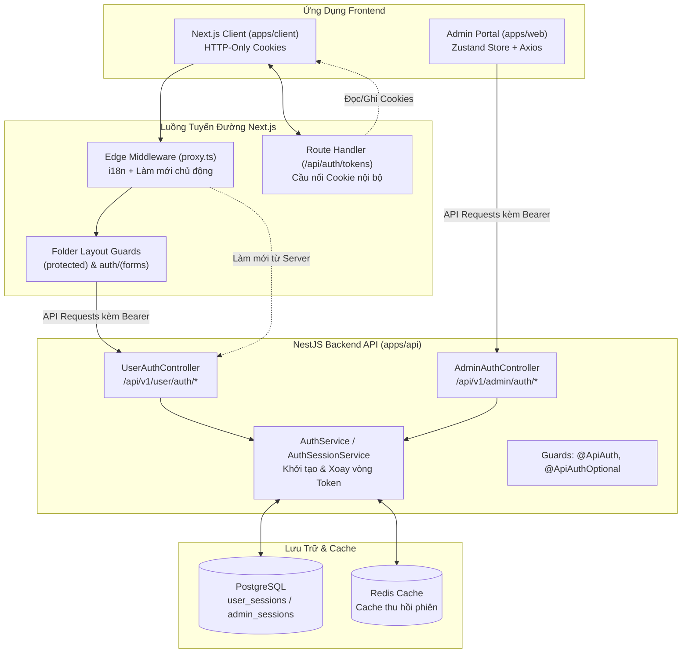
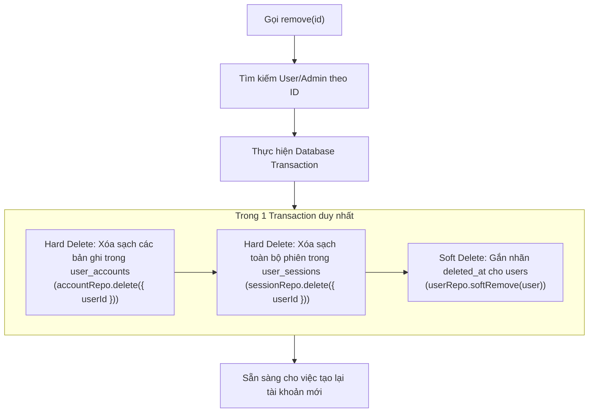

# Hướng Dẫn & Kiến Trúc Xác Thực (Authentication)

> [English](../en/AUTH.md) | **Tiếng Việt**
>
> **Kiến trúc quản lý vòng đời xác thực & phiên làm việc (Session Lifecycle) cấp doanh nghiệp** trên toàn bộ Monorepo (`apps/api`, `apps/client`, `apps/web`), nổi bật với cơ chế Xoay vòng Refresh Token (RTR), Kiểm soát đồng thời Single-Flight, Bảo vệ Route không dùng trick và Xử lý lỗi kiên cường (Resilient Error Handling).

---

## 1. Tổng Quan Kiến Trúc

Monorepo này triển khai kiến trúc xác thực phân tách lớp, bảo mật cao và tối ưu cho các ứng dụng fullstack hiện đại:

1. **Backend (`apps/api`)**: NestJS REST API lưu trữ phiên trong PostgreSQL, TypeORM, Redis cache và Passport JWT strategies hỗ trợ 2 nhóm đối tượng (`user` và `admin`).
2. **Web Client (`apps/client`)**: Ứng dụng Next.js App Router sử dụng HTTP-only cookie, Edge Middleware chủ động gia hạn token, Layout Guards dựa trên thư mục và Client Interceptor cơ chế Single-Flight.
3. **Admin Portal (`apps/web`)**: Ứng dụng SPA Vite + React quản lý trạng thái bằng Zustand kết hợp localStorage, ma trận phân quyền CASL và Axios Interceptor cơ chế Single-Flight.



---

## 2. Các Nguyên Tắc Kiến Trúc Cốt Lõi (Không Dùng Trick)

Kiến trúc xác thực tuân thủ nghiêm ngặt các tiêu chuẩn kỹ thuật phần mềm sạch:

1. **Không Dùng Tham Số Query Tạm Bợ**: Tuyệt đối không dùng các cờ như `?force=true` hoặc các header giả lập như `x-auth-force-login: 1` để can thiệp luồng điều hướng.
2. **Phân Định Trách Nhiệm Rõ Ràng**:
   - **Middleware (`proxy.ts`)**: Chỉ chịu trách nhiệm định tuyến đa ngôn ngữ (`next-intl`), chuyển tiếp header (`x-pathname`) và chủ động làm mới token sắp hết hạn. Middleware **không** nắm danh sách cứng các route riêng tư và **không** cưỡng chế chuyển hướng khách (guest redirect).
   - **Server Component Layouts**: Nhiệm vụ bảo vệ route nằm ở chính cấp layout tương ứng. `(protected)/layout.tsx` bảo vệ các trang riêng tư, trong khi `auth/(forms)/layout.tsx` xử lý chuyển hướng người dùng đã đăng nhập khi truy cập form đăng nhập/đăng ký.
3. **Kiểm Soát Đồng Thời Single-Flight (Promise Deduplication)**: Khi nhiều request bất đồng bộ đồng thời nhận mã lỗi `401 Unauthorized`, chúng sẽ được hợp nhất vào duy nhất 1 request làm mới token gửi lên backend. Điều này ngăn chặn triệt để xung đột Race Condition với cơ chế Xoay vòng Refresh Token (RTR).
4. **Xử Lý Mạng Kiên Cường (Resilient Network Handling)**: Phân định rạch ròi giữa lỗi xác thực thực sự (`401` / `400`) và lỗi hạ tầng mạng tạm thời (`500`, `502`, `503`, `ECONNREFUSED`, timeout). Người dùng **không bao giờ** bị xóa cookie hay bị đá văng khỏi phiên làm việc chỉ vì mạng chập chờn trong chốc lát.
5. **Đa Ngôn Ngữ Tuyệt Đối (i18n)**: Không hardcode bất kỳ chuỗi văn bản thông báo lỗi nào trên giao diện. Toàn bộ thông báo chuyển hướng, nút bấm, tiêu đề cảnh báo đều dùng translation keys từ `next-intl` (`apps/client`) và `react-i18next` (`apps/web`).

---

## 3. Lớp Backend API (`apps/api`)

### 3.1. Đặc Tả Token & Cơ Chế Xoay Vòng (RTR)

- **Access Token**: JWT thời hạn ngắn (mặc định 15 phút), được ký bằng secret riêng cho từng đối tượng (`auth.userSecret` / `auth.secret`).
- **Refresh Token**: JWT thời hạn dài (mặc định 7 ngày), liên kết trực tiếp với bản ghi phiên trong PostgreSQL (`UserSessionEntity` / `AdminSessionEntity`).
- **Refresh Token Rotation (RTR)**: Mỗi lần làm mới thành công, backend cấp 1 access token mới **đồng thời** tạo 1 refresh token mới và vô hiệu hóa hash của token cũ. Nếu phát hiện token cũ được gửi lại, hệ thống nhận diện đây là hành vi tái sử dụng trái phép và lập tức thu hồi toàn bộ phiên.

### 3.2. Guards Endpoint & Đăng Xuất An Toàn

- `@ApiPublic()`: Bỏ qua kiểm tra xác thực đối với các endpoint công khai (login, register, refresh).
- `@ApiAuth()`: Yêu cầu bắt buộc Access Token hợp lệ thông qua Passport JWT strategy.
- `@ApiAuthOptional({ statusCode: 204 })`: Guard xác thực tùy chọn áp dụng cho các endpoint **Logout** (`user-auth.controller.ts` & `admin-auth.controller.ts`).
  - Cho phép thu hồi phiên trong database và dọn sạch cookie ngay cả khi access token của client đã hết hạn từ trước.
  - Phản hồi mã `204 No Content` gọn gàng, không bắn lỗi `401 Unauthorized` unhandled khi người dùng bấm đăng xuất.

### 3.3. Hợp Đồng Kiểm Tra DTO

- **Refresh Request**:
  ```typescript
  export class RefreshReqDto {
    @TokenField()
    refreshToken!: string;
  }
  ```
  Cả hai phía frontend đều gửi payload `{ refreshToken: string }` khớp chuẩn với DTO này.

### 3.4. Phân Tách Danh Tính & Xác Thực (Identity vs Credentials Separation)

Kiến trúc xác thực trong backend tách bạch rõ ràng giữa hai khái niệm:

1. **Hồ sơ Danh tính (`users`, `admin_users`)**:
   - Chứa thông tin hồ sơ (họ tên, email, avatar, trạng thái kích hoạt, quan hệ đơn hàng, audit log...).
   - Đảm bảo tính toàn vẹn dữ liệu nghiệp vụ thông qua cơ chế **Soft Delete** (`deleted_at: Date | null`).
   - Sử dụng **Partial Unique Index** trên PostgreSQL:
     ```typescript
     @Index('UQ_user_email', { where: '"deleted_at" IS NULL', unique: true })
     email!: string;
     ```
     Điều này đảm bảo tính duy nhất của email giữa các tài khoản đang hoạt động, đồng thời cho phép tạo lại tài khoản với cùng email sau khi tài khoản cũ đã bị soft delete.

2. **Thông tin Xác thực & Nhà cung cấp (`user_accounts`, `admin_accounts`)**:
   - Chứa phương thức đăng nhập (`provider`: `LOCAL`, `GOOGLE`, `FACEBOOK`, `APPLE`...) và mật khẩu đã hash.
   - Định danh `providerAccountId`:
     - Với `LOCAL`: chính là email người dùng (`user@example.com`).
     - Với OAuth (`GOOGLE`,...): là định danh duy nhất từ nhà cung cấp bên thứ ba (`sub` ID số, ví dụ `"1093847291823"`).
   - Ràng buộc Unique: `@Index(['provider', 'providerAccountId'], { unique: true })` và `@Index(['userId', 'provider'], { unique: true })`.

3. **Phiên Đăng Nhập (`user_sessions`, `admin_sessions`)**:
   - Lưu trữ trạng thái phiên làm việc thực tế, Refresh Token hash, thông tin thiết bị (`userAgent`, `ipAddress`) và thời điểm hết hạn.

### 3.5. Vòng Đời Soft Delete & Tái Khởi Tạo Tài Khoản (Soft Delete & Recreation Lifecycle)

Khi một tài khoản người dùng hoặc quản trị viên bị xóa khỏi hệ thống:



1. **Khi Xóa (`remove(id)`)**:
   - **Hard Delete credentials & sessions**: Xóa vật lý toàn bộ bản ghi trong `*_accounts` và `*_sessions` thuộc về user đó. Điều này vừa bảo đảm an toàn bảo mật (thu hồi phiên tức thì, không lưu giữ hash mật khẩu cũ), vừa giải phóng Unique Constraint `(provider, providerAccountId)` trong database.
   - **Soft Delete hồ sơ**: Gắn thời điểm `deleted_at` cho `users`/`admin_users`, giữ toàn vẹn dữ liệu đơn hàng và lịch sử kiểm toán liên kết.
2. **Khi Tạo Lại Tài Khoản (`create` / `signUp`)**:
   - Bản ghi `users` mới được tạo với ID mới mà không bị lỗi trùng email (nhờ Partial Unique Index bỏ qua các bản ghi có `deleted_at IS NOT NULL`).
   - Lớp phòng vệ an toàn (defensive check) `accountRepo.delete({ provider: LOCAL, providerAccountId: email })` dọn sạch bản ghi local mồ côi (nếu có từ dữ liệu cũ) trước khi lưu credentials mới.
3. **Khi Đăng Nhập Xã Hội (Social Login / OAuth)**:
   - Trong `signInOrRegisterSocialUser`, nếu phát hiện bản ghi `user_accounts` từ phiên bản cũ trỏ tới một `userId` đã bị soft-delete, hệ thống tự động xóa bản ghi mồ côi này và cấp tài khoản mới trong sạch cho người dùng.

---

## 4. Lớp Next.js Web Client (`apps/client`)

### 4.1. Cookie & Cầu Nối Token Nội Bộ

Nhằm ngăn chặn lỗ hổng XSS, thông tin xác thực được lưu trong cookie với các thuộc tính `httpOnly`, `sameSite: "lax"` và `secure` trên domain client:

- `accessToken`
- `refreshToken`

Vì JavaScript trình duyệt không thể can thiệp trực tiếp vào `httpOnly` cookie, các BFF Route Handlers đóng vai trò cầu nối nội bộ an toàn tuyệt đối mà không để lộ refresh token ra trình duyệt:

- `GET /api/auth/tokens`: Chỉ trả về duy nhất `{ accessToken }` (Chuẩn Zero-Trust: `refreshToken` không bao giờ bị rò rỉ ra JavaScript trình duyệt).
- `POST /api/auth/tokens`: Thiết lập cookie ban đầu sau khi đăng nhập thành công hoặc hoàn tất OAuth callback.
- `POST /api/auth/refresh`: BFF Route Handler đọc `refreshToken` trực tiếp từ httpOnly cookie, gọi NestJS API làm mới token, xoay vòng cookie và trả về `{ accessToken }` mới.
- `POST /api/auth/logout`: Thu hồi session trên backend NestJS và xóa sạch 2 cookie khi đăng xuất.

### 4.2. Cơ Chế Làm Mới Single-Flight (`apps/client/src/lib/http.ts`)

Để tránh việc các request gửi đồng thời kích hoạt nhiều lệnh làm mới (làm hỏng cơ chế xoay vòng Refresh Token của server), `http.ts` áp dụng pattern **Single-Flight Promise Deduplication** kết nối trực tiếp với route BFF `/api/auth/refresh`:

```typescript
let refreshTokenPromise: Promise<string | null> | null = null;

export async function refreshClientToken(): Promise<string | null> {
  if (refreshTokenPromise) {
    return refreshTokenPromise;
  }

  refreshTokenPromise = (async () => {
    try {
      const res = await xior.post<{ accessToken?: string }>(
        `${process.env.NEXT_PUBLIC_APP_URL}/api/auth/refresh`,
        {},
        { credentials: "same-origin" },
      );

      const newAccessToken = res.data?.accessToken;
      if (!newAccessToken) return null;

      http.defaults.headers.Authorization = `Bearer ${newAccessToken}`;
      return newAccessToken;
    } catch {
      // Xử lý khi xác thực thất bại: logout và chuyển hướng đăng nhập
      return null;
    } finally {
      refreshTokenPromise = null;
    }
  })();

  return refreshTokenPromise;
}
```

- Khi 5 truy vấn đồng thời nhận lỗi `401`, chỉ duy nhất truy vấn đầu tiên kích hoạt `/api/auth/refresh`.
- 4 truy vấn còn lại cùng chờ kết quả từ `refreshTokenPromise`.
- JavaScript ở trình duyệt hoàn toàn không bao giờ chạm tới hoặc nhận chuỗi `refreshToken` thô.
- Không sử dụng cache biến toàn cục, không dùng event tùy ý trên window, không dùng phép so sánh thời gian cảm tính.

### 4.3. Edge Middleware (`apps/client/src/proxy.ts`)

Middleware của Next.js phụ trách:

1. Định tuyến quốc tế hóa qua `createMiddleware(routing)`.
2. Chuyển tiếp các header `x-pathname` và `x-middleware-*`.
3. Chủ động làm mới token trước khi hết hạn (khi thời gian còn lại `< 1 phút`).

#### Khả Năng Chịu Lỗi (Error Resilience):

- Khi làm mới token trả về `401` hoặc `400` (phiên thực sự hết hạn/không hợp lệ):
  - Xóa cookie `accessToken` và `refreshToken`.
  - Nếu người dùng đang ở trang công khai (`/`) hoặc trang auth (`/auth/login`), không điều hướng cưỡng chế; trang tiếp tục hiển thị bình thường ở trạng thái Khách (Guest).
  - Nếu người dùng đang ở route được bảo vệ, chuyển hướng về `/${locale}/auth/login?code=session_expired&from=${pathname}`.
- Khi gặp sự cố mạng API (backend dừng, timeout, 502/503):
  - Cookie **không** bị xóa, đảm bảo phiên đăng nhập của người dùng không bị mất oan vì trục trặc hạ tầng tạm thời.

### 4.4. Cấu Trúc Bảo Vệ Tuyến Đường (Route Protection Hierarchy)

| Nhóm Tuyến Đường            | Component Phụ Trách | Hành Vi                                                                                                                                                            |
| :-------------------------- | :------------------ | :----------------------------------------------------------------------------------------------------------------------------------------------------------------- |
| `[locale]/(protected)/*`    | `ProtectedLayout`   | Nếu không có phiên hợp lệ, chuyển hướng về `/${locale}/auth/login?code=unauthorized&from=${pathname}`.                                                             |
| `[locale]/auth/(forms)/*`   | `AuthLayout`        | Guest guard. Nếu có `refreshToken` và chưa hết hạn (`exp * 1000 > Date.now()`), chuyển hướng vào `/${locale}/profile`. Ngược lại, hiển thị form đăng nhập sạch sẽ. |
| `[locale]/(public)/*` & `/` | Công khai           | Cho phép mọi người dùng truy cập tự do.                                                                                                                            |

### 4.5. Mã Trạng Thái Chuẩn Hóa (`AUTH_CODE`)

Khai báo tại `apps/client/src/constants/auth.ts`:

- `session_expired`: Phiên làm việc hết hạn hoặc refresh token không còn hợp lệ.
- `unauthorized`: Yêu cầu đăng nhập để truy cập trang được bảo vệ.
- `invalid_token`: Token bị hỏng hoặc payload JWT không hợp lệ.

Form đăng nhập đón nhận các mã này và hiển thị banner cảnh báo thông qua các bản dịch tương ứng (`useTranslations("Auth.login")`).

---

## 5. Lớp Admin Portal (`apps/web`)

### 5.1. Quản Lý Phiên Làm Việc

- Xây dựng trên **Zustand** (`useAuthStore`) kết hợp lưu trữ lâu dài trong localStorage cho `meta.accessToken` và `meta.refreshToken`.
- Request Interceptor tự động gán header `Authorization: Bearer ${accessToken}` đồng bộ từ store.

### 5.2. Làm Mới Token Single-Flight (`apps/web/src/lib/http.ts`)

- Triển khai `refreshAdminToken()` sử dụng chung biến `refreshTokenPromise`.
- Khi gặp lỗi `401`, các request được xếp hàng chờ trong khi tiến trình xoay vòng token diễn ra.
- Sau khi hoàn thành, các request bị hoãn sẽ tự động retry với Bearer token mới.

### 5.3. Xử Lý Khi Mất Kết Nối Server (`ServerOffline`)

- Khi mất kết nối API trong giai đoạn tải quyền hạn, `ProtectedRoutes` sẽ hiển thị màn hình `<ServerOffline />` (tại `pages/errors/server-offline.tsx`).
- Cung cấp 2 lựa chọn: **Thử Lại** (gọi `refetch()`) và **Đăng Xuất** (xóa session và về `/sign-in`).
- Tuân thủ 100% tiêu chuẩn đa ngôn ngữ `react-i18next`.

### 5.4. Permission & Role Matrix Core (`pages/roles/`)

- **Domain Helpers (`permission-matrix.helper.ts`)**:
  - `parsePermissionKey(key)`: Phân tích cú pháp chuỗi quyền `action:subject`.
  - `getPermissionAction(key)`: Trích xuất action verb theo chuẩn CASL.
  - `formatSubjectLabel(subject)`: Format định dạng Title Case (ví dụ `admin_user` -> `Admin User`).
  - `isSuperAdminPermissions(permissions)`: Nhận diện quyền quản trị toàn hệ thống (`manage:all`).
  - `groupPermissions(permissions)`: Nhóm danh sách quyền theo functional domain hoặc subject.
  - `validateAssignablePermissionIds(selected, assignable)`: Xác thực payload khi submit form phân quyền.
- **Matrix Hook (`use-permission-matrix.ts`)**:
  - Đóng gói toàn bộ logic tìm kiếm, nhóm quyền, toggle theo nhóm/từng quyền, trạng thái `indeterminate` checkbox và auto-cleaning unassignable IDs.
  - Sử dụng trong `RolePermissionsField` (rút gọn từ 320 xuống ~170 dòng) và `PageRoleShow`.

---

## 6. Cơ Chế Khôi Phục Tài Khoản (Account Restoration Architecture)

Hệ thống triển khai kiến trúc khôi phục tài khoản hai cấp độ (Admin Portal & Client Self-Service) tuân thủ nghiêm ngặt nguyên tắc **Zero-Trust Security** và toàn vẹn dữ liệu:

### 6.1. Nguyên Lý Lưu Trữ & Xóa Mềm (Soft Delete)

- **Partial Unique Index**: Bảng `users` và `admin_users` sử dụng partial index PostgreSQL `@Index('UQ_user_email', { where: '"deleted_at" IS NULL', unique: true })`.
- **Khi xóa tài khoản**: Hệ thống thực hiện `softRemove` trên entity người dùng (`deleted_at` được gán timestamp), đồng thời dọn sạch thông tin xác thực (`user_accounts` / `admin_accounts`) và thu hồi toàn bộ phiên hoạt động (`sessions`). Nhờ đó, email được giải phóng ngay lập tức khỏi unique constraint và ngăn chặn hoàn toàn việc sử dụng mật khẩu cũ.

### 6.2. Cấp Độ 1: Quản Trị Viên Khôi Phục Trong Admin Portal (`apps/web`)

- **Hiển thị Tập Trung trong 1 Bảng (Single Table & Toolbar Filter)**: Danh sách Admins (`/admins`) và Users (`/users`) hiển thị cả tài khoản đang hoạt động lẫn tài khoản đã xóa trong một bảng duy nhất (API listing tự động truy vấn `withDeleted()`). Người dùng có thể lọc nhanh theo cột **Trạng thái** (`Đang hoạt động` / `Đã xóa`) ngay trên thanh công cụ lọc `DataTableToolbar` thông qua query param `status=active|deleted`.
- **Hành động Khôi phục**: Khi dòng ở trạng thái đã xóa, hiển thị nút Restore (hộp thoại xác nhận) gọi API:
  - `POST /api/v1/admin-users/:id/restore` (yêu cầu quyền `Update:Admin`)
  - `POST /api/v1/users/:id/restore` (yêu cầu quyền `Update:User`)
- **Kiểm soát Xung đột**: Backend kiểm tra nghiêm ngặt không có tài khoản active nào khác đang chiếm giữ email trước khi gỡ cờ `deleted_at`, đồng thời gửi email kích hoạt/cấp lại mật khẩu tới chủ sở hữu.

### 6.3. Cấp Độ 2: Người Dùng Tự Khôi Phục (Self-Service trên `apps/client`)

- **Phát hiện khi Đăng nhập**: Khi người dùng nhập email của tài khoản đã bị xóa mềm, `UserAuthService.signIn` phát hiện và trả về mã lỗi đặc biệt `ACCOUNT_DELETED` kèm cờ `canRestore: true`.
- **Yêu cầu Khôi phục**: Giao diện đăng nhập `login-form.tsx` hiển thị Alert thông báo và nút **Khôi phục tài khoản**. Bấm nút sẽ gọi `POST /api/v1/user/auth/restore-request` để tạo mã bảo mật có hạn và gửi email HTML (`user-email-restore.hbs`).
- **Đặt Mật khẩu Mới & Kích hoạt lại**: Người dùng click link trong email dẫn đến trang `apps/client/src/app/[locale]/auth/(forms)/restore/` (`/auth/restore?token=...`). Sau khi nhập mật khẩu mới hợp lệ, request `POST /api/v1/user/auth/restore` sẽ:
  1. Xác thực và tiêu thụ token an toàn từ Redis cache.
  2. Khôi phục `deleted_at = null`.
  3. Mã hóa và lưu mật khẩu mới vào `user_accounts`.
  4. Thu hồi mọi phiên làm việc cũ và chuyển hướng về trang đăng nhập với thông báo thành công.

---

## 7. Lệnh Kiểm Thử & Kiểm Tra Sức Khỏe Toàn Bộ Ứng Dụng

Chạy từ thư mục gốc của repository:

```bash
# Kiểm tra kiểu TypeScript
pnpm --filter api check-types
pnpm --filter client check-types
pnpm --filter web check-types

# Kiểm thử đơn vị & Tích hợp
pnpm --filter api test
pnpm --filter client test
pnpm --filter web test

# Build production
pnpm --filter api build
pnpm --filter client build
pnpm --filter web build
```
