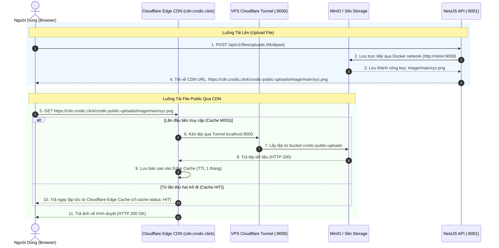

# Hướng Dẫn Triển Khai Production Toàn Diện (VPS & Docker Compose)

> [English](../en/DEPLOYMENT.md) | **Tiếng Việt**

Tài liệu này hướng dẫn chi tiết từng bước triển khai toàn bộ hệ thống Monorepo lên máy chủ VPS Ubuntu theo kiến trúc chuẩn sản xuất bằng **Docker Compose** ([`docker-compose.prod.yml`](../../docker-compose.prod.yml)), tự động hóa CI/CD bằng **GitHub Actions Self-Hosted Runner**, và định tuyến tên miền qua **Cloudflare Tunnel (Zero Trust)** hoặc **Nginx Reverse Proxy**.

---

## Mục Lục

1. [Kiến Trúc Triển Khai & Sơ Đồ Hạ Tầng](#1-kiến-trúc-triển-khai--sơ-đồ-hạ-tầng)
2. [Bước 1: Chuẩn Bị VPS, Tạo Swap & Cài Đặt Docker](#bước-1-chuẩn-bị-vps-tạo-swap--cài-đặt-docker)
3. [Bước 2: Cài Đặt GitHub Actions Self-Hosted Runner Trên VPS](#bước-2-cài-đặt-github-actions-self-hosted-runner-trên-vps)
4. [Bước 3: Clone Mã Nguồn & Cấu Hình 4 File `.env`](#bước-3-clone-mã-nguồn--cấu-hình-4-file-env)
5. [Bước 4: Cấu Hình Tên Miền & Routing (Cloudflare Tunnel / Nginx)](#bước-4-cấu-hình-tên-miền--routing-cloudflare-tunnel--nginx)
6. [Bước 5: Triển Khai Lần Đầu & Khởi Tạo Cơ Sở Dữ Liệu](#bước-5-triển-khai-lần-đầu--khởi-tạo-cơ-sở-dữ-liệu)
7. [Bước 6: Quy Trình CI/CD Tự Động Hóa (GitHub Actions)](#bước-6-quy-trình-cicd-tự-động-hóa-github-actions)
8. [Bước 7: Vận Hành, Quản Trị Hàng Ngày & Sao Lưu](#bước-7-vận-hành-quản-trị-hàng-ngày--sao-lưu)
9. [Xử Lý Sự Cố Thường Gặp (Troubleshooting)](#xử-lý-sự-cố-thường-gặp-troubleshooting)

---

## 1. Kiến Trúc Triển Khai & Sơ Đồ Hạ Tầng

### 1.1. Sơ Đồ Mạng & Điều Phối Dịch Vụ

Dự án hỗ trợ 2 phương án đưa dịch vụ ra Internet:

- **Phương án 1 (Khuyến nghị - Đang áp dụng)**: **Cloudflare Tunnel (Zero Trust)**. Toàn bộ lưu lượng đi qua tunnel mã hóa, **không cần mở bất kỳ cổng nào** trên tường lửa VPS, chống DDoS và ẩn IP gốc 100%.
- **Phương án 2**: **Nginx Reverse Proxy (Host) + Certbot SSL** truyền thống.

```
                          [ Internet: Người Dùng & Quản Trị Viên ]
                                             │
                   ┌─────────────────────────┴─────────────────────────┐
                   ▼ (Phương án 1: Zero Trust)                         ▼ (Phương án 2: Direct)
        ┌─────────────────────────┐                         ┌─────────────────────────┐
        │ Cloudflare Edge Network │                         │ Nginx Reverse Proxy     │
        │ (*.crodic.click)        │                         │ Ports 80 / 443 (SSL)    │
        └────────────┬────────────┘                         └────────────┬────────────┘
                     │                                                   │
                     ▼ (Outbound Tunnel: network_mode: host)             │
        ┌─────────────────────────┐                                      │
        │  crodic_tunnel          │                                      │
        │  (cloudflare/cloudflared)                                      │
        └────────────┬────────────┘                                      │
                     │                                                   │
  ───────────────────┴───────────────────────────────────────────────────┴───────────────────
  MÁY CHỦ HOST (VPS Ubuntu):
        ┌────────────────────────────────┬────────────────────────────────┐
        │ api.crodic.click               │ crodic.click                   │ admin.crodic.click
        ▼ (:8001 -> container :8000)     ▼ (:3000 -> container :3000)     ▼ (:8080 -> container :80)
 ┌──────────────┐                 ┌──────────────┐                 ┌──────────────┐
 │  crodic_api  │                 │crodic_client │                 │  crodic_web  │
 │  NestJS 11   │                 │  Next.js 16  │                 │ Nginx + Vite │
 └──────┬───┬───┘                 └──────┬───────┘                 └──────────────┘
        │   │                            │ (SSR internal fetch http://api:8000)
        │   └──────────────┬─────────────┘
        ▼                  ▼                                ┌─────────────────────────┐
 ┌──────────────┐   ┌──────────────┐                        │    crodic_minio_init    │
 │  PostgreSQL  │   │    Redis     │                        │    (pgsty/mc bucket)    │
 │  :5432       │   │    :6379     │                        └────────────┬────────────┘
 └──────────────┘   └──────────────┘                                     ▼
        ▲                  ▲                                ┌─────────────────────────┐
        │                  │                                │      crodic_minio       │
        └──────────────────┴────────────────────────────────┤   (pgsty/silo S3 API)   │
                                                            │       :9000/:9001       │
                                                            └─────────────────────────┘
 (Các dịch vụ dữ liệu cô lập trong mạng Docker app-network & bind 127.0.0.1 trên Host)
```

### 1.2. Danh Mục Cổng (Port Mapping)

| Dịch Vụ               | Container Name    | Cổng Host (VPS)           | Cổng Container  | Ghi Chú                                                                                     |
| :-------------------- | :---------------- | :------------------------ | :-------------- | :------------------------------------------------------------------------------------------ |
| **Backend API**       | `crodic_api`      | `8001`                    | `8000`          | Tránh xung đột cổng 8000 mặc định trên VPS                                                  |
| **Admin Portal**      | `crodic_web`      | `8080`                    | `80`            | Phục vụ SPA qua Nginx nội bộ container                                                      |
| **Client Web**        | `crodic_client`   | `3000`                    | `3000`          | Next.js Server-Side Rendering (Standalone)                                                  |
| **PostgreSQL 16**     | `crodic_postgres` | `127.0.0.1:5432`          | `5432`          | Chỉ bind localhost, lưu volume `postgres_data`                                              |
| **Redis 7**           | `crodic_redis`    | `127.0.0.1:6379`          | `6379`          | Hàng đợi BullMQ & Cache, có mật khẩu                                                        |
| **S3 Storage (Silo)** | `crodic_minio`    | `127.0.0.1:9000` / `9001` | `9000` / `9001` | Dùng image `pgsty/silo` siêu nhẹ thay thế MinIO. Cổng 9000 kết nối CDN (`cdn.crodic.click`) |
| **Cloudflare Tunnel** | `crodic_tunnel`   | `network_mode: host`      | -               | Chạy ngầm kết nối ra Cloudflare Edge                                                        |

### 1.3. Cấu Hình VPS Khuyến Nghị

| Tiêu Chí         | Cấu Hình Tối Thiểu                    | Khuyến Nghị Sản Xuất    |
| :--------------- | :------------------------------------ | :---------------------- |
| **Hệ Điều Hành** | Ubuntu 22.04 LTS / 24.04 LTS x86_64   | Ubuntu 24.04 LTS x86_64 |
| **CPU**          | 2 vCPU                                | 4 vCPU                  |
| **RAM**          | 4 GB (**bắt buộc có 4GB - 8GB Swap**) | 8 GB (+ 4GB Swap)       |
| **Ổ Cứng**       | 40 GB NVMe SSD                        | 80+ GB NVMe SSD         |

---

## Bước 1: Chuẩn Bị VPS, Tạo Swap & Cài Đặt Docker

Kết nối SSH vào máy chủ VPS với quyền `root` hoặc user có quyền `sudo`:

```bash
ssh root@<IP_VPS_CUA_BAN>
```

### 1.1. Cập nhật hệ thống & cài công cụ nền tảng

```bash
apt update && apt upgrade -y
apt install -y curl wget git ufw htop ca-certificates gnupg
```

### 1.2. Tạo 4GB - 8GB Swapfile (Bắt buộc)

> [!IMPORTANT]
> Quá trình biên dịch TypeScript và tối ưu bundle của Next.js (`apps/client`) và Vite (`apps/web`) ngốn nhiều RAM trong thời gian ngắn. Nếu không có Swap, tiến trình biên dịch sẽ bị kernel Linux tắt đột ngột với mã lỗi `Exit code 137 (OOM Killed)`.

```bash
# Tạo file swap 4GB (hoặc 8G nếu RAM VPS là 4GB)
fallocate -l 4G /swapfile || dd if=/dev/zero of=/swapfile bs=1M count=4096
chmod 600 /swapfile
mkswap /swapfile
swapon /swapfile

# Thiết lập tự động mount khi khởi động lại VPS
echo '/swapfile none swap sw 0 0' | tee -a /etc/fstab

# Tối ưu hóa tần suất sử dụng swap
sysctl vm.swappiness=10
echo 'vm.swappiness=10' | tee -a /etc/sysctl.conf

# Kiểm tra dung lượng RAM & Swap
free -h
```

### 1.3. Cài đặt Docker Engine & Docker Compose Plugin chính thức

```bash
curl -fsSL https://get.docker.com | sh
systemctl enable --now docker

# Kiểm tra phiên bản (Yêu cầu Docker 26+ và Docker Compose v2.20+)
docker --version
docker compose version
```

### 1.4. Thiết lập thư mục triển khai chuẩn

Thư mục mặc định được thống nhất sử dụng xuyên suốt hệ thống và trong CI/CD là `/var/www/crodic-framework`:

```bash
mkdir -p /var/www/crodic-framework
```

---

## Bước 2: Cài Đặt GitHub Actions Self-Hosted Runner Trên VPS

Thay vì dùng SSH action tiềm ẩn nguy cơ bảo mật khóa private key và phụ thuộc mở port 22 ra ngoài, dự án sử dụng **GitHub Actions Self-Hosted Runner** chạy trực tiếp trên máy chủ. Runner lắng nghe lệnh từ GitHub qua cổng HTTPS outbound (không cần mở inbound port).

### 2.1. Lấy Token Runner từ GitHub Repository

1. Mở Repository trên GitHub bằng trình duyệt.
2. Điều hướng tới **Settings > Actions > Runners > New self-hosted runner**.
3. Chọn hệ điều hành: **Linux**, Kiến trúc: **x64**.
4. GitHub sẽ hiển thị chuỗi lệnh tải runner và mã `<TOKEN>` một lần.

### 2.2. Cài đặt và đăng ký Runner trên VPS

Thực hiện cài đặt runner trong thư mục riêng:

```bash
# Tạo thư mục runner
mkdir -p /opt/actions-runner && cd /opt/actions-runner

# Tải gói runner mới nhất (ví dụ bản 2.322.0)
curl -o actions-runner-linux-x64-2.322.0.tar.gz -L https://github.com/actions/runner/releases/download/v2.322.0/actions-runner-linux-x64-2.322.0.tar.gz
tar xzf ./actions-runner-linux-x64-2.322.0.tar.gz

# Cấu hình runner kết nối với repository của bạn
# (Thay <ORG>/<REPO> và <TOKEN> bằng giá trị trên GitHub hiển thị)
./config.sh --url https://github.com/<ORG>/<REPO> --token <TOKEN> --name vps-production-runner --work /var/www/crodic-framework --unattended --replace
```

### 2.3. Cài Runner thành Systemd Daemon Service

Để đảm bảo Runner luôn tự khởi động cùng máy chủ và phục hồi nếu tiến trình dừng:

```bash
cd /opt/actions-runner
sudo ./svc.sh install
sudo ./svc.sh start
sudo ./svc.sh status
```

Kiểm tra tại GitHub: **Settings > Actions > Runners**, bạn sẽ thấy `vps-production-runner` có trạng thái xanh **Idle** (Sẵn sàng).

---

## Bước 3: Clone Mã Nguồn & Cấu Hình 4 File `.env`

### 3.1. Clone mã nguồn về thư mục `/var/www/crodic-framework`

```bash
cd /var/www/crodic-framework
git clone https://github.com/<ORG>/<REPO>.git .
git checkout main
```

### 3.2. Khởi tạo 4 file `.env` từ file mẫu

```bash
cp .env.example .env
cp apps/api/.env.example apps/api/.env
cp apps/web/.env.example apps/web/.env
cp apps/client/.env.example apps/client/.env
```

### 3.3. Cấu hình chi tiết từng file `.env`

#### 1. File `.env` gốc (Hạ tầng, Port máy chủ & Cloudflare Token)

Mở file `.env`:

```env
# Port máy chủ VPS ánh xạ ra ngoài
API_PORT=8001
WEB_PORT=8080
CLIENT_PORT=3000

# Cơ sở dữ liệu PostgreSQL (nội bộ Docker)
POSTGRES_HOST=postgres
POSTGRES_USER=postgres
POSTGRES_PASSWORD=MatKhauDatabaseBaoMat123!
POSTGRES_DB=monorepo
POSTGRES_PORT=5432

# Redis Cache & BullMQ Queue
REDIS_HOST=redis
REDIS_PASSWORD=MatKhauRedisBaoMat123!
REDIS_PORT=6379

# S3 Storage (pgsty/silo)
MINIO_HOST=minio
MINIO_PORT=9000
MINIO_CONSOLE_PORT=9001
AWS_ACCESS_KEY_ID=crodic_5ce135e51e0b5f4e
AWS_SECRET_ACCESS_KEY=36605c11bdd76bd03c0f64f04a80a448ed17dd7b9862db7a
AWS_DEFAULT_S3_BUCKET=crodic-public-uploads
AWS_PRIVATE_BUCKET=crodic-private-uploads

# Token Cloudflare Tunnel (Lấy từ Cloudflare Zero Trust Dashboard)
CLOUDFLARE_TUNNEL_TOKEN=eyJhIjoi...
```

#### 2. File `apps/api/.env` (Backend NestJS)

```env
NODE_ENV=production
APP_PORT=8000
APP_URL=https://api.crodic.click
APP_DEBUG=false
APP_CORS_ORIGIN=https://crodic.click,https://www.crodic.click,https://admin.crodic.click

# Kết nối database container qua mạng app-network
DATABASE_HOST=postgres
DATABASE_PORT=5432
DATABASE_USERNAME=postgres
DATABASE_PASSWORD=MatKhauDatabaseBaoMat123!
DATABASE_NAME=monorepo
DATABASE_SYNCHRONIZE=false

# Redis
REDIS_HOST=redis
REDIS_PORT=6379
REDIS_PASSWORD=MatKhauRedisBaoMat123!

# Storage S3 & Cloudflare CDN
FILESYSTEM_DISK=s3
STORAGE_PUBLIC_DISK=s3
STORAGE_PRIVATE_DISK=local
AWS_ACCESS_KEY_ID=crodic_5ce135e51e0b5f4e
AWS_SECRET_ACCESS_KEY=36605c11bdd76bd03c0f64f04a80a448ed17dd7b9862db7a
AWS_REGION=us-east-1
AWS_BUCKET=crodic-public-uploads
AWS_PRIVATE_BUCKET=crodic-private-uploads
AWS_ENDPOINT=http://minio:9000
AWS_URL=https://cdn.crodic.click/crodic-public-uploads
AWS_USE_PATH_STYLE_ENDPOINT=true

# Điều hướng liên kết xác thực (Email, Reset Password, 2FA)
AUTH_PORTAL_URL=https://admin.crodic.click
AUTH_PORTAL_RESET_PASSWORD_URL=https://admin.crodic.click/reset-password
USER_AUTH_CLIENT_URL=https://crodic.click
USER_AUTH_CLIENT_RESET_PASSWORD_URL=https://crodic.click/auth/reset-password

# JWT Secrets (Bắt buộc tạo chuỗi ngẫu nhiên tối thiểu 32 ký tự)
AUTH_JWT_SECRET=chuoi-ngau-nhien-bao-mat-admin-jwt-secret-32-chars
USER_AUTH_JWT_SECRET=chuoi-ngau-nhien-bao-mat-client-jwt-secret-32-chars
```

> [!TIP]
> Bạn có thể sinh chuỗi bí mật ngẫu nhiên bảo mật cao bằng lệnh:
> `openssl rand -base64 32`

#### 3. File `apps/web/.env` (Admin Portal - Vite + React)

```env
PORT=5173
VITE_API_URL=https://api.crodic.click/api/v1
VITE_APP_NAME="Crodic Framework"
VITE_AUTH_KEY="${VITE_APP_NAME}_AUTH_KEY"
VITE_CLIENT_URL=https://crodic.click
VITE_SENTRY_ENVIRONMENT=production
```

#### 4. File `apps/client/.env` (Client Website - Next.js)

```env
PORT=3000
NEXT_PUBLIC_APP_URL=https://crodic.click
NEXT_PUBLIC_API_URL=https://api.crodic.click
NEXT_PUBLIC_ADMIN_PORTAL_URL=https://admin.crodic.click

# SSR server-to-server fetch qua mạng nội bộ Docker
SERVER_API_URL=http://api:8000

TOKEN_EXPIRY_MINUTES_REMAINING=1m
APP_NAME=Crodic
NEXT_PUBLIC_ENABLE_WHITE_LABEL=true
NEXT_PUBLIC_USE_CASE=as-needed
NEXT_PUBLIC_APP_LOCALE=en
NEXT_PUBLIC_FALLBACK_LOCALE=en
NEXT_PUBLIC_ALLOWED_LOCALE=en,vi
SENTRY_ENVIROMENT=production
```

---

## Bước 4: Cấu Hình Tên Miền & Routing (Cloudflare Tunnel / Nginx)

### Phương Án A: Cloudflare Tunnel (Khuyến Nghị - Đang Áp Dụng)

Với Cloudflare Tunnel, bạn không cần mở cổng 80, 443 hay 8001 trên tường lửa của VPS. Toàn bộ lưu lượng được bảo vệ bởi mạng toàn cầu của Cloudflare.

1. Đăng nhập vào [Cloudflare Zero Trust Dashboard](https://one.dash.cloudflare.com/).
2. Vào **Networks > Tunnels > Create a tunnel > Chọn Cloudflared**.
3. Đặt tên tunnel (ví dụ: `crodic-vps-tunnel`) và sao chép chuỗi mã Token trong câu lệnh cài đặt.
4. Gán token vào biến `CLOUDFLARE_TUNNEL_TOKEN` trong file `.env` ở thư mục gốc.
5. Tại tab **Public Hostname**, thêm 4 quy tắc điều hướng:

| Public Hostname      | Service Type | URL Đích Trên Host | Chức Năng                            |
| :------------------- | :----------- | :----------------- | :----------------------------------- |
| `crodic.click`       | `HTTP`       | `localhost:3000`   | Client Web (Next.js SSR)             |
| `admin.crodic.click` | `HTTP`       | `localhost:8080`   | Admin Portal (Vite React SPA)        |
| `api.crodic.click`   | `HTTP`       | `localhost:8001`   | Backend API (NestJS)                 |
| `cdn.crodic.click`   | `HTTP`       | `localhost:9000`   | S3 Object Storage CDN (MinIO / Silo) |

Container `crodic_tunnel` chạy với cờ `network_mode: host` trong [`docker-compose.prod.yml`](../../docker-compose.prod.yml) sẽ tự động đồng bộ và định tuyến lưu lượng vào các port nội bộ tương ứng.

---

### 4.2. Hướng Dẫn Cấu Hình Cloudflare CDN Caching Cho MinIO Storage

Hệ thống lưu trữ ảnh và tài liệu của Crodic Framework sử dụng mô hình kết hợp **Self-Hosted MinIO/Silo** và **Cloudflare Global CDN** thông qua Cloudflare Tunnel. Mô hình này mang lại 3 ưu điểm vượt trội:

- **Tốc độ tải siêu tốc**: Tệp tin tĩnh (ảnh, avatar, tài liệu) được lưu đệm (cache) tại hàng trăm cụm máy chủ Cloudflare Edge gần người dùng nhất (`cf-cache-status: HIT`).
- **Tiết kiệm 99% tài nguyên VPS**: VPS không phải tốn CPU hay băng thông đường truyền để phục vụ lượt xem ảnh lặp đi lặp lại.
- **Bảo mật tuyệt đối**: Port lưu trữ 9000 chỉ bind trên `127.0.0.1` của VPS, không mở cổng nào ra ngoài Internet. Toàn bộ lượt truy cập đều được kiểm soát và định tuyến an toàn qua Cloudflare Tunnel.



#### Bước 1: Thêm Public Hostname Trong Cloudflare Tunnel

1. Truy cập [Cloudflare Zero Trust Dashboard](https://one.dash.cloudflare.com/) > **Networks** > **Tunnels**.
2. Chọn tunnel của bạn (ví dụ `crodic-vps-tunnel`) > **Configure** > tab **Public Hostname**.
3. Bấm **Add a public hostname** và điền:
   - **Subdomain**: `cdn`
   - **Domain**: `crodic.click` (chọn domain của bạn)
   - **Path**: Để trống
   - **Service**: Chọn `HTTP`
   - **URL**: `localhost:9000`
4. Bấm **Save hostname**. Bây giờ `https://cdn.crodic.click` đã kết nối an toàn tới MinIO S3 API trên VPS.

#### Bước 2: Thiết Lập Cache Rule Trên Cloudflare Dashboard

Mặc định Cloudflare không lưu cache các response trả về từ S3 API. Ta cần tạo một Cache Rule để Cloudflare Edge chủ động lưu đệm mọi tệp tĩnh trên domain CDN:

1. Đăng nhập [Cloudflare Dashboard](https://dash.cloudflare.com/) thông thường.
2. Chọn tên miền (ví dụ `crodic.click`) > Mục **Caching** trên thanh menu bên trái > **Cache Rules**.
3. Bấm **Create rule** và điền thông số:
   - **Rule name**: `Cache MinIO S3 CDN Assets`
   - **When incoming requests match (Quy tắc lọc tùy chỉnh)**:
     - Field: `Hostname`
     - Operator: `equals`
     - Value: `cdn.crodic.click`
       _(Biểu thức xem trước: `http.host eq "cdn.crodic.click"`)_
   - **Cache eligibility**: Chọn **Eligible for cache** (Cho phép lưu cache)
   - **Edge TTL**: Chọn **Override origin** > Chọn khoảng thời gian: `1 month` (1 tháng) hoặc tùy chọn của bạn
   - **Browser TTL**: Chọn `Respect origin` hoặc `Override origin` (`1 month`)
4. Bấm **Deploy** để quy tắc có hiệu lực toàn cầu.

#### Bước 3: Tạo & Phân Quyền Bucket Trên MinIO

Hệ thống phân biệt rõ ràng giữa 2 loại dữ liệu:

| Loại Bucket            | Tên Bucket Mẫu           | Quyền Truy Cập                   | Mục Đích Sử Dụng                                                 | Cơ Chế Phục Vụ                                                     |
| :--------------------- | :----------------------- | :------------------------------- | :--------------------------------------------------------------- | :----------------------------------------------------------------- |
| **Công khai (Public)** | `crodic-public-uploads`  | Anonymous Download (`download`)  | Avatar, banner, logo, hình ảnh bài viết, file đính kèm công khai | Trực tiếp qua CDN Cloudflare (`cf-cache-status: HIT`)              |
| **Riêng tư (Private)** | `crodic-private-uploads` | Chặn ẩn danh hoàn toàn (Private) | Hóa đơn, CMND/CCCD, tài liệu hợp đồng, file nội bộ nhạy cảm      | Tạo Presigned URL có thời hạn (`temporaryUrl`) hoặc route xác thực |

Khi triển khai lần đầu, container `crodic_minio_init` sẽ tự động khởi tạo 2 bucket này theo biến môi trường trong file `.env`. Nếu cần tạo hoặc kiểm tra lại bằng tay trên VPS, thực hiện lệnh sau:

```bash
docker run --rm --network crodic-framework_app-network --entrypoint /bin/sh pgsty/mc:latest -c '
  mc alias set myminio http://minio:9000 <AWS_ACCESS_KEY_ID> <AWS_SECRET_ACCESS_KEY>
  mc mb --ignore-existing myminio/crodic-public-uploads
  mc anonymous set download myminio/crodic-public-uploads
  mc mb --ignore-existing myminio/crodic-private-uploads
  mc ls myminio
'
```

#### Bước 4: Cấu Hình Biến Môi Trường `apps/api/.env`

Đảm bảo backend NestJS trỏ đúng cấu hình S3 CDN:

```env
# Kích hoạt lưu trữ S3 cho các file public
FILESYSTEM_DISK=s3
STORAGE_PUBLIC_DISK=s3
STORAGE_PRIVATE_DISK=local # hoặc s3-private nếu muốn lưu file mật lên bucket private S3

# Thông tin tài khoản MinIO / Silo
AWS_ACCESS_KEY_ID=crodic_5ce135e51e0b5f4e
AWS_SECRET_ACCESS_KEY=36605c11bdd76bd03c0f64f04a80a448ed17dd7b9862db7a
AWS_REGION=us-east-1
AWS_BUCKET=crodic-public-uploads
AWS_PRIVATE_BUCKET=crodic-private-uploads

# Kết nối nội bộ khi upload
AWS_ENDPOINT=http://minio:9000
AWS_USE_PATH_STYLE_ENDPOINT=true

# Domain CDN công khai trả về cho trình duyệt
AWS_URL=https://cdn.crodic.click/crodic-public-uploads
```

> [!IMPORTANT]
>
> - `AWS_ENDPOINT=http://minio:9000`: Dùng hostname nội bộ Docker `minio` để upload trực tiếp trong container network tốc độ cao, không đi vòng ra ngoài Internet.
> - `AWS_URL`: Tiền tố CDN công khai sẽ được nối vào tên file khi API trả link cho Web / Mobile (ví dụ: `${AWS_URL}/image/main/xyz.png`).
> - `AWS_USE_PATH_STYLE_ENDPOINT=true`: Bắt buộc với MinIO / Silo vì định dạng URL là `hostname/bucket/key` thay vì `bucket.hostname/key`.

#### Bước 5: Kiểm Tra & Nghiệm Thu CDN

Sau khi upload một file ảnh từ trang quản trị hoặc ứng dụng client, mở Terminal và kiểm tra header phản hồi:

```bash
curl -I https://cdn.crodic.click/crodic-public-uploads/image/main/example.png
```

Kết quả mong đợi:

```http
HTTP/2 200
server: cloudflare
cf-cache-status: HIT
content-type: image/png
cache-control: public, max-age=...
```

- `server: cloudflare`: Xác nhận tệp được phục vụ qua hạ tầng Cloudflare.
- `cf-cache-status: HIT`: Xác nhận Cloudflare Edge đã lưu cache tệp, không còn gửi request về VPS nữa.

---

### Phương Án B: Nginx Reverse Proxy (Host) & Certbot Let's Encrypt

Nếu không sử dụng Cloudflare Tunnel:

1. Trỏ DNS A-record của `@`, `admin`, `api` về IP VPS.
2. Mở cổng tường lửa UFW:
   ```bash
   ufw allow 80/tcp
   ufw allow 443/tcp
   ufw --force enable
   ```
3. Cài đặt Nginx & Certbot:
   ```bash
   apt install -y nginx certbot python3-certbot-nginx
   ```
4. Copy file cấu hình mẫu [`deploy/nginx/vps-reverse-proxy.conf`](../../deploy/nginx/vps-reverse-proxy.conf):
   ```bash
   cp deploy/nginx/vps-reverse-proxy.conf /etc/nginx/sites-available/crodic.conf
   ```
5. Chỉnh sửa `server_name` và port proxy_pass:
   - `api.crodic.click` -> `proxy_pass http://127.0.0.1:8001;`
   - `admin.crodic.click` -> `proxy_pass http://127.0.0.1:8080;`
   - `crodic.click` -> `proxy_pass http://127.0.0.1:3000;`
6. Kích hoạt và cấp chứng chỉ SSL:
   ```bash
   ln -s /etc/nginx/sites-available/crodic.conf /etc/nginx/sites-enabled/
   nginx -t && systemctl reload nginx
   certbot --nginx -d crodic.click -d www.crodic.click -d admin.crodic.click -d api.crodic.click
   ```

---

## Bước 5: Triển Khai Lần Đầu & Khởi Tạo Cơ Sở Dữ Liệu

Tại thư mục `/var/www/crodic-framework`, chạy script triển khai chuẩn với cờ `--seed` để khởi tạo database lần đầu:

```bash
cd /var/www/crodic-framework
chmod +x scripts/deploy.sh
./scripts/deploy.sh --seed
```

### Các bước script tự động thực hiện:

1. **Kiểm tra tiên quyết**: Xác thực Docker, Docker Compose và sự tồn tại của 4 file `.env`.
2. **Build Docker Images**: Biên dịch image sản xuất cho `api`, `web`, `client`, khởi chạy cơ sở dữ liệu `postgres`, `redis`, `silo S3` và `cloudflared tunnel`.
3. **Chạy TypeORM Migrations**:
   Khởi tạo cấu trúc bảng thông qua lệnh node trực tiếp bên trong container (tránh lỗi TTY):
   ```bash
   docker compose -f docker-compose.prod.yml exec -T -e CI=true api node ./node_modules/typeorm/cli.js -d dist/database/data-source.js migration:run
   ```
4. **Đồng bộ phân quyền RBAC**:
   Nạp danh mục quyền hạn hệ thống vào bảng `permissions`:
   ```bash
   docker compose -f docker-compose.prod.yml exec -T -e CI=true api node dist/database/sync-permissions.js
   ```
5. **Nạp dữ liệu mẫu & Super Admin (`--seed`)**:
   Khởi tạo tài khoản quản trị mặc định và theme màu White-label:
   ```bash
   docker compose -f docker-compose.prod.yml exec -T -e CI=true api node dist/database/seeds/run-seed.js
   ```
6. **Smoke Test & Healthcheck**:
   Kiểm tra tự động endpoint `http://127.0.0.1:8001/health` để đảm bảo API và Database hoạt động hoàn hảo trước khi kết thúc.
7. **Dọn dẹp tài nguyên**:
   Tự động xóa các Docker image cũ không còn sử dụng (`docker image prune -f`).

---

## Bước 6: Quy Trình CI/CD Tự Động Hóa (GitHub Actions)

Dự án đã tích hợp sẵn workflow tự động hóa tại [`.github/workflows/deploy.yml`](../../.github/workflows/deploy.yml).

### 6.1. Triển khai tự động khi Push code

Mỗi khi lập trình viên tạo Pull Request hoặc merge commit vào nhánh `main`:

1. GitHub Actions kích hoạt runner `self-hosted` trên VPS.
2. Runner tự động di chuyển vào `/var/www/crodic-framework`, kéo code mới (`git pull origin main`).
3. Thực thi `./scripts/deploy.sh`.
4. Nhờ cơ chế tối ưu Docker Layer Cache:
   - Nếu chỉ sửa code của `apps/web`: Docker chỉ build lại `crodic_web` trong 10-15 giây, các container `api`, `client`, `postgres` không bị ảnh hưởng.
   - Nếu sửa code backend: Docker build lại `crodic_api`, chạy migration mới và kiểm tra health check tự động.

### 6.2. Kích hoạt triển khai thủ công (Manual Dispatch)

Khi cần deploy lại hoặc chạy migration riêng lẻ:

1. Truy cập tab **Actions** trên GitHub.
2. Chọn workflow **Deploy to Production (VPS)**.
3. Bấm nút **Run workflow**.
4. _(Tùy chọn)_ Đánh dấu vào ô `skip_migration` nếu bản deploy không cần chạy migration.

---

## Bước 7: Vận Hành, Quản Trị Hàng Ngày & Sao Lưu

### 7.1. Các cờ lệnh của `scripts/deploy.sh`

Bạn có thể chạy script thủ công trên VPS với các tham số:

```bash
# Triển khai chuẩn (kéo git + build + migration + healthcheck)
./scripts/deploy.sh

# Triển khai kèm nạp lại hạt giống dữ liệu (Seeds)
./scripts/deploy.sh --seed

# Triển khai mà không kéo git pull (Hữu ích khi bạn sửa file trực tiếp trên VPS để debug)
./scripts/deploy.sh --skip-pull

# Triển khai bỏ qua chạy migration
./scripts/deploy.sh --skip-migration
```

### 7.2. Các câu lệnh quản trị Docker thường dùng

```bash
# Xem trạng thái tất cả các container
docker compose -f docker-compose.prod.yml ps

# Xem log thời gian thực của một dịch vụ cụ thể
docker compose -f docker-compose.prod.yml logs -f api
docker compose -f docker-compose.prod.yml logs -f web
docker compose -f docker-compose.prod.yml logs -f client
docker compose -f docker-compose.prod.yml logs -f cloudflared

# Khởi động lại 1 container đơn lẻ (không gián đoạn các dịch vụ khác)
docker compose -f docker-compose.prod.yml restart api

# Tạm dừng toàn bộ hệ thống
docker compose -f docker-compose.prod.yml down
```

### 7.3. Sao lưu cơ sở dữ liệu PostgreSQL tự động (Cronjob)

Để đảm bảo an toàn dữ liệu, thiết lập lịch sao lưu cơ sở dữ liệu tự động mỗi ngày vào 02:00 sáng và tự động xóa bản sao lưu cũ hơn 14 ngày:

```bash
# 1. Tạo thư mục chứa backup
mkdir -p /var/backups/postgres

# 2. Mở crontab để chỉnh sửa
crontab -e

# 3. Dán dòng cấu hình sau vào cuối file crontab:
0 2 * * * docker exec crodic_postgres pg_dump -U postgres monorepo | gzip > /var/backups/postgres/db_$(date +\%F_%H%M%S).sql.gz && find /var/backups/postgres -type f -name "db_*.sql.gz" -mtime +14 -delete
```

Lệnh khôi phục cơ sở dữ liệu từ file backup khi cần:

```bash
gunzip -c /var/backups/postgres/db_2026-11-10.sql.gz | docker exec -i crodic_postgres psql -U postgres -d monorepo
```

---

## Xử Lý Sự Cố Thường Gặp (Troubleshooting)

### 1. Build bị dừng đột ngột với mã lỗi `Exit code 137 (OOM Killed)`

- **Hiện tượng**: Khi đang build container `web` hoặc `client`, tiến trình đột ngột dừng và báo lỗi code 137.
- **Nguyên nhân**: Máy chủ VPS hết bộ nhớ RAM vật lý.
- **Xử lý**: Kiểm tra bằng lệnh `free -h`. Bắt buộc phải tạo Swap dung lượng tối thiểu 4GB - 8GB theo hướng dẫn tại [Bước 1.2](#12-tạo-4gb--8gb-swapfile-bắt-buộc).

### 2. Lỗi `ERR_PNPM_NO_TTY` khi chạy lệnh bên trong container

- **Hiện tượng**: `pnpm run migration:run` báo lỗi yêu cầu TTY khi chạy trong script hoặc CI.
- **Xử lý**: Dự án đã chuẩn hóa việc chạy các file JavaScript đã biên dịch bằng lệnh `node` trực tiếp kèm biến môi trường `-e CI=true`:
  ```bash
  docker compose -f docker-compose.prod.yml exec -T -e CI=true api node ./node_modules/typeorm/cli.js -d dist/database/data-source.js migration:run
  ```

### 3. Lỗi CORS khi gọi API từ trình duyệt

- **Hiện tượng**: Trình duyệt báo `Cross-Origin Request Blocked`.
- **Xử lý**: Mở `apps/api/.env`, kiểm tra biến `APP_CORS_ORIGIN` đã chứa đầy đủ danh sách domain kèm giao thức `https://` và **không có dấu gạch chéo `/` ở cuối**:
  ```env
  APP_CORS_ORIGIN=https://crodic.click,https://www.crodic.click,https://admin.crodic.click
  ```
  Sau khi sửa, khởi động lại container API:
  ```bash
  docker compose -f docker-compose.prod.yml up -d api
  ```

### 4. Thay đổi biến môi trường trong `apps/web/.env` hoặc `apps/client/.env` nhưng giao diện không nhận

- **Nguyên nhân**: Các biến có tiền tố `VITE_*` (trong React) và `NEXT_PUBLIC_*` (trong Next.js) được đóng gói cố định vào file bundle JS tại thời điểm build image (`pnpm build`).
- **Xử lý**: Khi chỉnh sửa các file `.env` này, bạn bắt buộc phải build lại image tương ứng:
  ```bash
  docker compose -f docker-compose.prod.yml up -d --build web client
  ```

### 5. Dịch vụ S3 / MinIO báo lỗi kéo image hoặc cấp phép

- **Xử lý**: Image MinIO chính thức trên Docker Hub thường gặp vấn đề cấp phép và dung lượng lớn. Dự án đã chuyển sang sử dụng image chuẩn `pgsty/silo:latest` (drop-in S3-compatible server siêu nhẹ) và `pgsty/mc:latest` để tự động khởi tạo bucket `nest-uploads`. Dữ liệu lưu bền vững trong volume `minio_data`.

### 6. Lỗi `NoSuchBucket: The specified bucket does not exist` khi tải tệp lên

- **Hiện tượng**: Khi người dùng tải ảnh hoặc tệp lên, API trả về mã lỗi HTTP 404/500 kèm thông báo `NoSuchBucket: The specified bucket does not exist` trong log container `crodic_api`.
- **Nguyên nhân**: Tên bucket khai báo trong biến `AWS_BUCKET` (ví dụ `crodic-public-uploads`) chưa được khởi tạo trên MinIO / Silo.
- **Xử lý**: Chạy lệnh tạo bucket và cấp quyền tải công khai bằng `pgsty/mc`:
  ```bash
  docker run --rm --network crodic-framework_app-network --entrypoint /bin/sh pgsty/mc:latest -c '
    mc alias set myminio http://minio:9000 <AWS_ACCESS_KEY_ID> <AWS_SECRET_ACCESS_KEY>
    mc mb --ignore-existing myminio/<AWS_BUCKET>
    mc anonymous set download myminio/<AWS_BUCKET>
    mc mb --ignore-existing myminio/<AWS_PRIVATE_BUCKET>
  '
  ```
  Sau đó kiểm tra danh sách bucket bằng `mc ls myminio` và thử tải tệp lại từ giao diện.
