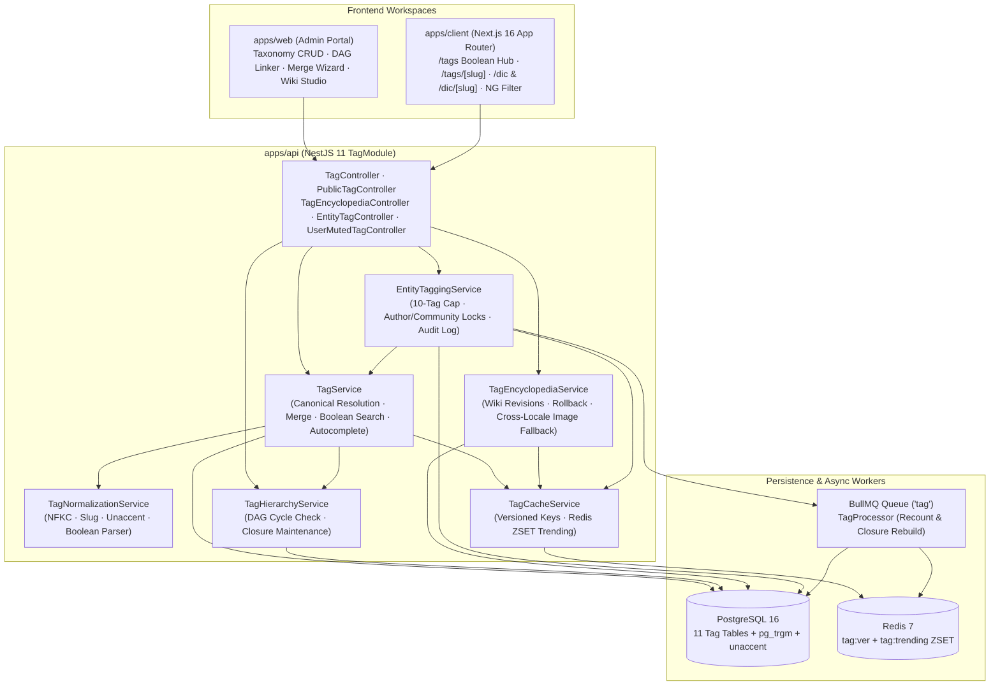
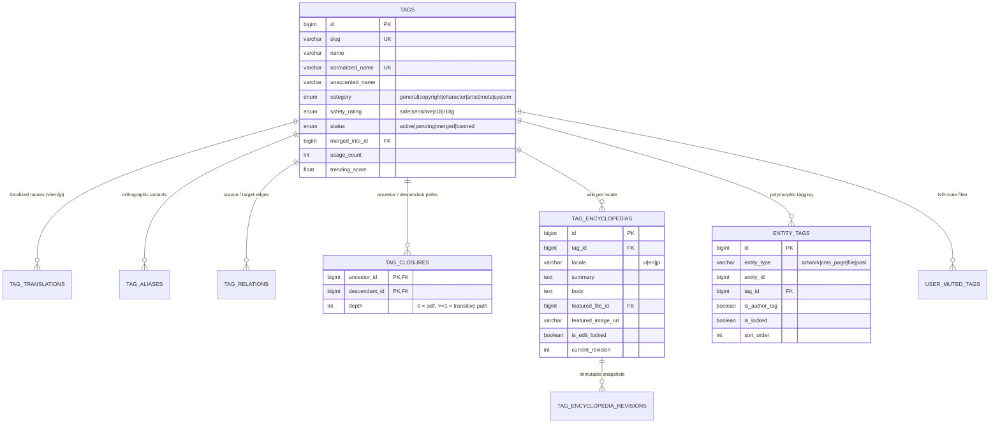

# Hệ Thống Quản Lý Tags & Bách Khoa Toàn Thư Cộng Đồng (`dic`)

> [English](../en/TAGS.md) | **Tiếng Việt**

Hệ thống quản lý **Semantic Taxonomy, Folksonomy Cộng Tác & Bách Khoa Toàn Thư (`dic`)** lấy cảm hứng từ các nền tảng nghệ thuật cộng đồng, được thiết kế độc lập (standalone), đa hình (polymorphic) và hỗ trợ đầy đủ đa ngôn ngữ (`vi`, `en`, `jp`) xuyên suốt `apps/api`, `apps/web` và `apps/client`.

---

## Mục lục

- [Tổng quan tính năng](#tổng-quan-tính-năng)
- [Kiến trúc hệ thống (System Architecture)](#kiến-trúc-hệ-thống-system-architecture)
  - [Sơ đồ kiến trúc tổng thể](#sơ-đồ-kiến-trúc-tổng-thể)
  - [Mô hình dữ liệu 11 bảng (ERD)](#mô-hình-dữ-liệu-11-bảng-erd)
  - [Chuẩn hóa Unicode NFKC & Giải quyết đồng nghĩa (`表記揺れ`)](#chuẩn-hóa-unicode-nfkc--giải-quyết-đồng-nghĩa-表記揺れ)
  - [Đồ thị phân cấp có hướng không chu trình (DAG) & Bảng bao đóng (`Closure Table`)](#đồ-thị-phân-cấp-có-hướng-không-chu-trình-dag--bảng-bao-đóng-closure-table)
  - [Quản trị Folksonomy cộng tác (Giới hạn 10 thẻ & Khóa thẻ)](#quản-trị-folksonomy-cộng-tác-giới-hạn-10-thẻ--khóa-thẻ)
  - [Bách khoa toàn thư (`dic`) & Phiên bản bất biến](#bách-khoa-toàn-thư-dic--phiên-bản-bất-biến)
  - [Tầng Cache Redis & Hàng đợi BullMQ](#tầng-cache-redis--hàng-đợi-bullmq)
- [Hướng dẫn sử dụng cho Người dùng & Quản trị viên](#hướng-dẫn-sử-dụng-cho-người-dùng--quản-trị-viên)
  - [1. Cổng Quản trị Admin (`apps/web`)](#1-cổng-quản-trị-admin-appsweb)
  - [2. Ứng dụng Khách hàng (`apps/client`)](#2-ứng-dụng-khách-hàng-appsclient)
- [Hướng dẫn cho Lập trình viên (Developer Guide)](#hướng-dẫn-cho-lập-trình-viên-developer-guide)
  - [Cấu trúc thư mục](#cấu-trúc-thư-mục)
  - [Khởi tạo Database, Quyền RBAC & Seed dữ liệu](#khởi-tạo-database-quyền-rbac--seed-dữ-liệu)
  - [Tích hợp Tags vào bất kỳ Module thực thể mới nào](#tích-hợp-tags-vào-bất-kỳ-module-thực-thể-mới-nào)
  - [Danh mục REST API Endpoints](#danh-mục-rest-api-endpoints)
  - [Kiểm thử (Testing)](#kiểm-thử-testing)

---

## Tổng quan tính năng

- **6 Nhóm Ngữ nghĩa (Semantic Categories)**: `general`, `copyright` (tác phẩm/series), `character` (nhân vật), `artist` (tác giả), `meta` (kỹ thuật/định dạng), `system` (hệ thống như `AI-Generated`).
- **4 Mức Độ An Toàn (Safety Ratings)**: `safe`, `sensitive`, `r18`, `r18g`.
- **Giải quyết từ đồng nghĩa & Chuyển hướng SEO (`表記揺れ`)**: Mọi biến thể viết tắt, gõ sai hoặc tên cũ sau khi gộp (`synonym`, `abbreviation`, `typo`, `legacy_merge`) đều tự động giải quyết về thẻ chuẩn (Canonical Tag) và trả chuyển hướng vĩnh viễn `308 Permanent Redirect`.
- **Phân cấp DAG & Closure Table**: Hỗ trợ đa cha - đa con (`Parent 親タグ` / `Child 子タグ`), thẻ liên quan (`Related 関連タグ`) và phân biệt nhập nhằng (`Disambiguation 曖昧さ回避`). Tự động phát hiện vòng lặp (cycle detection) và mở rộng tìm kiếm thẻ con chỉ với **1 phép JOIN**.
- **Tìm kiếm Boolean nâng cao nâng cao**: Hỗ trợ toán tử `AND` (khoảng trắng), `OR`, `-exclude` (loại trừ), `"cụm từ có dấu cách"`, kết hợp tự động lọc thẻ ẩn cá nhân (**NG Tag Mute Filter**).
- **Folksonomy Cộng tác**: Giới hạn tối đa **10 thẻ / đối tượng**, phân biệt thẻ của Tác giả (`*`) và thẻ Cộng đồng, hỗ trợ khóa từng thẻ hoặc khóa toàn bộ thanh thẻ, lưu vết kiểm toán bất biến (`entity_tag_logs`).
- **Bách khoa toàn thư thẻ (`dic`)**: Bài viết wiki đa ngôn ngữ (`vi`, `en`, `jp`) dùng trình soạn thảo Tiptap, hỗ trợ chọn ảnh bìa từ **Media Library Picker** hoặc **Upload trực tiếp**, tự động kế thừa ảnh bìa xuyên ngôn ngữ, lưu lịch sử phiên bản bất biến và khôi phục (`Rollback`) 1 chạm.

---

## Kiến trúc hệ thống (System Architecture)

### Sơ đồ kiến trúc tổng thể



### Mô hình dữ liệu 11 bảng (ERD)



### Chuẩn hóa Unicode NFKC & Giải quyết đồng nghĩa (`表記揺れ`)

`TagNormalizationService` chuẩn hóa mọi đầu vào trước khi lưu hoặc truy vấn:

1. Chuẩn hóa **Unicode `NFKC`** (chuyển ký tự full-width tiếng Nhật/Latin sang dạng chuẩn, gộp khoảng trắng thừa, cắt ký tự `#` đầu chuỗi).
2. Sinh đồng thời `normalizedName` (chữ thường), `unaccentedName` (bỏ dấu tiếng Việt phục vụ tìm kiếm không dấu) và `slug` thân thiện URL (giữ nguyên chữ Kanji/Kana nếu là thẻ tiếng Nhật).
3. Khi người dùng truy cập `/tags/fgo` hoặc `/dic/fgo`, hệ thống tra cứu `tag_aliases` → phát hiện thẻ chuẩn `fate-grand-order` → trả về `redirectSlug: "fate-grand-order"` để Next.js thực hiện **`permanentRedirect` (HTTP 308)**.

### Đồ thị phân cấp có hướng không chu trình (DAG) & Bảng bao đóng (`Closure Table`)

Thay vì đệ quy `WITH RECURSIVE` tốn chi phí trên mỗi lượt tìm kiếm, `TagHierarchyService` duy trì bảng `tag_closures (ancestor_id, descendant_id, depth)`:

- Mỗi thẻ luôn có 1 dòng tự thân `(id, id, depth = 0)`.
- Khi thêm cạnh `Parent → Child`, hệ thống kiểm tra bảng `tag_closures` xem `Parent` có đang là hậu duệ của `Child` không. Nếu có, ném lỗi `400 Bad Request` ngăn chặn vòng lặp DAG ngay lập tức.
- Khi bật **DAG Sub-Tag Expansion** (`expandHierarchy = true`), tìm kiếm thẻ cha `#Fate/Grand Order` tự động lấy toàn bộ tác phẩm gắn thẻ con (`#Mash Kyrielight`, ...) chỉ bằng 1 truy vấn `SELECT descendant_id FROM tag_closures WHERE ancestor_id IN (...)`.

### Quản trị Folksonomy cộng tác (Giới hạn 10 thẻ & Khóa thẻ)

Mô phỏng cơ chế gắn thẻ cộng tác đặc trưng của hệ thống qua `EntityTaggingService`:

- **Giới hạn 10 thẻ** mặc định trên mỗi đối tượng (`maxTags = 10`, có thể cấu hình riêng trong `entity_tag_settings`).
- **Thẻ Tác giả (`*`) vs Thẻ Cộng đồng**: Thẻ do chủ sở hữu đối tượng gắn được đánh dấu `isAuthorTag = true` và tự động khóa bảo vệ (`isLocked = true`), người dùng cộng đồng không thể xóa.
- **Khóa toàn cục (`tagEditLocked`)**: Chủ sở hữu hoặc Admin có thể khóa toàn bộ thanh thẻ của một đối tượng, chỉ cho phép chủ sở hữu/Admin chỉnh sửa.
- **Nhật ký kiểm toán (`entity_tag_logs`)**: Mọi thao tác thêm, xóa, khóa, mở khóa đều ghi nhận người thực hiện và snapshot tên thẻ.

### Bách khoa toàn thư (`dic`) & Phiên bản bất biến

- Mỗi thẻ chuẩn có thể có bài viết Wiki riêng theo từng ngôn ngữ (`vi`, `en`, `jp`) trong `tag_encyclopedias`.
- **Ảnh bìa trực quan (`Featured Header Image`)**: Hỗ trợ cả **chọn ảnh từ Media Library (`FilePickerDialog` lưu `featuredFileId`)**, **tải ảnh trực tiếp (`POST /api/v1/files/upload`)**, hoặc nhập URL ngoài (`featuredImageUrl`). Nếu ngôn ngữ hiện tại chưa đặt ảnh bìa riêng, API tự động kế thừa ảnh bìa từ ngôn ngữ khác của cùng thẻ chuẩn để giao diện luôn đồng nhất.
- Mỗi lần lưu bài viết đều sinh một bản ghi bất biến trong `tag_encyclopedia_revisions` (`v1`, `v2`, ...). Khi `Rollback`, hệ thống tạo phiên bản mới sao chép nội dung cũ, bảo toàn 100% lịch sử đóng góp.

### Tầng Cache Redis & Hàng đợi BullMQ

- **Versioned Cache Invalidation**: `TagCacheService` lưu khóa phiên bản toàn cục `tag:ver`. Khi cập nhật taxonomy/merge/wiki, chỉ cần `INCR tag:ver` (`O(1)`) thay vì quét `SCAN/KEYS` trên Redis.
- **Trending Leaderboard**: Sử dụng Redis Sorted Set (`ZINCRBY tag:trending`) để xếp hạng thẻ thịnh hành theo thời gian thực.
- **BullMQ Worker (`TagProcessor`)**: Xử lý bất đồng bộ tác vụ tính toán lại `usage_count` và đồng bộ lại cây `tag_closures` sau khi gộp thẻ quy mô lớn.

---

## Hướng dẫn sử dụng cho Người dùng & Quản trị viên

### 1. Cổng Quản trị Admin (`apps/web`)

Yêu cầu tài khoản Admin có quyền RBAC thuộc nhóm `TAG` và `TAG_ENCYCLOPEDIA`.

1. **Danh mục Tags (`/tags`)**:
   - Lọc theo nhóm ngữ nghĩa (`Category`), mức độ an toàn (`Safety Rating`), trạng thái (`Status`), hoặc tìm nhanh theo tên/alias.
   - Sắp xếp theo lượt sử dụng (`usageCount`), điểm thịnh hành (`trendingScore`) hoặc ngày tạo.
2. **Tạo & Chỉnh sửa Tag (`/tags/create`, `/tags/:id/edit`)**:
   - Chọn **Semantic Category**, **Safety Rating**, **Lifecycle Status**, bật cờ **Official Verified Tag** hoặc **System Tag**.
   - Khai báo **Multilingual Translations** (`EN`, `VI`, `JP`) gồm tên hiển thị bản địa và đoạn tóm tắt hiển thị trên Hover Card (tối đa 280 ký tự).
   - Khai báo **Orthographic Aliases (`表記揺れ`)** để ánh xạ từ viết tắt (`FGO`), tên tiếng Nhật (`フリーレン`) hoặc lỗi chính tả phổ biến về thẻ chuẩn.
3. **Chi tiết Tag, Cây phân cấp DAG & Gộp Tag (`/tags/:id`)**:
   - Tab **Overview**: Xem toàn bộ bản dịch, alias và nhật ký kiểm toán gắn thẻ gần đây.
   - Tab **DAG Hierarchy**: Liên kết `Parent Tag (親タグ)`, `Child Tag (子タグ)`, `Related Tag (関連タグ)` hoặc `Disambiguation (曖昧さ回避)`.
   - Nút **Merge Into Another Tag**: Mở hộp thoại xem trước số lượng đối tượng, alias và cạnh quan hệ sẽ chuyển sang thẻ đích trước khi xác nhận gộp.
4. **Biên tập Bách khoa toàn thư (`/tags/:id` → Tab Encyclopedia & `/tag-encyclopedias`)**:
   - Chọn ngôn ngữ xuất bản (`Edition: EN / VI / JP`).
   - Chọn **Featured Header Image** bằng nút **Browse** (Media Library) hoặc **Upload** (tải file mới từ máy tính).
   - Soạn thảo bài viết giàu định dạng với Tiptap, nhập **Revision Change Note**, bật/tắt **Lock Community Editing** và nhấn **Save & Publish Revision**.
   - Cột **Revision History** bên phải cho phép xem toàn bộ lịch sử chỉnh sửa và nhấn **Rollback** về bất kỳ phiên bản nào.

### 2. Ứng dụng Khách hàng (`apps/client`)

1. **Trung tâm Khám phá & Tìm kiếm Boolean (`/[locale]/tags`)**:
   - Hỗ trợ cú pháp tìm kiếm kết hợp thông minh:
     - `frieren illustration` → **AND**: Phải chứa cả hai thẻ (hoặc thẻ con nếu bật mở rộng DAG).
     - `genshin-impact OR honkai-star-rail` → **OR**: Chứa ít nhất một trong các thẻ.
     - `-ai-generated` → **NOT**: Loại trừ mọi nội dung gắn thẻ `AI-Generated`.
     - `"fate/grand order"` → Cụm thẻ có khoảng trắng.
   - Tự động gợi ý thẻ (Autocomplete) ngay khi gõ, hiển thị cả alias khớp tương ứng.
2. **Trang Chi tiết Tag (`/[locale]/tags/[slug]`)**:
   - Hiển thị thẻ chuẩn, ảnh bìa `dic`, số lượng tác phẩm, danh sách alias, sơ đồ quan hệ `Parents / Children / Siblings & Related` và danh sách nội dung được gắn thẻ.
   - Hỗ trợ nút **Mute Tag (NG)** ngay trên đầu trang cho người dùng đã đăng nhập.
3. **Bách khoa toàn thư Thẻ (`/[locale]/dic` & `/[locale]/dic/[slug]`)**:
   - Trang danh mục `/[locale]/dic` hiển thị lưới bài viết bách khoa kèm ảnh bìa trực quan và bộ lọc theo nhóm ngữ nghĩa.
   - Trang bài viết `/[locale]/dic/[slug]` hiển thị bài viết chi tiết, ảnh bìa, cảnh báo phân biệt nhập nhằng (`曖昧さ回避`), hộp thông tin **Canonical Taxonomy Infobox**, và cho phép thành viên đăng nhập đóng góp bản sửa đổi mới (nếu bài viết chưa bị Admin khóa).
4. **Cài đặt Ẩn thẻ cá nhân — NG Filter (`/[locale]/settings/muted-tags`)**:
   - Người dùng đăng nhập có thể thêm bất kỳ thẻ nào vào danh sách ẩn (ví dụ: `AI-Generated` hoặc một series không muốn xem) và tùy chọn **ẩn luôn toàn bộ thẻ con trong cây phân cấp DAG**.

---

## Hướng dẫn cho Lập trình viên (Developer Guide)

### Cấu trúc thư mục

```text
monorepo/
├── apps/api/src/
│   ├── api/tag/
│   │   ├── constants/tag.constant.ts               # Enums, Redis keys, giới hạn 10 tags
│   │   ├── entities/                               # 11 TypeORM Entities
│   │   ├── dto/                                    # Request / Response DTOs + Swagger
│   │   ├── services/
│   │   │   ├── tag-normalization.service.ts        # NFKC, slug, boolean parser
│   │   │   ├── tag-cache.service.ts                # Redis versioned cache & ZSET trending
│   │   │   ├── tag-hierarchy.service.ts            # DAG cycle detection & closure table
│   │   │   ├── tag.service.ts                      # CRUD, merge, autocomplete, boolean search
│   │   │   ├── tag-encyclopedia.service.ts         # Wiki CRUD, revisions, rollback
│   │   │   └── entity-tagging.service.ts           # Polymorphic tagging, locks, audit logs
│   │   ├── queues/tag.processor.ts                 # BullMQ async recount & closure rebuild
│   │   ├── tag.controller.ts                       # Admin Tag CRUD & Merge endpoints
│   │   ├── public-tag.controller.ts                # Public SSR/Client discovery endpoints
│   │   ├── tag-encyclopedia.controller.ts          # Admin & Community Wiki endpoints
│   │   ├── entity-tag.controller.ts                # Polymorphic entity tagging endpoints
│   │   ├── user-muted-tag.controller.ts            # User NG mute endpoints
│   │   └── tag.module.ts                           # Standalone NestJS module
│   └── database/seeds/tag/                         # TagSeedModule & TagSeedService
├── apps/web/src/pages/tags/                        # Admin Portal Tag & Encyclopedia UI
└── apps/client/src/
    ├── services/tags.ts                            # SSR fetchers + TanStack Query hooks
    ├── components/tags/                            # TagChip, TagHoverCard, BooleanTagSearchBar, CollaborativeTagBar
    └── app/[locale]/(public)/
        ├── tags/                                   # /tags & /tags/[slug]
        ├── dic/                                    # /dic & /dic/[slug]
        └── settings/muted-tags/                    # /settings/muted-tags
```

### Khởi tạo Database, Quyền RBAC & Seed dữ liệu

Chạy lần lượt các lệnh sau từ thư mục gốc monorepo:

```bash
# 1. Chạy migration tạo 11 bảng hệ thống Tags & Encyclopedia
pnpm --filter api migration:run

# 2. Đồng bộ quyền CASL RBAC mới (TAG, TAG_ENCYCLOPEDIA) vào database
pnpm --filter api permissions:sync

# 3. Seed dữ liệu mẫu chuẩn cộng đồng (14 thẻ chuẩn đa ngôn ngữ, DAG, Wiki, Artwork mẫu)
pnpm --filter api seed:tags
```

### Tích hợp Tags vào bất kỳ Module thực thể mới nào

Hệ thống Tags hoàn toàn tách biệt (decoupled) thông qua cặp khóa đa hình `(entityType, entityId)`:

#### Bước 1: Khai báo loại thực thể (nếu thêm module mới)

Mở `apps/api/src/api/tag/constants/tag.constant.ts` và bổ sung giá trị vào `ETaggableEntityType` (mặc định đã hỗ trợ sẵn `artwork`, `cms_page`, `file`, `post`).

#### Bước 2: Gắn thẻ từ Backend Service (Tác giả đăng/cập nhật nội dung)

Import `TagModule` vào module của bạn và gọi `EntityTaggingService.syncAuthorTags`:

```typescript
import { Injectable } from "@nestjs/common";
import { ETaggableEntityType } from "../tag/constants/tag.constant";
import { EntityTaggingService } from "../tag/services/entity-tagging.service";

@Injectable()
export class ArtworkService {
  constructor(private readonly entityTaggingService: EntityTaggingService) {}

  async publishArtwork(
    artworkId: string,
    authorUserId: string,
    rawTags: string[],
  ) {
    // Tự động chuẩn hóa tên thẻ, giải quyết alias, tạo thẻ mới nếu chưa tồn tại,
    // đánh dấu isAuthorTag = true và khóa bảo vệ thẻ tác giả:
    await this.entityTaggingService.syncAuthorTags(
      ETaggableEntityType.ARTWORK,
      artworkId,
      rawTags,
      { userId: authorUserId, adminId: null },
      false, // tagEditLocked
    );
  }
}
```

#### Bước 3: Hiển thị Thanh Thẻ Cộng Tác hoặc Hover Card trên Frontend (`apps/client`)

Nhúng trực tiếp `<CollaborativeTagBar />` vào trang chi tiết sản phẩm/bài viết/tác phẩm:

```tsx
import { CollaborativeTagBar } from "@/components/tags/collaborative-tag-bar";

export function ArtworkDetailFooter({
  artworkId,
  locale,
}: {
  artworkId: string;
  locale: string;
}) {
  return (
    <CollaborativeTagBar
      entityType="artwork"
      entityId={artworkId}
      locale={locale}
    />
  );
}
```

Hoặc hiển thị từng chip thẻ đơn lẻ có sẵn popup xem trước ảnh bìa + tóm tắt Wiki khi rê chuột:

```tsx
import { TagHoverCard } from "@/components/tags/tag-hover-card";

<TagHoverCard
  locale="vi"
  slug="frieren"
  name="Frieren"
  translatedName="Frieren — Pháp Sư Tiễn Táng"
  category="character"
  isOfficial
  showWikiLink
/>;
```

### Danh mục REST API Endpoints

| Phân nhóm            | Phương thức & Đường dẫn                                   | Quyền hạn                  | Mô tả                                                                          |
| :------------------- | :-------------------------------------------------------- | :------------------------- | :----------------------------------------------------------------------------- |
| **Public Discovery** | `GET /api/v1/public/tags`                                 | Public                     | Danh bạ thẻ chuẩn (hỗ trợ QueryBuilder filter, sort, paginate).                |
| **Public Discovery** | `GET /api/v1/public/tags/trending`                        | Public                     | Top thẻ thịnh hành từ Redis ZSET + PostgreSQL fallback.                        |
| **Public Discovery** | `GET /api/v1/public/tags/autocomplete`                    | Public                     | Gợi ý thẻ nhanh theo prefix + trigram + alias (`?q=&locale=`).                 |
| **Public Discovery** | `GET /api/v1/public/tags/by-slug/:slug`                   | Public (Optional JWT)      | Chi tiết thẻ chuẩn, đồ thị DAG và `redirectSlug` nếu truy cập qua alias.       |
| **Public Discovery** | `GET /api/v1/public/tags/by-slug/:slug/tooltip`           | Public                     | Dữ liệu gọn nhẹ (tóm tắt, thẻ cha, `featuredImageUrl`) cho `TagHoverCard`.     |
| **Public Discovery** | `GET /api/v1/public/tags/encyclopedia/:slug`              | Public                     | Bài viết Bách khoa toàn thư (`dic`) + lịch sử phiên bản.                       |
| **Public Discovery** | `GET /api/v1/public/tags/search-content`                  | Public (Optional JWT)      | Tìm kiếm Boolean (`AND`, `OR`, `-NOT`) kết hợp mở rộng cây DAG & lọc NG.       |
| **Folksonomy**       | `GET /api/v1/entity-tags/:entityType/:entityId`           | Public (Optional JWT)      | Danh sách thẻ hiện tại của đối tượng kèm cờ quyền sửa/xóa.                     |
| **Folksonomy**       | `POST /api/v1/entity-tags/:entityType/:entityId`          | User JWT                   | Cộng đồng thêm thẻ vào đối tượng (tuân thủ giới hạn 10 thẻ & trạng thái khóa). |
| **Folksonomy**       | `DELETE /api/v1/entity-tags/:entityType/:entityId/:tagId` | User JWT                   | Xóa thẻ chưa bị khóa khỏi đối tượng.                                           |
| **Community Wiki**   | `PUT /api/v1/tag-encyclopedias/community/:tagId`          | User JWT                   | Thành viên đóng góp phiên bản mới cho bài viết `dic` (khi chưa khóa).          |
| **NG Mute Filter**   | `GET / POST / DELETE /api/v1/users/me/muted-tags`         | User JWT                   | Quản lý danh sách thẻ ẩn cá nhân (bao gồm tùy chọn ẩn thẻ con).                |
| **Admin Taxonomy**   | `GET / POST / PATCH / DELETE /api/v1/tags`                | Admin (`TAG`)              | Quản trị vòng đời thẻ chuẩn, bản dịch và alias.                                |
| **Admin Taxonomy**   | `POST /api/v1/tags/:sourceId/merge-preview` & `/merge`    | Admin (`TAG.UPDATE`)       | Xem trước tác động và thực thi gộp thẻ an toàn trong Transaction.              |
| **Admin DAG**        | `POST / DELETE /api/v1/tags/:id/relations`                | Admin (`TAG.UPDATE`)       | Tạo/xóa cạnh quan hệ DAG và tự động cập nhật `tag_closures`.                   |
| **Admin Wiki**       | `PUT /api/v1/tag-encyclopedias/admin/:tagId` & `rollback` | Admin (`TAG_ENCYCLOPEDIA`) | Xuất bản bài viết `dic`, gắn ảnh bìa, khóa sửa đổi và khôi phục phiên bản.     |

### Kiểm thử (Testing)

Toàn bộ logic chuẩn hóa, phát hiện chu trình DAG, giới hạn 10 thẻ Folksonomy, OpenAPI Swagger schema, Zod validation và bộ phân tích cú pháp Boolean đều có Unit Test độc lập:

```bash
# Chạy kiểm thử toàn bộ monorepo
pnpm test

# Hoặc chạy riêng các bộ test của Tags trên từng workspace
pnpm --filter api test -- tag
pnpm --filter web test -- schema.test.ts
pnpm --filter client test -- boolean-tag-search-bar.test.ts
```
